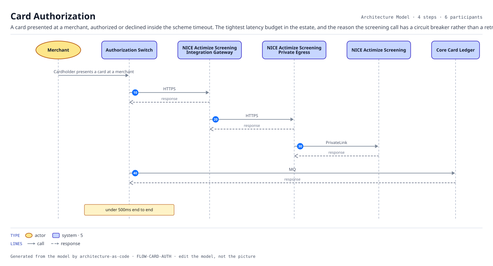
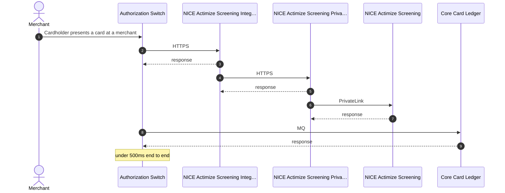

# Card Authorization

A card presented at a merchant, authorized or declined inside the scheme timeout. The tightest latency budget in the estate, and the reason the screening call has a circuit breaker rather than a retry.

| | |
|---|---|
| Trigger | Cardholder presents a card at a merchant |
| Target | under 500ms end to end |
| Criticality | High |
| Owner | ORG-PAYMENTS |

| # | From | To | Via |
|---:|---|---|---|
| 10 | Authorization Switch | NICE Actimize Screening Integration Gateway | `INT-SCREENING-CALLER-GATEWAY` HTTPS, Request-response |
| 20 | NICE Actimize Screening Integration Gateway | NICE Actimize Screening Private Egress | `INT-SCREENING-GATEWAY-EGRESS` HTTPS, Request-response |
| 30 | NICE Actimize Screening Private Egress | NICE Actimize Screening | `INT-SCREENING-EGRESS-VENDOR` PrivateLink, Request-response |
| 40 | Authorization Switch | Core Card Ledger | `INT-AUTH-LEDGER` MQ, Request-response |

4 step(s). Every hop is a recorded interface, so a hop that is not in the model cannot appear here.
