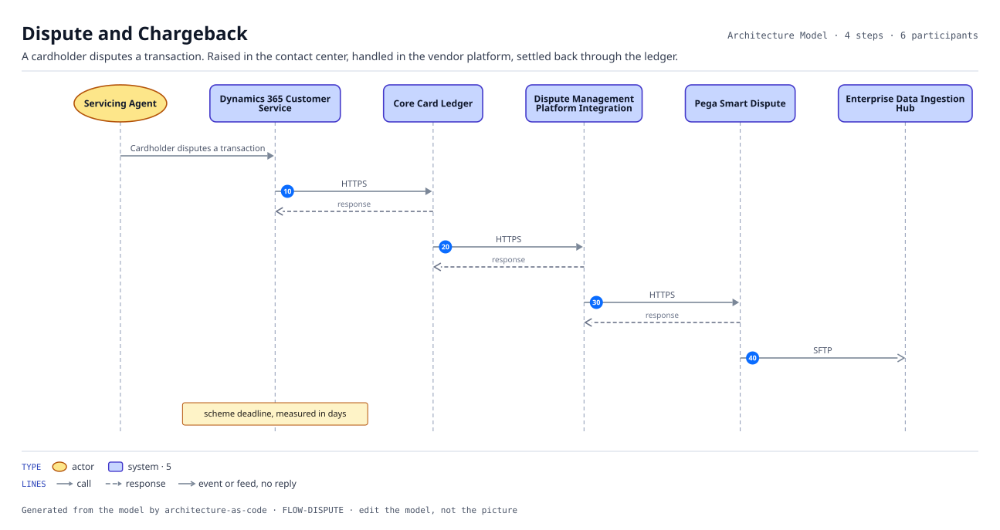
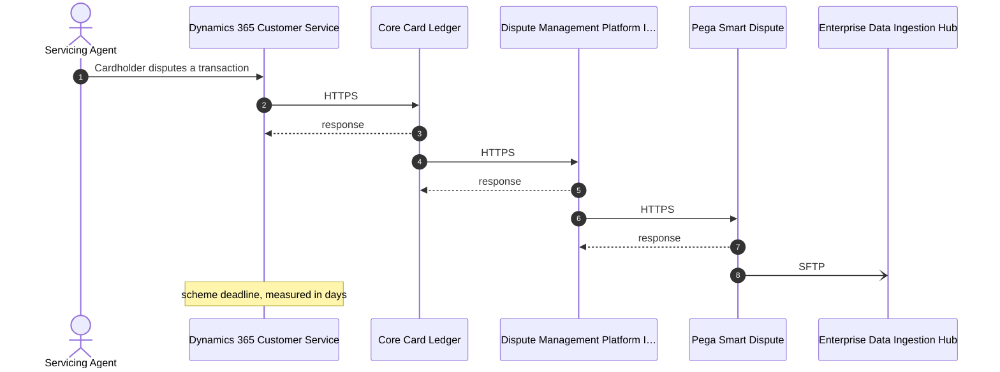

# Dispute and Chargeback

A cardholder disputes a transaction. Raised in the contact center, handled in the vendor platform, settled back through the ledger.

| | |
|---|---|
| Trigger | Cardholder disputes a transaction |
| Target | scheme deadline, measured in days |
| Criticality | Medium |
| Owner | ORG-SERVICING |

| # | From | To | Via |
|---:|---|---|---|
| 10 | Dynamics 365 Customer Service | Core Card Ledger | `INT-CRM-LEDGER` HTTPS, Request-response |
| 20 | Core Card Ledger | Dispute Management Platform Integration Gateway | `INT-DISPUTES-UP-GATEWAY` HTTPS, Request-response |
| 30 | Dispute Management Platform Integration Gateway | Pega Smart Dispute | `INT-DISPUTES-GATEWAY-SAAS` HTTPS, Request-response |
| 40 | Pega Smart Dispute | Enterprise Data Ingestion Hub | `INT-DISPUTES-SAAS-FEED` SFTP, Batch |

4 step(s). Every hop is a recorded interface, so a hop that is not in the model cannot appear here.
