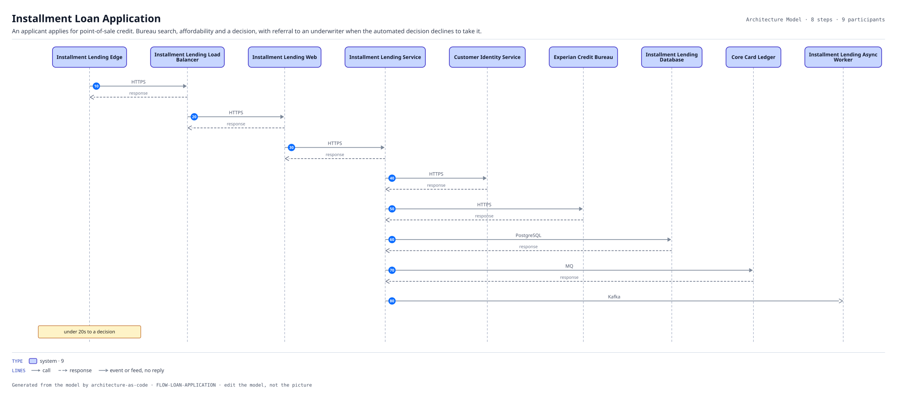
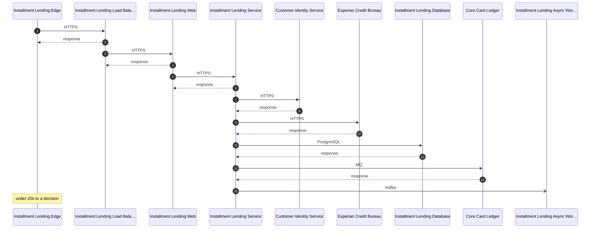

# Installment Loan Application

An applicant applies for point-of-sale credit. Bureau search, affordability and a decision, with referral to an underwriter when the automated decision declines to take it.

| | |
|---|---|
| Trigger | Applicant submits an application |
| Target | under 20s to a decision |
| Criticality | High |
| Owner | ORG-PRODUCT |

| # | From | To | Via |
|---:|---|---|---|
| 10 | Installment Lending Edge | Installment Lending Load Balancer | `INT-LENDING-EDGE-ALB` HTTPS, Request-response |
| 20 | Installment Lending Load Balancer | Installment Lending Web | `INT-LENDING-ALB-WEB` HTTPS, Request-response |
| 30 | Installment Lending Web | Installment Lending Service | `INT-LENDING-WEB-API` HTTPS, Request-response |
| 40 | Installment Lending Service | Customer Identity Service | `INT-LENDING-API-IDENTITY` HTTPS, Request-response |
| 50 | Installment Lending Service | Experian Credit Bureau | `INT-LENDING-API-BUREAU` HTTPS, Request-response |
| 60 | Installment Lending Service | Installment Lending Database | `INT-LENDING-API-DB` PostgreSQL, Request-response |
| 70 | Installment Lending Service | Core Card Ledger | `INT-LENDING-API-LEDGER` MQ, Request-response |
| 80 | Installment Lending Service | Installment Lending Async Worker | `INT-LENDING-API-WORKER` Kafka, Event |

8 step(s). Every hop is a recorded interface, so a hop that is not in the model cannot appear here.
