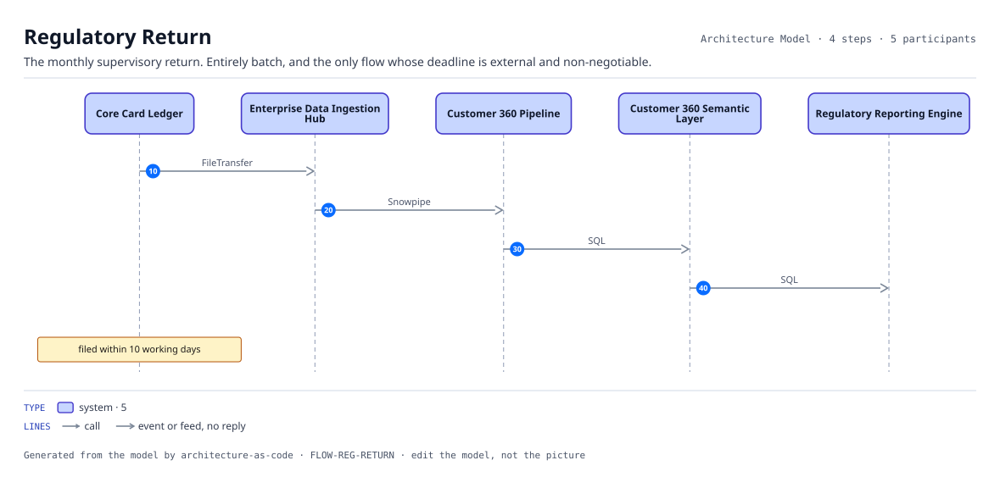
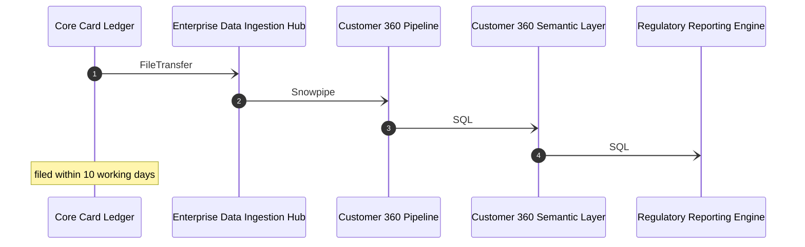

# Regulatory Return

The monthly supervisory return. Entirely batch, and the only flow whose deadline is external and non-negotiable.

| | |
|---|---|
| Trigger | Month end |
| Target | filed within 10 working days |
| Criticality | High |
| Owner | ORG-COMPLIANCE |

| # | From | To | Via |
|---:|---|---|---|
| 10 | Core Card Ledger | Enterprise Data Ingestion Hub | `INT-LEDGER-INGEST` FileTransfer, Batch |
| 20 | Enterprise Data Ingestion Hub | Customer 360 Pipeline | `INT-CUST360-INGEST` Snowpipe, Batch |
| 30 | Customer 360 Pipeline | Customer 360 Semantic Layer | `INT-CUST360-PIPE-SEMANTIC` SQL, Batch |
| 40 | Customer 360 Semantic Layer | Regulatory Reporting Engine | `INT-CUST360-REGREPORTING` SQL, Batch |

4 step(s). Every hop is a recorded interface, so a hop that is not in the model cannot appear here.
