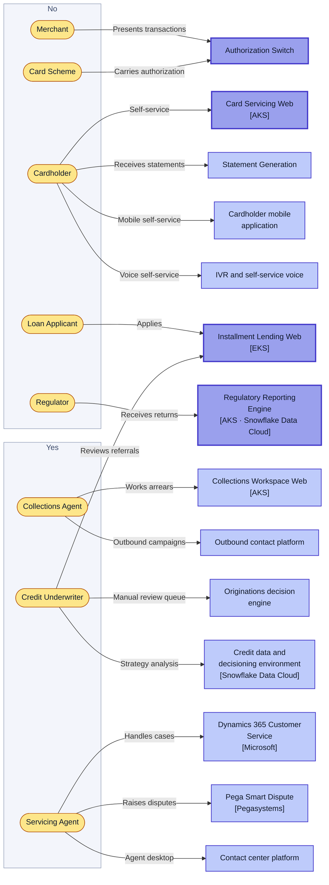
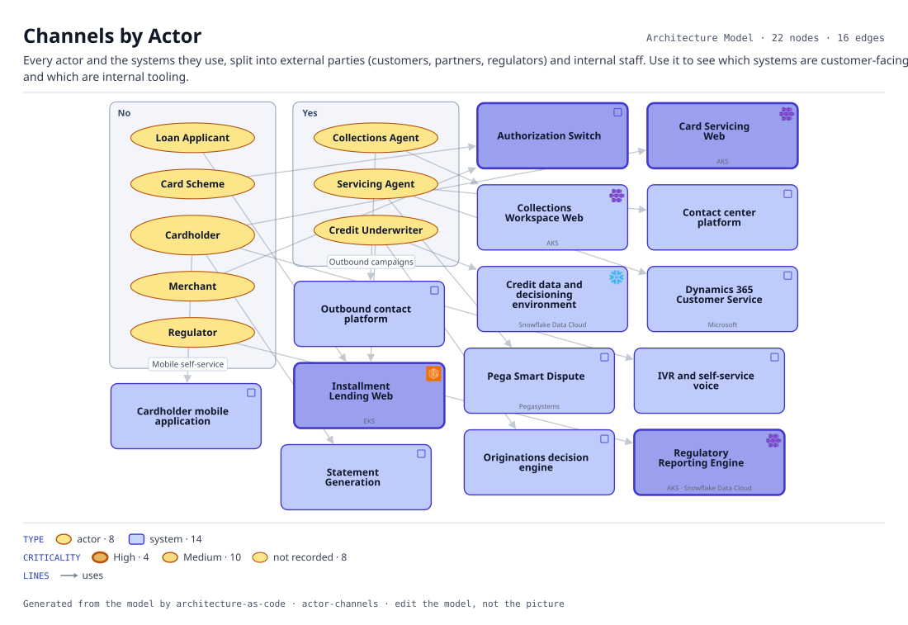

# Channels by Actor

Every actor and the systems they use, split into external parties (customers, partners, regulators) and internal staff. Use it to see which systems are customer-facing and which are internal tooling.

The same view as the app draws it, written beside the Mermaid by `terrane render`:

**Hue is the entity type.**

| | Entity type |
|---|---|
| `#b45309` | actors |
| `#4338ca` | systems |

**criticality** is drawn as border weight and tint, strongest first.

| Border | Value |
|---|---|
| 2.6px | High |
| 1.4px | Medium |
| 1.1px | default |

22 entities, 16 relationships. Generated from the model; edit the model, not this file.
