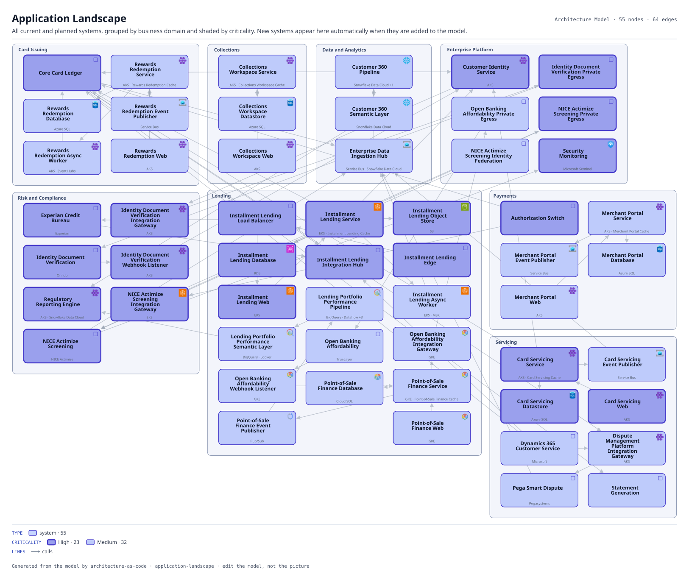

# Application Landscape

All current and planned systems, grouped by business domain and shaded by criticality. New systems appear here automatically when they are added to the model.

```mermaid
%%{init: {'flowchart': {'curve': 'basis'}} }%%
flowchart LR
  %% Application Landscape
  %% Generated from the model by `terrane render`. Do not edit by hand.

  subgraph grp_Card_Issuing["Card Issuing"]
    direction LR
    SYS_CORE_LEDGER["Core Card Ledger"]
    SYS_REWARDS_WORKER["Rewards Redemption Async<br/>Worker<br/>[AKS · Event Hubs]"]
    SYS_REWARDS_STORE["Rewards Redemption<br/>Database<br/>[Azure SQL]"]
    SYS_REWARDS_EVENTS["Rewards Redemption Event<br/>Publisher<br/>[Service Bus]"]
    SYS_REWARDS_API["Rewards Redemption Service<br/>[AKS · Rewards Redemption Cache]"]
    SYS_REWARDS_WEB["Rewards Redemption Web<br/>[AKS]"]
  end

  subgraph grp_Collections["Collections"]
    direction LR
    SYS_COLLECT_STORE["Collections Workspace<br/>Datastore<br/>[Azure SQL]"]
    SYS_COLLECT_API["Collections Workspace<br/>Service<br/>[AKS · Collections Workspace Cache]"]
    SYS_COLLECT_WEB["Collections Workspace Web<br/>[AKS]"]
  end

  subgraph grp_Data_and_Analytics["Data and Analytics"]
    direction LR
    SYS_CUST360_PIPELINE["Customer 360 Pipeline<br/>[Snowflake Data Cloud +1]"]
    SYS_CUST360_SEMANTIC["Customer 360 Semantic<br/>Layer<br/>[Snowflake Data Cloud]"]
    SYS_DATA_INGEST["Enterprise Data Ingestion<br/>Hub<br/>[Service Bus · Snowflake Data Cloud]"]
  end

  subgraph grp_Enterprise_Platform["Enterprise Platform"]
    direction LR
    SYS_IDENTITY_SVC["Customer Identity Service<br/>[AKS]"]
    SYS_IDV_EGRESS["Identity Document<br/>Verification Private<br/>Egress"]
    SYS_SCREENING_FEDERATION["NICE Actimize Screening<br/>Identity Federation"]
    SYS_SCREENING_EGRESS["NICE Actimize Screening<br/>Private Egress"]
    SYS_OBAFF_EGRESS["Open Banking Affordability<br/>Private Egress"]
    SYS_SIEM["Security Monitoring<br/>[Microsoft Sentinel]"]
  end

  subgraph grp_Lending["Lending"]
    direction LR
    SYS_LENDING_WORKER["Installment Lending Async<br/>Worker<br/>[EKS · MSK]"]
    SYS_LENDING_DB["Installment Lending<br/>Database<br/>[RDS]"]
    SYS_LENDING_EDGE["Installment Lending Edge"]
    SYS_LENDING_HUB["Installment Lending<br/>Integration Hub"]
    SYS_LENDING_ALB["Installment Lending Load<br/>Balancer"]
    SYS_LENDING_BUCKET["Installment Lending Object<br/>Store<br/>[S3]"]
    SYS_LENDING_API["Installment Lending<br/>Service<br/>[EKS · Installment Lending Cache]"]
    SYS_LENDING_WEB["Installment Lending Web<br/>[EKS]"]
    SYS_LENDPERF_PIPELINE["Lending Portfolio<br/>Performance Pipeline<br/>[BigQuery · Dataflow +3]"]
    SYS_LENDPERF_SEMANTIC["Lending Portfolio<br/>Performance Semantic Layer<br/>[BigQuery · Looker]"]
    SYS_OBAFF_VENDOR["Open Banking Affordability<br/>[TrueLayer]"]
    SYS_OBAFF_GATEWAY["Open Banking Affordability<br/>Integration Gateway<br/>[GKE]"]
    SYS_OBAFF_WEBHOOKS["Open Banking Affordability<br/>Webhook Listener<br/>[GKE]"]
    SYS_POSFIN_DB["Point-of-Sale Finance<br/>Database<br/>[Cloud SQL]"]
    SYS_POSFIN_EVENTS["Point-of-Sale Finance<br/>Event Publisher<br/>[Pub/Sub]"]
    SYS_POSFIN_API["Point-of-Sale Finance<br/>Service<br/>[GKE · Point-of-Sale Finance Cache]"]
    SYS_POSFIN_WEB["Point-of-Sale Finance Web<br/>[GKE]"]
  end

  subgraph grp_Payments["Payments"]
    direction LR
    SYS_AUTH_SWITCH["Authorization Switch"]
    SYS_MERCHANT_STORE["Merchant Portal Database<br/>[Azure SQL]"]
    SYS_MERCHANT_EVENTS["Merchant Portal Event<br/>Publisher<br/>[Service Bus]"]
    SYS_MERCHANT_API["Merchant Portal Service<br/>[AKS · Merchant Portal Cache]"]
    SYS_MERCHANT_WEB["Merchant Portal Web<br/>[AKS]"]
  end

  subgraph grp_Risk_and_Compliance["Risk and Compliance"]
    direction LR
    SYS_CREDIT_BUREAU["Experian Credit Bureau<br/>[Experian]"]
    SYS_IDV_VENDOR["Identity Document<br/>Verification<br/>[Onfido]"]
    SYS_IDV_GATEWAY["Identity Document<br/>Verification Integration<br/>Gateway<br/>[AKS]"]
    SYS_IDV_WEBHOOKS["Identity Document<br/>Verification Webhook<br/>Listener<br/>[AKS]"]
    SYS_SCREENING_VENDOR["NICE Actimize Screening<br/>[NICE Actimize]"]
    SYS_SCREENING_GATEWAY["NICE Actimize Screening<br/>Integration Gateway<br/>[EKS]"]
    SYS_REG_REPORTING["Regulatory Reporting<br/>Engine<br/>[AKS · Snowflake Data Cloud]"]
  end

  subgraph grp_Servicing["Servicing"]
    direction LR
    SYS_CARDSVC_STORE["Card Servicing Datastore<br/>[Azure SQL]"]
    SYS_CARDSVC_EVENTS["Card Servicing Event<br/>Publisher<br/>[Service Bus]"]
    SYS_CARDSVC_API["Card Servicing Service<br/>[AKS · Card Servicing Cache]"]
    SYS_CARDSVC_WEB["Card Servicing Web<br/>[AKS]"]
    SYS_DISPUTES_GATEWAY["Dispute Management<br/>Platform Integration<br/>Gateway<br/>[AKS]"]
    SYS_CRM["Dynamics 365 Customer<br/>Service<br/>[Microsoft]"]
    SYS_DISPUTES_SAAS["Pega Smart Dispute<br/>[Pegasystems]"]
    SYS_STATEMENTS["Statement Generation"]
  end

  SYS_CRM -->|"HTTPS"| SYS_DISPUTES_GATEWAY
  SYS_AUTH_SWITCH -->|"MQ"| SYS_CORE_LEDGER
  SYS_CARDSVC_API -->|"HTTPS"| SYS_IDENTITY_SVC
  SYS_CARDSVC_API -->|"MQ"| SYS_CORE_LEDGER
  SYS_CARDSVC_EVENTS -->|"AMQP"| SYS_DATA_INGEST
  SYS_COLLECT_API -->|"HTTPS"| SYS_IDENTITY_SVC
  SYS_COLLECT_API -->|"MQ"| SYS_CORE_LEDGER
  SYS_CRM -->|"HTTPS"| SYS_CORE_LEDGER
  SYS_CUST360_SEMANTIC -->|"SQL"| SYS_REG_REPORTING
  SYS_CORE_LEDGER -->|"FileTransfer"| SYS_DATA_INGEST
  SYS_CORE_LEDGER -->|"FileTransfer"| SYS_STATEMENTS
  SYS_LENDING_API -->|"MQ"| SYS_CORE_LEDGER
  SYS_LENDING_API -->|"HTTPS"| SYS_IDENTITY_SVC
  SYS_LENDING_WORKER -->|"S3"| SYS_DATA_INGEST
  SYS_LENDING_API -->|"HTTPS"| SYS_CREDIT_BUREAU
  SYS_CARDSVC_WEB -->|"HTTPS"| SYS_CARDSVC_API
  SYS_CARDSVC_API -->|"TDS"| SYS_CARDSVC_STORE
  SYS_CARDSVC_API -->|"AMQP"| SYS_CARDSVC_EVENTS
  SYS_COLLECT_WEB -->|"HTTPS"| SYS_COLLECT_API
  SYS_COLLECT_API -->|"TDS"| SYS_COLLECT_STORE
  SYS_DATA_INGEST -->|"Snowpipe"| SYS_CUST360_PIPELINE
  SYS_CUST360_PIPELINE -->|"SQL"| SYS_CUST360_SEMANTIC
  SYS_CORE_LEDGER -->|"HTTPS"| SYS_DISPUTES_GATEWAY
  SYS_DISPUTES_GATEWAY -->|"HTTPS"| SYS_DISPUTES_SAAS
  SYS_DISPUTES_SAAS -->|"SFTP"| SYS_DATA_INGEST
  SYS_IDENTITY_SVC -->|"HTTPS"| SYS_IDV_GATEWAY
  SYS_IDV_GATEWAY -->|"HTTPS"| SYS_IDV_EGRESS
  SYS_IDV_EGRESS -->|"PrivateLink"| SYS_IDV_VENDOR
  SYS_IDV_VENDOR -->|"HTTPS"| SYS_IDV_WEBHOOKS
  SYS_IDV_WEBHOOKS -->|"HTTPS"| SYS_IDENTITY_SVC
  SYS_LENDING_WEB -->|"HTTPS"| SYS_LENDING_API
  SYS_LENDING_EDGE -->|"HTTPS"| SYS_LENDING_ALB
  SYS_LENDING_ALB -->|"HTTPS"| SYS_LENDING_WEB
  SYS_LENDING_API -->|"Kafka"| SYS_LENDING_WORKER
  SYS_LENDING_API -->|"PostgreSQL"| SYS_LENDING_DB
  SYS_LENDING_API -->|"HTTPS"| SYS_LENDING_BUCKET
  SYS_CORE_LEDGER -->|"HTTPS"| SYS_LENDING_HUB
  SYS_CREDIT_BUREAU -->|"HTTPS"| SYS_LENDING_HUB
  SYS_CRM -->|"HTTPS"| SYS_LENDING_HUB
  SYS_POSFIN_EVENTS -->|"Pub/Sub"| SYS_LENDPERF_PIPELINE
  SYS_LENDPERF_PIPELINE -->|"SQL"| SYS_LENDPERF_SEMANTIC
  SYS_LENDPERF_SEMANTIC -->|"HTTPS"| SYS_REG_REPORTING
  SYS_MERCHANT_WEB -->|"HTTPS"| SYS_MERCHANT_API
  SYS_MERCHANT_API -->|"TDS"| SYS_MERCHANT_STORE
  SYS_MERCHANT_API -->|"AMQP"| SYS_MERCHANT_EVENTS
  SYS_POSFIN_API -->|"HTTPS"| SYS_OBAFF_GATEWAY
  SYS_OBAFF_GATEWAY -->|"HTTPS"| SYS_OBAFF_EGRESS
  SYS_OBAFF_EGRESS -->|"PrivateLink"| SYS_OBAFF_VENDOR
  SYS_OBAFF_VENDOR -->|"HTTPS"| SYS_OBAFF_WEBHOOKS
  SYS_OBAFF_WEBHOOKS -->|"HTTPS"| SYS_POSFIN_API
  SYS_POSFIN_WEB -->|"HTTPS"| SYS_POSFIN_API
  SYS_POSFIN_API -->|"PostgreSQL"| SYS_POSFIN_DB
  SYS_POSFIN_API -->|"AMQP"| SYS_POSFIN_EVENTS
  SYS_REWARDS_WEB -->|"HTTPS"| SYS_REWARDS_API
  SYS_REWARDS_API -->|"TDS"| SYS_REWARDS_STORE
  SYS_REWARDS_API -->|"AMQP"| SYS_REWARDS_EVENTS
  SYS_REWARDS_API -->|"Kafka"| SYS_REWARDS_WORKER
  SYS_REWARDS_WORKER -->|"MQ"| SYS_CORE_LEDGER
  SYS_AUTH_SWITCH -->|"HTTPS"| SYS_SCREENING_GATEWAY
  SYS_SCREENING_FEDERATION -->|"SAML"| SYS_SCREENING_VENDOR
  SYS_SCREENING_VENDOR -->|"HTTPS"| SYS_SIEM
  SYS_SCREENING_GATEWAY -->|"HTTPS"| SYS_SCREENING_EGRESS
  SYS_SCREENING_EGRESS -->|"PrivateLink"| SYS_SCREENING_VENDOR
  SYS_SCREENING_VENDOR -->|"SFTP"| SYS_DATA_INGEST

  classDef s_systems__high fill:#9aa0ed,stroke:#4338ca,color:#0f172a,stroke-width:2.6px;
  classDef s_systems__medium fill:#becbfb,stroke:#4338ca,color:#0f172a,stroke-width:1.4px;
  class SYS_AUTH_SWITCH,SYS_CARDSVC_API,SYS_CARDSVC_STORE,SYS_CARDSVC_WEB,SYS_CORE_LEDGER,SYS_CREDIT_BUREAU,SYS_IDENTITY_SVC,SYS_IDV_EGRESS,SYS_IDV_GATEWAY,SYS_IDV_VENDOR,SYS_IDV_WEBHOOKS,SYS_LENDING_ALB,SYS_LENDING_API,SYS_LENDING_BUCKET,SYS_LENDING_DB,SYS_LENDING_EDGE,SYS_LENDING_HUB,SYS_LENDING_WEB,SYS_REG_REPORTING,SYS_SCREENING_EGRESS,SYS_SCREENING_GATEWAY,SYS_SCREENING_VENDOR,SYS_SIEM s_systems__high;
  class SYS_CARDSVC_EVENTS,SYS_COLLECT_API,SYS_COLLECT_STORE,SYS_COLLECT_WEB,SYS_CRM,SYS_CUST360_PIPELINE,SYS_CUST360_SEMANTIC,SYS_DATA_INGEST,SYS_DISPUTES_GATEWAY,SYS_DISPUTES_SAAS,SYS_LENDING_WORKER,SYS_LENDPERF_PIPELINE,SYS_LENDPERF_SEMANTIC,SYS_MERCHANT_API,SYS_MERCHANT_EVENTS,SYS_MERCHANT_STORE,SYS_MERCHANT_WEB,SYS_OBAFF_EGRESS,SYS_OBAFF_GATEWAY,SYS_OBAFF_VENDOR,SYS_OBAFF_WEBHOOKS,SYS_POSFIN_API,SYS_POSFIN_DB,SYS_POSFIN_EVENTS,SYS_POSFIN_WEB,SYS_REWARDS_API,SYS_REWARDS_EVENTS,SYS_REWARDS_STORE,SYS_REWARDS_WEB,SYS_REWARDS_WORKER,SYS_SCREENING_FEDERATION,SYS_STATEMENTS s_systems__medium;
  classDef boundary1 fill:#f3f5fb,stroke:#8f9bb5,color:#3b4a6b;
  class grp_Card_Issuing,grp_Collections,grp_Data_and_Analytics,grp_Enterprise_Platform,grp_Lending,grp_Payments,grp_Risk_and_Compliance,grp_Servicing boundary1;
```

The same view as the app draws it, written beside the Mermaid by `terrane render`:

**criticality** is drawn as border weight and tint, strongest first.

| Border | Value |
|---|---|
| 2.6px | High |
| 1.4px | Medium |

## Flows across this diagram

Each flow is a recorded sequence of interfaces. The steps drawn on this diagram are numbered; a step whose interface is not on it is marked.

**Installment Loan Application**: An applicant applies for point-of-sale credit. Bureau search, affordability and a decision, with referral to an underwriter when the automated decision declines to take it.

1. Installment Lending Edge → Installment Lending Load Balancer (HTTPS)
2. Installment Lending Load Balancer → Installment Lending Web (HTTPS)
3. Installment Lending Web → Installment Lending Service (HTTPS)
4. Installment Lending Service → Customer Identity Service (HTTPS)
5. Installment Lending Service → Experian Credit Bureau (HTTPS)
6. Installment Lending Service → Installment Lending Database (PostgreSQL)
7. Installment Lending Service → Core Card Ledger (MQ)
8. Installment Lending Service → Installment Lending Async Worker (Kafka)

**Card Authorization**: A card presented at a merchant, authorized or declined inside the scheme timeout. The tightest latency budget in the estate, and the reason the screening call has a circuit breaker rather than a retry.

1. Authorization Switch → NICE Actimize Screening Integration Gateway (HTTPS)
2. NICE Actimize Screening Integration Gateway → NICE Actimize Screening Private Egress (HTTPS)
3. NICE Actimize Screening Private Egress → NICE Actimize Screening (PrivateLink)
4. Authorization Switch → Core Card Ledger (MQ)

**Dispute and Chargeback**: A cardholder disputes a transaction. Raised in the contact center, handled in the vendor platform, settled back through the ledger.

1. Dynamics 365 Customer Service → Core Card Ledger (HTTPS)
2. Core Card Ledger → Dispute Management Platform Integration Gateway (HTTPS)
3. Dispute Management Platform Integration Gateway → Pega Smart Dispute (HTTPS)
4. Pega Smart Dispute → Enterprise Data Ingestion Hub (SFTP)

**Regulatory Return**: The monthly supervisory return. Entirely batch, and the only flow whose deadline is external and non-negotiable.

1. Core Card Ledger → Enterprise Data Ingestion Hub (FileTransfer)
2. Enterprise Data Ingestion Hub → Customer 360 Pipeline (Snowpipe)
3. Customer 360 Pipeline → Customer 360 Semantic Layer (SQL)
4. Customer 360 Semantic Layer → Regulatory Reporting Engine (SQL)

55 entities, 64 relationships. Generated from the model; edit the model, not this file.
