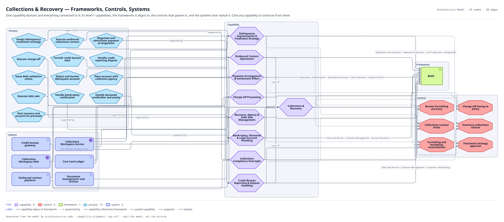

# Collections & Recovery — Frameworks, Controls, Systems

One capability domain and everything connected to it: its level-1 capabilities, the frameworks it aligns to, the controls that govern it, and the systems that realize it. Click any capability to continue from there.

```mermaid
%%{init: {'flowchart': {'curve': 'basis'}} }%%
flowchart LR
  %% Collections & Recovery — Frameworks, Controls, Systems
  %% Generated from the model by `terrane render`. Do not edit by hand.

  subgraph grp_Capability["Capability"]
    direction LR
    CAP_COLL_06{{"Bankruptcy, Deceased &<br/>Legal Account Handling"}}
    CAP_COLL_04{{"Charge-off Processing"}}
    CAP_COLL{{"Collections & Recovery"}}
    CAP_COLL_07{{"Collections Compliance<br/>Oversight"}}
    CAP_COLL_08{{"Credit Bureau Reporting &<br/>Dispute Handling"}}
    CAP_COLL_01{{"Delinquency Segmentation &<br/>Treatment Strategy"}}
    CAP_COLL_02{{"Outbound Contact<br/>Operations"}}
    CAP_COLL_03{{"Payment Arrangement &<br/>Settlement Offers"}}
    CAP_COLL_05{{"Recovery, Agency & Debt<br/>Sale Management"}}
  end

  subgraph grp_Control["Control"]
    direction LR
    CTL_BUREAU_ACC[["Bureau furnishing accuracy"]]
    CTL_CHARGEOFF_TIME[["Charge-off timing to<br/>policy"]]
    CTL_CONTACT_LIM[["Collections contact limits"]]
    CTL_METRO2_RECON[["Furnishing and bucketing<br/>reconciliation"]]
    CTL_FDCPA_NOTICE[["Statutory collections<br/>notices"]]
    CTL_TREATMENT_APPR[["Treatment strategy<br/>approval"]]
  end

  subgraph grp_Framework["Framework"]
    direction LR
    FW_BIAN["BIAN"]
  end

  subgraph grp_Process["Process"]
    direction LR
    P_COLLECTIONS_001[\"Assign delinquency<br/>treatment strategy"/]
    P_DELQ_001[\"Detect and bucket<br/>delinquent account"/]
    P_COLLECTIONS_004[\"Execute charge-off"/]
    P_RECOVERY_002[\"Execute debt sale"/]
    P_COLLECTIONS_002[\"Execute outbound<br/>collections contact"/]
    P_COLLECTIONS_005[\"Furnish credit bureau data"/]
    P_RECOVERY_003[\"Handle bankruptcy<br/>notification"/]
    P_COLLECTIONS_006[\"Handle credit reporting<br/>dispute"/]
    P_RECOVERY_004[\"Handle deceased cardholder<br/>and estate"/]
    P_COLLECTIONS_007[\"Issue debt validation<br/>notice"/]
    P_COLLECTIONS_003[\"Negotiate and administer<br/>payment arrangement"/]
    P_RECOVERY_001[\"Place account with<br/>collection agency"/]
    P_RECOVERY_005[\"Post recovery and account<br/>for proceeds"/]
  end

  subgraph grp_System["System"]
    direction LR
    SYS_COLLECT_API["Collections Workspace<br/>Service<br/>[AKS · Collections Workspace Cache]"]
    SYS_COLLECT_WEB["Collections Workspace Web<br/>[AKS]"]
    SYS_CORE_LEDGER["Core Card Ledger"]
    SYS_BUREAU_GW["Credit bureau gateway"]
    SYS_DOC["Document management and<br/>archive"]
    SYS_DIALER["Outbound contact platform"]
  end

  CAP_COLL_01 -->|"part of"| CAP_COLL
  CAP_COLL_02 -->|"part of"| CAP_COLL
  CAP_COLL_03 -->|"part of"| CAP_COLL
  CAP_COLL_04 -->|"part of"| CAP_COLL
  CAP_COLL_05 -->|"part of"| CAP_COLL
  CAP_COLL_06 -->|"part of"| CAP_COLL
  CAP_COLL_07 -->|"part of"| CAP_COLL
  CAP_COLL_08 -->|"part of"| CAP_COLL
  CAP_COLL -->|"Aligned to"| FW_BIAN
  CAP_COLL_01 -->|"Operations and Executio…"| FW_BIAN
  CAP_COLL_02 -->|"Sales and Service #gt;…"| FW_BIAN
  CAP_COLL_03 -->|"Operations and Executio…"| FW_BIAN
  CAP_COLL_04 -->|"Sales and Service #gt;…"| FW_BIAN
  CAP_COLL_05 -->|"Sales and Service #gt;…"| FW_BIAN
  CAP_COLL_06 -->|"Sales and Service #gt;…"| FW_BIAN
  CAP_COLL_07 -->|"Risk and Compliance #gt…"| FW_BIAN
  CAP_COLL_08 -->|"Sales and Service #gt;…"| FW_BIAN
  P_DELQ_001 -->|"supported by"| CAP_COLL_01
  P_COLLECTIONS_001 -->|"supported by"| CAP_COLL_01
  P_COLLECTIONS_002 -->|"supported by"| CAP_COLL_02
  P_COLLECTIONS_002 -->|"supported by"| CAP_COLL_07
  P_COLLECTIONS_003 -->|"supported by"| CAP_COLL_03
  P_COLLECTIONS_004 -->|"supported by"| CAP_COLL_04
  P_COLLECTIONS_005 -->|"supported by"| CAP_COLL_08
  P_COLLECTIONS_006 -->|"supported by"| CAP_COLL_08
  P_COLLECTIONS_007 -->|"supported by"| CAP_COLL_07
  P_RECOVERY_001 -->|"supported by"| CAP_COLL_05
  P_RECOVERY_002 -->|"supported by"| CAP_COLL_05
  P_RECOVERY_003 -->|"supported by"| CAP_COLL_06
  P_RECOVERY_004 -->|"supported by"| CAP_COLL_06
  P_RECOVERY_005 -->|"supported by"| CAP_COLL_05
  CAP_COLL -->|"governed by"| CTL_BUREAU_ACC
  CAP_COLL -->|"governed by"| CTL_CHARGEOFF_TIME
  CAP_COLL -->|"governed by"| CTL_CONTACT_LIM
  CAP_COLL -->|"governed by"| CTL_FDCPA_NOTICE
  CAP_COLL -->|"governed by"| CTL_METRO2_RECON
  CAP_COLL -->|"governed by"| CTL_TREATMENT_APPR
  CAP_COLL_01 -->|"governed by"| CTL_METRO2_RECON
  CAP_COLL_01 -->|"governed by"| CTL_TREATMENT_APPR
  CAP_COLL_02 -->|"governed by"| CTL_CONTACT_LIM
  CAP_COLL_04 -->|"governed by"| CTL_CHARGEOFF_TIME
  CAP_COLL_06 -->|"governed by"| CTL_FDCPA_NOTICE
  CAP_COLL_07 -->|"governed by"| CTL_CONTACT_LIM
  CAP_COLL_07 -->|"governed by"| CTL_FDCPA_NOTICE
  CAP_COLL_08 -->|"governed by"| CTL_BUREAU_ACC
  CAP_COLL_08 -->|"governed by"| CTL_METRO2_RECON
  SYS_COLLECT_API -->|"realizes"| CAP_COLL
  SYS_COLLECT_WEB -->|"realizes"| CAP_COLL
  SYS_BUREAU_GW -->|"realizes"| CAP_COLL_08
  SYS_COLLECT_API -->|"realizes"| CAP_COLL_01
  SYS_COLLECT_API -->|"realizes"| CAP_COLL_03
  SYS_COLLECT_API -->|"realizes"| CAP_COLL_05
  SYS_COLLECT_API -->|"realizes"| CAP_COLL_06
  SYS_CORE_LEDGER -->|"realizes"| CAP_COLL_01
  SYS_CORE_LEDGER -->|"realizes"| CAP_COLL_04
  SYS_DIALER -->|"realizes"| CAP_COLL_02
  SYS_DIALER -->|"realizes"| CAP_COLL_07
  SYS_DOC -->|"realizes"| CAP_COLL_07

  classDef s_capabilities__capabilities fill:#ddd6fe,stroke:#6d28d9,color:#0f172a,stroke-width:1.4px;
  classDef s_controls__controls fill:#fca5a5,stroke:#b91c1c,color:#0f172a,stroke-width:1.4px;
  classDef s_frameworks__frameworks fill:#d9f99d,stroke:#4d7c0f,color:#0f172a,stroke-width:1.4px;
  classDef s_processes__processes fill:#bae6fd,stroke:#0369a1,color:#0f172a,stroke-width:1.4px;
  classDef s_systems__systems fill:#c7d6ff,stroke:#4338ca,color:#0f172a,stroke-width:1.4px;
  class CAP_COLL,CAP_COLL_01,CAP_COLL_02,CAP_COLL_03,CAP_COLL_04,CAP_COLL_05,CAP_COLL_06,CAP_COLL_07,CAP_COLL_08 s_capabilities__capabilities;
  class CTL_BUREAU_ACC,CTL_CHARGEOFF_TIME,CTL_CONTACT_LIM,CTL_FDCPA_NOTICE,CTL_METRO2_RECON,CTL_TREATMENT_APPR s_controls__controls;
  class FW_BIAN s_frameworks__frameworks;
  class P_COLLECTIONS_001,P_COLLECTIONS_002,P_COLLECTIONS_003,P_COLLECTIONS_004,P_COLLECTIONS_005,P_COLLECTIONS_006,P_COLLECTIONS_007,P_DELQ_001,P_RECOVERY_001,P_RECOVERY_002,P_RECOVERY_003,P_RECOVERY_004,P_RECOVERY_005 s_processes__processes;
  class SYS_BUREAU_GW,SYS_COLLECT_API,SYS_COLLECT_WEB,SYS_CORE_LEDGER,SYS_DIALER,SYS_DOC s_systems__systems;
  classDef boundary1 fill:#f3f5fb,stroke:#8f9bb5,color:#3b4a6b;
  class grp_Capability,grp_Control,grp_Framework,grp_Process,grp_System boundary1;
```

The same view as the app draws it, written beside the Mermaid by `terrane render`:

**Hue is the entity type.**

| | Entity type |
|---|---|
| `#6d28d9` | capabilities |
| `#b91c1c` | controls |
| `#4d7c0f` | frameworks |
| `#0369a1` | processes |
| `#4338ca` | systems |

35 entities, 58 relationships. Generated from the model; edit the model, not this file.
