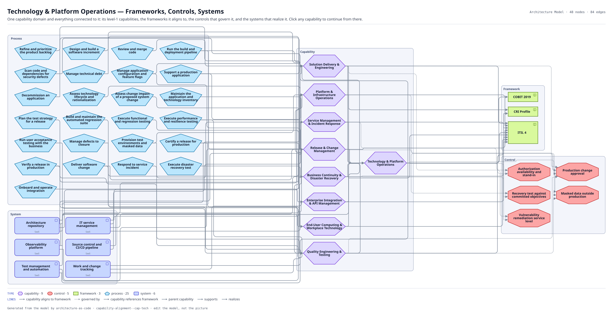

# Technology & Platform Operations — Frameworks, Controls, Systems

One capability domain and everything connected to it: its level-1 capabilities, the frameworks it aligns to, the controls that govern it, and the systems that realize it. Click any capability to continue from there.

```mermaid
%%{init: {'flowchart': {'curve': 'basis'}} }%%
flowchart LR
  %% Technology & Platform Operations — Frameworks, Controls, Systems
  %% Generated from the model by `terrane render`. Do not edit by hand.

  subgraph grp_Capability["Capability"]
    direction LR
    CAP_TECH_05{{"Business Continuity &<br/>Disaster Recovery"}}
    CAP_TECH_07{{"End-User Computing &<br/>Workplace Technology"}}
    CAP_TECH_06{{"Enterprise Integration &<br/>API Management"}}
    CAP_TECH_02{{"Platform & Infrastructure<br/>Operations"}}
    CAP_TECH_08{{"Quality Engineering &<br/>Testing"}}
    CAP_TECH_04{{"Release & Change<br/>Management"}}
    CAP_TECH_03{{"Service Management &<br/>Incident Response"}}
    CAP_TECH_01{{"Solution Delivery &<br/>Engineering"}}
    CAP_TECH{{"Technology & Platform<br/>Operations"}}
  end

  subgraph grp_Control["Control"]
    direction LR
    CTL_AUTH_AVAIL[["Authorization availability<br/>and stand-in"]]
    CTL_MASK_NONPROD[["Masked data outside<br/>production"]]
    CTL_CHG_APPROVAL[["Production change approval"]]
    CTL_DR_TEST[["Recovery test against<br/>committed objectives"]]
    CTL_VULN_SLA[["Vulnerability remediation<br/>service level"]]
  end

  subgraph grp_Framework["Framework"]
    direction LR
    FW_COBIT["COBIT 2019"]
    FW_CRI["CRI Profile"]
    FW_ITIL["ITIL 4"]
  end

  subgraph grp_Process["Process"]
    direction LR
    P_EA_007[\"Assess change impact of a<br/>proposed system change"/]
    P_EA_005[\"Assess technology<br/>lifecycle and<br/>rationalization"/]
    P_QE_002[\"Build and maintain the<br/>automated regression suite"/]
    P_QE_008[\"Certify a release for<br/>production"/]
    P_APPDEV_009[\"Decommission an<br/>application"/]
    P_TECH_001[\"Deliver software change"/]
    P_APPDEV_002[\"Design and build a<br/>software increment"/]
    P_TECH_003[\"Execute disaster recovery<br/>test"/]
    P_QE_003[\"Execute functional and<br/>regression testing"/]
    P_QE_004[\"Execute performance and<br/>resilience testing"/]
    P_EA_009[\"Maintain the application<br/>and technology inventory"/]
    P_APPDEV_007[\"Manage application<br/>configuration and feature<br/>flags"/]
    P_QE_006[\"Manage defects to closure"/]
    P_APPDEV_006[\"Manage technical debt"/]
    P_TECH_004[\"Onboard and operate<br/>integration"/]
    P_QE_001[\"Plan the test strategy for<br/>a release"/]
    P_QE_007[\"Provision test<br/>environments and masked<br/>data"/]
    P_APPDEV_001[\"Refine and prioritize the<br/>product backlog"/]
    P_TECH_002[\"Respond to service<br/>incident"/]
    P_APPDEV_003[\"Review and merge code"/]
    P_APPDEV_004[\"Run the build and<br/>deployment pipeline"/]
    P_QE_005[\"Run user acceptance<br/>testing with the business"/]
    P_APPDEV_005[\"Scan code and dependencies<br/>for security defects"/]
    P_APPDEV_008[\"Support a production<br/>application"/]
    P_QE_009[\"Verify a release in<br/>production"/]
  end

  subgraph grp_System["System"]
    direction LR
    SYS_ARCHREPO["Architecture repository<br/>[SaaS]"]
    SYS_ITSM["IT service management<br/>[SaaS]"]
    SYS_OBSERV["Observability platform<br/>[SaaS]"]
    SYS_SCM["Source control and CI/CD<br/>pipeline<br/>[SaaS]"]
    SYS_TESTMGMT["Test management and<br/>automation<br/>[SaaS]"]
    SYS_WORKTRACK["Work and change tracking<br/>[SaaS]"]
  end

  CAP_TECH_01 -->|"part of"| CAP_TECH
  CAP_TECH_02 -->|"part of"| CAP_TECH
  CAP_TECH_03 -->|"part of"| CAP_TECH
  CAP_TECH_04 -->|"part of"| CAP_TECH
  CAP_TECH_05 -->|"part of"| CAP_TECH
  CAP_TECH_06 -->|"part of"| CAP_TECH
  CAP_TECH_07 -->|"part of"| CAP_TECH
  CAP_TECH_08 -->|"part of"| CAP_TECH
  CAP_TECH -->|"Aligned to"| FW_ITIL
  CAP_TECH -->|"Informed by"| FW_COBIT
  CAP_TECH_01 -->|"Protect #gt; PR.PS-06"| FW_CRI
  CAP_TECH_01 -->|"Technical management #g…"| FW_ITIL
  CAP_TECH_02 -->|"Service management #gt;…"| FW_ITIL
  CAP_TECH_03 -->|"Service management #gt;…"| FW_ITIL
  CAP_TECH_04 -->|"Service management #gt;…"| FW_ITIL
  CAP_TECH_05 -->|"Recover #gt; RC.RP-01"| FW_CRI
  CAP_TECH_05 -->|"Service management #gt;…"| FW_ITIL
  CAP_TECH_06 -->|"Technical management #g…"| FW_ITIL
  CAP_TECH_07 -->|"Service management #gt;…"| FW_ITIL
  CAP_TECH_08 -->|"Service management #gt;…"| FW_ITIL
  P_TECH_001 -->|"supported by"| CAP_TECH_01
  P_TECH_001 -->|"supported by"| CAP_TECH_04
  P_TECH_002 -->|"supported by"| CAP_TECH_03
  P_TECH_003 -->|"supported by"| CAP_TECH_05
  P_TECH_004 -->|"supported by"| CAP_TECH_06
  P_EA_005 -->|"supported by"| CAP_TECH_02
  P_EA_007 -->|"supported by"| CAP_TECH_04
  P_EA_009 -->|"supported by"| CAP_TECH_07
  P_QE_001 -->|"supported by"| CAP_TECH_08
  P_QE_002 -->|"supported by"| CAP_TECH_08
  P_QE_003 -->|"supported by"| CAP_TECH_08
  P_QE_004 -->|"supported by"| CAP_TECH_08
  P_QE_004 -->|"supported by"| CAP_TECH_02
  P_QE_005 -->|"supported by"| CAP_TECH_08
  P_QE_006 -->|"supported by"| CAP_TECH_08
  P_QE_007 -->|"supported by"| CAP_TECH_08
  P_QE_007 -->|"supported by"| CAP_TECH_02
  P_QE_008 -->|"supported by"| CAP_TECH_08
  P_QE_008 -->|"supported by"| CAP_TECH_04
  P_QE_009 -->|"supported by"| CAP_TECH_08
  P_QE_009 -->|"supported by"| CAP_TECH_04
  P_APPDEV_001 -->|"supported by"| CAP_TECH_01
  P_APPDEV_002 -->|"supported by"| CAP_TECH_01
  P_APPDEV_003 -->|"supported by"| CAP_TECH_01
  P_APPDEV_004 -->|"supported by"| CAP_TECH_01
  P_APPDEV_004 -->|"supported by"| CAP_TECH_04
  P_APPDEV_005 -->|"supported by"| CAP_TECH_01
  P_APPDEV_006 -->|"supported by"| CAP_TECH_01
  P_APPDEV_007 -->|"supported by"| CAP_TECH_01
  P_APPDEV_007 -->|"supported by"| CAP_TECH_04
  P_APPDEV_008 -->|"supported by"| CAP_TECH_01
  P_APPDEV_008 -->|"supported by"| CAP_TECH_03
  P_APPDEV_009 -->|"supported by"| CAP_TECH_01
  CAP_TECH -->|"governed by"| CTL_AUTH_AVAIL
  CAP_TECH -->|"governed by"| CTL_CHG_APPROVAL
  CAP_TECH -->|"governed by"| CTL_DR_TEST
  CAP_TECH -->|"governed by"| CTL_MASK_NONPROD
  CAP_TECH -->|"governed by"| CTL_VULN_SLA
  CAP_TECH_01 -->|"governed by"| CTL_CHG_APPROVAL
  CAP_TECH_01 -->|"governed by"| CTL_VULN_SLA
  CAP_TECH_02 -->|"governed by"| CTL_MASK_NONPROD
  CAP_TECH_03 -->|"governed by"| CTL_AUTH_AVAIL
  CAP_TECH_04 -->|"governed by"| CTL_CHG_APPROVAL
  CAP_TECH_05 -->|"governed by"| CTL_DR_TEST
  CAP_TECH_08 -->|"governed by"| CTL_CHG_APPROVAL
  CAP_TECH_08 -->|"governed by"| CTL_MASK_NONPROD
  SYS_ARCHREPO -->|"realizes"| CAP_TECH_01
  SYS_ARCHREPO -->|"realizes"| CAP_TECH_02
  SYS_ARCHREPO -->|"realizes"| CAP_TECH_04
  SYS_ARCHREPO -->|"realizes"| CAP_TECH_07
  SYS_ITSM -->|"realizes"| CAP_TECH_01
  SYS_ITSM -->|"realizes"| CAP_TECH_03
  SYS_ITSM -->|"realizes"| CAP_TECH_05
  SYS_ITSM -->|"realizes"| CAP_TECH_06
  SYS_OBSERV -->|"realizes"| CAP_TECH_04
  SYS_OBSERV -->|"realizes"| CAP_TECH_08
  SYS_SCM -->|"realizes"| CAP_TECH_01
  SYS_SCM -->|"realizes"| CAP_TECH_04
  SYS_TESTMGMT -->|"realizes"| CAP_TECH_02
  SYS_TESTMGMT -->|"realizes"| CAP_TECH_04
  SYS_TESTMGMT -->|"realizes"| CAP_TECH_08
  SYS_WORKTRACK -->|"realizes"| CAP_TECH_01
  SYS_WORKTRACK -->|"realizes"| CAP_TECH_04
  SYS_WORKTRACK -->|"realizes"| CAP_TECH_08

  classDef s_capabilities__capabilities fill:#ddd6fe,stroke:#6d28d9,color:#0f172a,stroke-width:1.4px;
  classDef s_controls__controls fill:#fca5a5,stroke:#b91c1c,color:#0f172a,stroke-width:1.4px;
  classDef s_frameworks__frameworks fill:#d9f99d,stroke:#4d7c0f,color:#0f172a,stroke-width:1.4px;
  classDef s_processes__processes fill:#bae6fd,stroke:#0369a1,color:#0f172a,stroke-width:1.4px;
  classDef s_systems__systems fill:#c7d6ff,stroke:#4338ca,color:#0f172a,stroke-width:1.4px;
  class CAP_TECH,CAP_TECH_01,CAP_TECH_02,CAP_TECH_03,CAP_TECH_04,CAP_TECH_05,CAP_TECH_06,CAP_TECH_07,CAP_TECH_08 s_capabilities__capabilities;
  class CTL_AUTH_AVAIL,CTL_CHG_APPROVAL,CTL_DR_TEST,CTL_MASK_NONPROD,CTL_VULN_SLA s_controls__controls;
  class FW_COBIT,FW_CRI,FW_ITIL s_frameworks__frameworks;
  class P_APPDEV_001,P_APPDEV_002,P_APPDEV_003,P_APPDEV_004,P_APPDEV_005,P_APPDEV_006,P_APPDEV_007,P_APPDEV_008,P_APPDEV_009,P_EA_005,P_EA_007,P_EA_009,P_QE_001,P_QE_002,P_QE_003,P_QE_004,P_QE_005,P_QE_006,P_QE_007,P_QE_008,P_QE_009,P_TECH_001,P_TECH_002,P_TECH_003,P_TECH_004 s_processes__processes;
  class SYS_ARCHREPO,SYS_ITSM,SYS_OBSERV,SYS_SCM,SYS_TESTMGMT,SYS_WORKTRACK s_systems__systems;
  classDef boundary1 fill:#f3f5fb,stroke:#8f9bb5,color:#3b4a6b;
  class grp_Capability,grp_Control,grp_Framework,grp_Process,grp_System boundary1;
```

The same view as the app draws it, written beside the Mermaid by `terrane render`:

**Hue is the entity type.**

| | Entity type |
|---|---|
| `#6d28d9` | capabilities |
| `#b91c1c` | controls |
| `#4d7c0f` | frameworks |
| `#0369a1` | processes |
| `#4338ca` | systems |

48 entities, 84 relationships. Generated from the model; edit the model, not this file.

> 48 entities on an architecture diagram. Past about 40 this has become a landscape: narrow the scope, or mark it `kind: map`.
