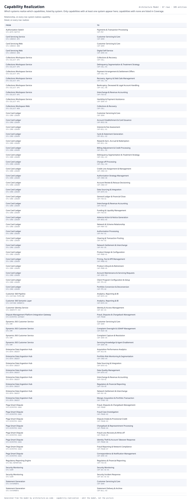

# Capability Realization

Which systems realize which capabilities, listed by system. Only capabilities with at least one system appear here; capabilities with none are listed in Coverage.

| From | | To | Detail |
|---|---|---|---|
| Core Card Ledger  `SYS-CORE-LEDGER` | system realizes capability | Interest & Fee Assessment  `CAP-BILL-01` | realizes |
| Core Card Ledger  `SYS-CORE-LEDGER` | system realizes capability | Cycle & Statement Generation  `CAP-BILL-02` | realizes |
| Core Card Ledger  `SYS-CORE-LEDGER` | system realizes capability | Rewards Earn, Accrual & Redemption  `CAP-BILL-04` | realizes |
| Enterprise Data Ingestion Hub  `SYS-DATA-INGEST` | system realizes capability | Acquisition Performance Analytics  `CAP-ACQ-05` | realizes |
| Statement Generation  `SYS-STATEMENTS` | system realizes capability | Statement Delivery & Archive  `CAP-BILL-03` | realizes |

5 relationships across 60 entities. Generated from the model; this is a report rather than a diagram, so it is a table.

> 109 entities matched; showing the 55 the scope names and the first 5 of the rest by id. Narrow the scope or raise limits.max_nodes.
