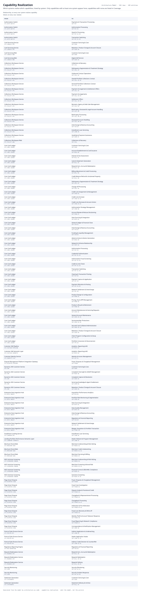

# Capability Realization

Which systems realize which capabilities, listed by system. Only capabilities with at least one system appear here; capabilities with none are listed in Coverage.

| From | | To | Detail |
|---|---|---|---|
| Authorization Switch  `SYS-AUTH-SWITCH` | system realizes capability | Payments & Transaction Processing  `CAP-PAY` | realizes |
| Authorization Switch  `SYS-AUTH-SWITCH` | system realizes capability | Authorization Processing  `CAP-PAY-01` | realizes |
| Authorization Switch  `SYS-AUTH-SWITCH` | system realizes capability | Stand-In Processing  `CAP-PAY-01-04` | realizes |
| Authorization Switch  `SYS-AUTH-SWITCH` | system realizes capability | Transaction Switching  `CAP-PAY-01-05` | realizes |
| Card Servicing Service  `SYS-CARDSVC-API` | system realizes capability | Customer Servicing & Care  `CAP-SERV` | realizes |
| Card Servicing Service  `SYS-CARDSVC-API` | system realizes capability | Retention, Product Change & Account Closure  `CAP-SERV-09` | realizes |
| Card Servicing Web  `SYS-CARDSVC-WEB` | system realizes capability | Customer Servicing & Care  `CAP-SERV` | realizes |
| Card Servicing Web  `SYS-CARDSVC-WEB` | system realizes capability | Digital Self-Service  `CAP-SERV-03` | realizes |
| Collections Workspace Service  `SYS-COLLECT-API` | system realizes capability | Collections & Recovery  `CAP-COLL` | realizes |
| Collections Workspace Service  `SYS-COLLECT-API` | system realizes capability | Delinquency Segmentation & Treatment Strategy  `CAP-COLL-01` | realizes |
| Collections Workspace Service  `SYS-COLLECT-API` | system realizes capability | Outbound Contact Operations  `CAP-COLL-02` | realizes |
| Collections Workspace Service  `SYS-COLLECT-API` | system realizes capability | Owned-Portfolio Collections Contact  `CAP-COLL-02-01` | realizes |
| Collections Workspace Service  `SYS-COLLECT-API` | system realizes capability | Serviced-Portfolio Collections Contact  `CAP-COLL-02-02` | realizes |
| Collections Workspace Service  `SYS-COLLECT-API` | system realizes capability | Payment Arrangement & Settlement Offers  `CAP-COLL-03` | realizes |
| Collections Workspace Service  `SYS-COLLECT-API` | system realizes capability | Payment Arrangements  `CAP-COLL-03-01` | realizes |
| Collections Workspace Service  `SYS-COLLECT-API` | system realizes capability | Settlement Offers  `CAP-COLL-03-02` | realizes |
| Collections Workspace Service  `SYS-COLLECT-API` | system realizes capability | Recovery, Agency & Debt Sale Management  `CAP-COLL-05` | realizes |
| Collections Workspace Service  `SYS-COLLECT-API` | system realizes capability | Bankruptcy, Deceased & Legal Account Handling  `CAP-COLL-06` | realizes |
| Collections Workspace Service  `SYS-COLLECT-API` | system realizes capability | Bankruptcy Processing  `CAP-COLL-06-01` | realizes |
| Collections Workspace Service  `SYS-COLLECT-API` | system realizes capability | Deceased Account Handling  `CAP-COLL-06-02` | realizes |
| Collections Workspace Service  `SYS-COLLECT-API` | system realizes capability | Interchange & Revenue Accounting  `CAP-FIN-02` | realizes |
| Collections Workspace Service  `SYS-COLLECT-API` | system realizes capability | Installment Loan Servicing  `CAP-LEND-05` | realizes |
| Collections Workspace Service  `SYS-COLLECT-API` | system realizes capability | Hardship & Payment Assistance  `CAP-SERV-07` | realizes |
| Collections Workspace Web  `SYS-COLLECT-WEB` | system realizes capability | Collections & Recovery  `CAP-COLL` | realizes |
| Core Card Ledger  `SYS-CORE-LEDGER` | system realizes capability | Customer Servicing & Care  `CAP-SERV` | realizes |
| Core Card Ledger  `SYS-CORE-LEDGER` | system realizes capability | Account Establishment & Card Issuance  `CAP-ORIG-06` | realizes |
| Core Card Ledger  `SYS-CORE-LEDGER` | system realizes capability | Interest & Fee Assessment  `CAP-BILL-01` | realizes |
| Core Card Ledger  `SYS-CORE-LEDGER` | system realizes capability | Cycle & Statement Generation  `CAP-BILL-02` | realizes |
| Core Card Ledger  `SYS-CORE-LEDGER` | system realizes capability | Rewards Earn, Accrual & Redemption  `CAP-BILL-04` | realizes |
| Core Card Ledger  `SYS-CORE-LEDGER` | system realizes capability | Billing Adjustment & Credit Processing  `CAP-BILL-05` | realizes |
| Core Card Ledger  `SYS-CORE-LEDGER` | system realizes capability | Credit Balance Refund & Unclaimed Property  `CAP-BILL-06` | realizes |
| Core Card Ledger  `SYS-CORE-LEDGER` | system realizes capability | Delinquency Segmentation & Treatment Strategy  `CAP-COLL-01` | realizes |
| Core Card Ledger  `SYS-CORE-LEDGER` | system realizes capability | Charge-off Processing  `CAP-COLL-04` | realizes |
| Core Card Ledger  `SYS-CORE-LEDGER` | system realizes capability | Credit Line Assignment & Management  `CAP-CRED-03` | realizes |
| Core Card Ledger  `SYS-CORE-LEDGER` | system realizes capability | Credit Line Increase  `CAP-CRED-03-01` | realizes |
| Core Card Ledger  `SYS-CORE-LEDGER` | system realizes capability | Credit Line Decrease & Account Action  `CAP-CRED-03-02` | realizes |
| Core Card Ledger  `SYS-CORE-LEDGER` | system realizes capability | Authorization Strategy Management  `CAP-CRED-06` | realizes |
| Core Card Ledger  `SYS-CORE-LEDGER` | system realizes capability | Account Review & Reissue Decisioning  `CAP-CRED-07` | realizes |
| Core Card Ledger  `SYS-CORE-LEDGER` | system realizes capability | Data Sourcing & Integration  `CAP-DATA-02` | realizes |
| Core Card Ledger  `SYS-CORE-LEDGER` | system realizes capability | General Ledger & Financial Close  `CAP-FIN-01` | realizes |
| Core Card Ledger  `SYS-CORE-LEDGER` | system realizes capability | Interchange & Revenue Accounting  `CAP-FIN-02` | realizes |
| Core Card Ledger  `SYS-CORE-LEDGER` | system realizes capability | Funding & Liquidity Management  `CAP-FIN-03` | realizes |
| Core Card Ledger  `SYS-CORE-LEDGER` | system realizes capability | Adverse Action & Notice Generation  `CAP-ORIG-05` | realizes |
| Core Card Ledger  `SYS-CORE-LEDGER` | system realizes capability | Network & Scheme Relationship  `CAP-PART-02` | realizes |
| Core Card Ledger  `SYS-CORE-LEDGER` | system realizes capability | Authorization Processing  `CAP-PAY-01` | realizes |
| Core Card Ledger  `SYS-CORE-LEDGER` | system realizes capability | Credential Authentication  `CAP-PAY-01-01` | realizes |
| Core Card Ledger  `SYS-CORE-LEDGER` | system realizes capability | Authorization Fraud Screening  `CAP-PAY-01-02` | realizes |
| Core Card Ledger  `SYS-CORE-LEDGER` | system realizes capability | Credit & Limit Check  `CAP-PAY-01-03` | realizes |
| Core Card Ledger  `SYS-CORE-LEDGER` | system realizes capability | Transaction Switching  `CAP-PAY-01-05` | realizes |
| Core Card Ledger  `SYS-CORE-LEDGER` | system realizes capability | Clearing & Transaction Posting  `CAP-PAY-02` | realizes |
| Core Card Ledger  `SYS-CORE-LEDGER` | system realizes capability | Payment Capture & Application  `CAP-PAY-03` | realizes |
| Core Card Ledger  `SYS-CORE-LEDGER` | system realizes capability | Payment Allocation & Posting  `CAP-PAY-03-02` | realizes |
| Core Card Ledger  `SYS-CORE-LEDGER` | system realizes capability | Network Settlement & Interchange  `CAP-PAY-05` | realizes |
| Core Card Ledger  `SYS-CORE-LEDGER` | system realizes capability | Product Design & Configuration  `CAP-PROD-01` | realizes |
| Core Card Ledger  `SYS-CORE-LEDGER` | system realizes capability | Pricing, Fee & APR Management  `CAP-PROD-02` | realizes |
| Core Card Ledger  `SYS-CORE-LEDGER` | system realizes capability | Product Lifecycle & Retirement  `CAP-PROD-05` | realizes |
| Core Card Ledger  `SYS-CORE-LEDGER` | system realizes capability | Account Maintenance & Servicing Requests  `CAP-SERV-02` | realizes |
| Core Card Ledger  `SYS-CORE-LEDGER` | system realizes capability | General Account Maintenance  `CAP-SERV-02-01` | realizes |
| Core Card Ledger  `SYS-CORE-LEDGER` | system realizes capability | Servicemember Protections  `CAP-SERV-02-02` | realizes |
| Core Card Ledger  `SYS-CORE-LEDGER` | system realizes capability | Secured Card Collateral Administration  `CAP-SERV-02-03` | realizes |
| Core Card Ledger  `SYS-CORE-LEDGER` | system realizes capability | Retention, Product Change & Account Closure  `CAP-SERV-09` | realizes |
| Core Card Ledger  `SYS-CORE-LEDGER` | system realizes capability | Client Program Configuration & Setup  `CAP-TPS-01` | realizes |
| Core Card Ledger  `SYS-CORE-LEDGER` | system realizes capability | Portfolio Conversion & Deconversion  `CAP-TPS-02` | realizes |
| Customer 360 Pipeline  `SYS-CUST360-PIPELINE` | system realizes capability | Analytics, Reporting & BI  `CAP-DATA-04` | realizes |
| Customer 360 Semantic Layer  `SYS-CUST360-SEMANTIC` | system realizes capability | Analytics, Reporting & BI  `CAP-DATA-04` | realizes |
| Customer Identity Service  `SYS-IDENTITY-SVC` | system realizes capability | Identity & Access Management  `CAP-SEC-01` | realizes |
| Dispute Management Platform Integration Gateway  `SYS-DISPUTES-GATEWAY` | system realizes capability | Fraud, Disputes & Chargeback Management  `CAP-FRAUD` | realizes |
| Dynamics 365 Customer Service  `SYS-CRM` | system realizes capability | Customer Servicing & Care  `CAP-SERV` | realizes |
| Dynamics 365 Customer Service  `SYS-CRM` | system realizes capability | Complaint Oversight & UDAAP Management  `CAP-RGOV-06` | realizes |
| Dynamics 365 Customer Service  `SYS-CRM` | system realizes capability | Complaint Capture & Resolution  `CAP-SERV-05` | realizes |
| Dynamics 365 Customer Service  `SYS-CRM` | system realizes capability | Servicing Knowledge & Agent Enablement  `CAP-SERV-06` | realizes |
| Dynamics 365 Customer Service  `SYS-CRM` | system realizes capability | Retention, Product Change & Account Closure  `CAP-SERV-09` | realizes |
| Enterprise Data Ingestion Hub  `SYS-DATA-INGEST` | system realizes capability | Acquisition Performance Analytics  `CAP-ACQ-05` | realizes |
| Enterprise Data Ingestion Hub  `SYS-DATA-INGEST` | system realizes capability | Portfolio Risk Monitoring & Segmentation  `CAP-CRED-04` | realizes |
| Enterprise Data Ingestion Hub  `SYS-DATA-INGEST` | system realizes capability | Data Sourcing & Integration  `CAP-DATA-02` | realizes |
| Enterprise Data Ingestion Hub  `SYS-DATA-INGEST` | system realizes capability | Data Quality Management  `CAP-DATA-03` | realizes |
| Enterprise Data Ingestion Hub  `SYS-DATA-INGEST` | system realizes capability | Interchange & Revenue Accounting  `CAP-FIN-02` | realizes |
| Enterprise Data Ingestion Hub  `SYS-DATA-INGEST` | system realizes capability | Regulatory & Financial Reporting  `CAP-FIN-04` | realizes |
| Enterprise Data Ingestion Hub  `SYS-DATA-INGEST` | system realizes capability | Network Settlement & Interchange  `CAP-PAY-05` | realizes |
| Enterprise Data Ingestion Hub  `SYS-DATA-INGEST` | system realizes capability | Merger, Acquisition & Portfolio Transaction  `CAP-STRAT-05` | realizes |
| Installment Lending Service  `SYS-LENDING-API` | system realizes capability | Installment Loan Servicing  `CAP-LEND-05` | realizes |
| Lending Portfolio Performance Semantic Layer  `SYS-LENDPERF-SEMANTIC` | system realizes capability | Dealer Network & Program Management  `CAP-LEND-01` | realizes |
| Merchant Portal Web  `SYS-MERCHANT-WEB` | system realizes capability | Merchant Underwriting & Risk Vetting  `CAP-MERCH-02` | realizes |
| Merchant Portal Web  `SYS-MERCHANT-WEB` | system realizes capability | Merchant Credit Underwriting  `CAP-MERCH-02-01` | realizes |
| Merchant Portal Web  `SYS-MERCHANT-WEB` | system realizes capability | Merchant Servicing & Billing  `CAP-MERCH-07` | realizes |
| NICE Actimize Screening  `SYS-SCREENING-VENDOR` | system realizes capability | Merchant Underwriting & Risk Vetting  `CAP-MERCH-02` | realizes |
| NICE Actimize Screening  `SYS-SCREENING-VENDOR` | system realizes capability | Merchant Screening & Brand Risk  `CAP-MERCH-02-02` | realizes |
| NICE Actimize Screening  `SYS-SCREENING-VENDOR` | system realizes capability | Financial Crimes & BSA/AML Compliance  `CAP-RGOV-07` | realizes |
| NICE Actimize Screening  `SYS-SCREENING-VENDOR` | system realizes capability | Sanctions Screening  `CAP-RGOV-07-01` | realizes |
| Pega Smart Dispute  `SYS-DISPUTES-SAAS` | system realizes capability | Fraud, Disputes & Chargeback Management  `CAP-FRAUD` | realizes |
| Pega Smart Dispute  `SYS-DISPUTES-SAAS` | system realizes capability | Fraud Case Investigation  `CAP-FRAUD-02` | realizes |
| Pega Smart Dispute  `SYS-DISPUTES-SAAS` | system realizes capability | Dispute Intake & Provisional Credit  `CAP-FRAUD-03` | realizes |
| Pega Smart Dispute  `SYS-DISPUTES-SAAS` | system realizes capability | Chargeback & Representment Processing  `CAP-FRAUD-04` | realizes |
| Pega Smart Dispute  `SYS-DISPUTES-SAAS` | system realizes capability | Chargeback Processing  `CAP-FRAUD-04-01` | realizes |
| Pega Smart Dispute  `SYS-DISPUTES-SAAS` | system realizes capability | Arbitration & Pre-Arbitration  `CAP-FRAUD-04-02` | realizes |
| Pega Smart Dispute  `SYS-DISPUTES-SAAS` | system realizes capability | Fraud Loss Recovery & Write-off  `CAP-FRAUD-05` | realizes |
| Pega Smart Dispute  `SYS-DISPUTES-SAAS` | system realizes capability | Identity Theft & Account Takeover Response  `CAP-FRAUD-06` | realizes |
| Pega Smart Dispute  `SYS-DISPUTES-SAAS` | system realizes capability | Fraud Reporting & Network Compliance  `CAP-FRAUD-07` | realizes |
| Pega Smart Dispute  `SYS-DISPUTES-SAAS` | system realizes capability | Correspondence & Notification Management  `CAP-SERV-04` | realizes |
| Point-of-Sale Finance Service  `SYS-POSFIN-API` | system realizes capability | Indirect Application & Underwriting  `CAP-LEND-02` | realizes |
| Point-of-Sale Finance Service  `SYS-POSFIN-API` | system realizes capability | Dealer Application Intake  `CAP-LEND-02-01` | realizes |
| Point-of-Sale Finance Service  `SYS-POSFIN-API` | system realizes capability | Indirect Credit Decision & Counteroffer  `CAP-LEND-02-02` | realizes |
| Regulatory Reporting Engine  `SYS-REG-REPORTING` | system realizes capability | Regulatory & Financial Reporting  `CAP-FIN-04` | realizes |
| Rewards Redemption Service  `SYS-REWARDS-API` | system realizes capability | Rewards Earn, Accrual & Redemption  `CAP-BILL-04` | realizes |
| Rewards Redemption Service  `SYS-REWARDS-API` | system realizes capability | Rewards Redemption  `CAP-BILL-04-02` | realizes |
| Rewards Redemption Service  `SYS-REWARDS-API` | system realizes capability | Rewards Delivery  `CAP-BILL-04-03` | realizes |
| Security Monitoring  `SYS-SIEM` | system realizes capability | Security Monitoring  `CAP-SEC-02-01` | realizes |
| Security Monitoring  `SYS-SIEM` | system realizes capability | Security Incident Response  `CAP-SEC-02-02` | realizes |
| Statement Generation  `SYS-STATEMENTS` | system realizes capability | Customer Servicing & Care  `CAP-SERV` | realizes |
| Statement Generation  `SYS-STATEMENTS` | system realizes capability | Statement Delivery & Archive  `CAP-BILL-03` | realizes |

110 relationships across 145 entities. Generated from the model; this is a report rather than a diagram, so it is a table.
