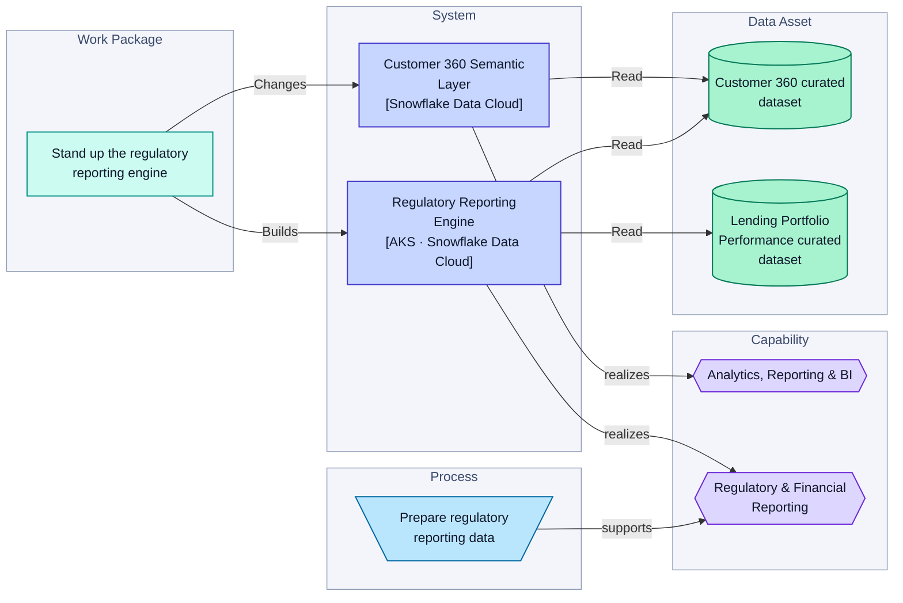
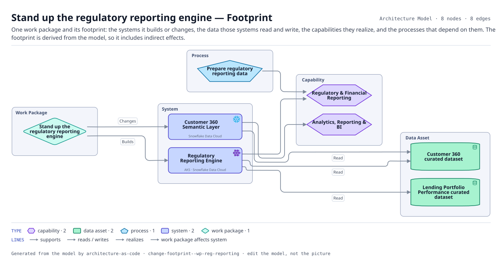

# Stand up the regulatory reporting engine — Footprint

One work package and its footprint: the systems it builds or changes, the data those systems read and write, the capabilities they realize, and the processes that depend on them. The footprint is derived from the model, so it includes indirect effects.

The same view as the app draws it, written beside the Mermaid by `terrane render`:

**Hue is the entity type.**

| | Entity type |
|---|---|
| `#6d28d9` | capabilities |
| `#047857` | data assets |
| `#0369a1` | processes |
| `#4338ca` | systems |
| `#0d9488` | work packages |

8 entities, 8 relationships. Generated from the model; edit the model, not this file.
