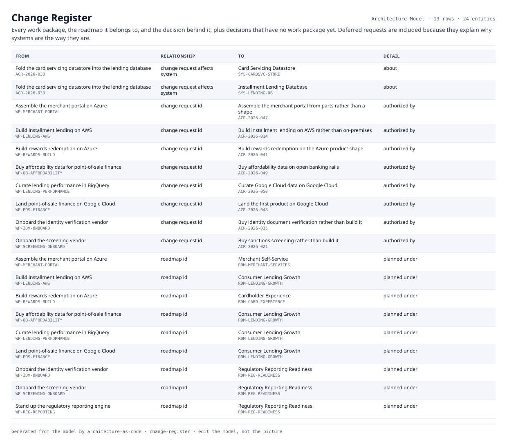

# Change Register

Every work package, the roadmap it belongs to, and the decision behind it, plus decisions that have no work package yet. Deferred requests are included because they explain why systems are the way they are.

| From | | To | Detail |
|---|---|---|---|
| Fold the card servicing datastore into the lending database  `ACR-2026-030` | change request affects system | Card Servicing Datastore  `SYS-CARDSVC-STORE` | about |
| Fold the card servicing datastore into the lending database  `ACR-2026-030` | change request affects system | Installment Lending Database  `SYS-LENDING-DB` | about |
| Assemble the merchant portal on Azure  `WP-MERCHANT-PORTAL` | change request id | Assemble the merchant portal from parts rather than a shape  `ACR-2026-047` | authorized by |
| Build installment lending on AWS  `WP-LENDING-AWS` | change request id | Build installment lending on AWS rather than on-premises  `ACR-2026-014` | authorized by |
| Build rewards redemption on Azure  `WP-REWARDS-BUILD` | change request id | Build rewards redemption on the Azure product shape  `ACR-2026-041` | authorized by |
| Buy affordability data for point-of-sale finance  `WP-OB-AFFORDABILITY` | change request id | Buy affordability data on open banking rails  `ACR-2026-049` | authorized by |
| Curate lending performance in BigQuery  `WP-LENDING-PERFORMANCE` | change request id | Curate Google Cloud data on Google Cloud  `ACR-2026-050` | authorized by |
| Land point-of-sale finance on Google Cloud  `WP-POS-FINANCE` | change request id | Land the first product on Google Cloud  `ACR-2026-048` | authorized by |
| Onboard the identity verification vendor  `WP-IDV-ONBOARD` | change request id | Buy identity document verification rather than build it  `ACR-2026-035` | authorized by |
| Onboard the screening vendor  `WP-SCREENING-ONBOARD` | change request id | Buy sanctions screening rather than build it  `ACR-2026-021` | authorized by |
| Assemble the merchant portal on Azure  `WP-MERCHANT-PORTAL` | roadmap id | Merchant Self-Service  `RDM-MERCHANT-SERVICES` | planned under |
| Build installment lending on AWS  `WP-LENDING-AWS` | roadmap id | Consumer Lending Growth  `RDM-LENDING-GROWTH` | planned under |
| Build rewards redemption on Azure  `WP-REWARDS-BUILD` | roadmap id | Cardholder Experience  `RDM-CARD-EXPERIENCE` | planned under |
| Buy affordability data for point-of-sale finance  `WP-OB-AFFORDABILITY` | roadmap id | Consumer Lending Growth  `RDM-LENDING-GROWTH` | planned under |
| Curate lending performance in BigQuery  `WP-LENDING-PERFORMANCE` | roadmap id | Consumer Lending Growth  `RDM-LENDING-GROWTH` | planned under |
| Land point-of-sale finance on Google Cloud  `WP-POS-FINANCE` | roadmap id | Consumer Lending Growth  `RDM-LENDING-GROWTH` | planned under |
| Onboard the identity verification vendor  `WP-IDV-ONBOARD` | roadmap id | Regulatory Reporting Readiness  `RDM-REG-READINESS` | planned under |
| Onboard the screening vendor  `WP-SCREENING-ONBOARD` | roadmap id | Regulatory Reporting Readiness  `RDM-REG-READINESS` | planned under |
| Stand up the regulatory reporting engine  `WP-REG-REPORTING` | roadmap id | Regulatory Reporting Readiness  `RDM-REG-READINESS` | planned under |

19 relationships across 24 entities. Generated from the model; this is a report rather than a diagram, so it is a table.
