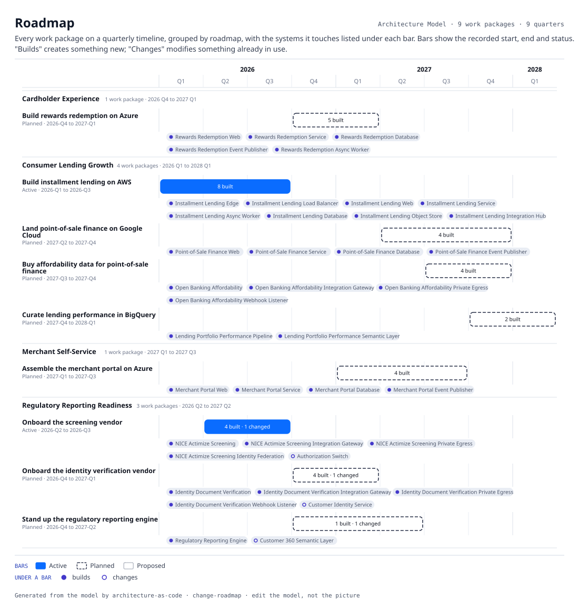
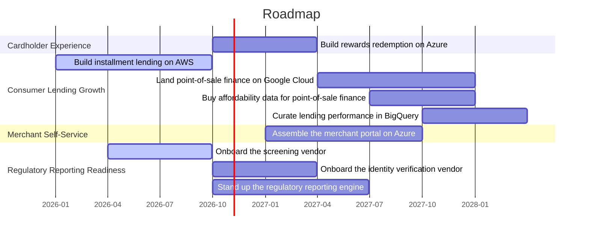

# Roadmap

Every work package on a quarterly timeline, grouped by roadmap, with the systems it touches listed under each bar. Bars show the recorded start, end and status. "Builds" creates something new; "Changes" modifies something already in use.

| Under | What | From | To | Status | Reaches |
|---|---|---|---|---|---|
| Cardholder Experience | Build rewards redemption on Azure  `WP-REWARDS-BUILD` | 2026-Q4 | 2027-Q1 | Planned | Rewards Redemption Async Worker (builds), Rewards Redemption Database (builds), Rewards Redemption Event Publisher (builds), Rewards Redemption Service (builds), Rewards Redemption Web (builds) |
| Consumer Lending Growth | Build installment lending on AWS  `WP-LENDING-AWS` | 2026-Q1 | 2026-Q3 | Active | Installment Lending Async Worker (builds), Installment Lending Database (builds), Installment Lending Edge (builds), Installment Lending Integration Hub (builds), Installment Lending Load Balancer (builds), Installment Lending Object Store (builds), Installment Lending Service (builds), Installment Lending Web (builds) |
| Consumer Lending Growth | Land point-of-sale finance on Google Cloud  `WP-POS-FINANCE` | 2027-Q2 | 2027-Q4 | Planned | Point-of-Sale Finance Database (builds), Point-of-Sale Finance Event Publisher (builds), Point-of-Sale Finance Service (builds), Point-of-Sale Finance Web (builds) |
| Consumer Lending Growth | Buy affordability data for point-of-sale finance  `WP-OB-AFFORDABILITY` | 2027-Q3 | 2027-Q4 | Planned | Open Banking Affordability (builds), Open Banking Affordability Integration Gateway (builds), Open Banking Affordability Private Egress (builds), Open Banking Affordability Webhook Listener (builds) |
| Consumer Lending Growth | Curate lending performance in BigQuery  `WP-LENDING-PERFORMANCE` | 2027-Q4 | 2028-Q1 | Planned | Lending Portfolio Performance Pipeline (builds), Lending Portfolio Performance Semantic Layer (builds) |
| Merchant Self-Service | Assemble the merchant portal on Azure  `WP-MERCHANT-PORTAL` | 2027-Q1 | 2027-Q3 | Planned | Merchant Portal Database (builds), Merchant Portal Event Publisher (builds), Merchant Portal Service (builds), Merchant Portal Web (builds) |
| Regulatory Reporting Readiness | Onboard the screening vendor  `WP-SCREENING-ONBOARD` | 2026-Q2 | 2026-Q3 | Active | Authorization Switch (changes), NICE Actimize Screening (builds), NICE Actimize Screening Identity Federation (builds), NICE Actimize Screening Integration Gateway (builds), NICE Actimize Screening Private Egress (builds) |
| Regulatory Reporting Readiness | Onboard the identity verification vendor  `WP-IDV-ONBOARD` | 2026-Q4 | 2027-Q1 | Planned | Customer Identity Service (changes), Identity Document Verification (builds), Identity Document Verification Integration Gateway (builds), Identity Document Verification Private Egress (builds), Identity Document Verification Webhook Listener (builds) |
| Regulatory Reporting Readiness | Stand up the regulatory reporting engine  `WP-REG-REPORTING` | 2026-Q4 | 2027-Q2 | Planned | Customer 360 Semantic Layer (changes), Regulatory Reporting Engine (builds) |

9 dated things; 39 without a quarter, listed under the bars that reach them. Generated from the model; this is a timeline, so the axis is time and the layout chose nothing.
