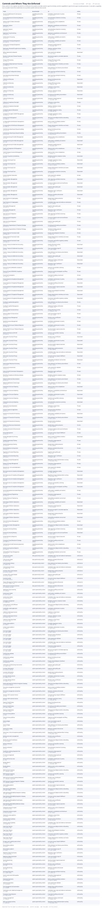

# Controls and Where They Are Enforced

Every control in the register and where it is enforced: the systems and data assets it governs directly, and the capabilities it governs through recorded processes. A row with a capability but no system means the model does not say which system enforces that control.

| From | | To | Detail |
|---|---|---|---|
| Account Establishment & Card Issuance  `CAP-ORIG-06` | capability governed by control | Cardholder authentication to policy  `CTL-AUTH-POLICY` | Process |
| Account Maintenance & Servicing Requests  `CAP-SERV-02` | capability governed by control | Servicemember protections screening  `CTL-SCRA-MLA` | Process |
| Adverse Action & Notice Generation  `CAP-ORIG-05` | capability governed by control | Adverse action notice completeness  `CTL-ADVERSE-ACT` | Process |
| Application Capture  `CAP-ORIG-01` | capability governed by control | Application completeness and disclosure  `CTL-APP-INTAKE` | Process |
| Application Capture  `CAP-ORIG-01` | capability governed by control | Servicemember protections screening  `CTL-SCRA-MLA` | Process |
| Application Fraud Screening  `CAP-ORIG-03` | capability governed by control | Application completeness and disclosure  `CTL-APP-INTAKE` | Process |
| Authorization Processing  `CAP-PAY-01` | capability governed by control | Authorization availability and stand-in  `CTL-AUTH-AVAIL` | Process |
| Authorization Strategy Management  `CAP-CRED-06` | capability governed by control | Authorization availability and stand-in  `CTL-AUTH-AVAIL` | Process |
| Authorization Strategy Management  `CAP-CRED-06` | capability governed by control | Treatment strategy approval  `CTL-TREATMENT-APPR` | Process |
| Bankruptcy, Deceased & Legal Account Handling  `CAP-COLL-06` | capability governed by control | Statutory collections notices  `CTL-FDCPA-NOTICE` | Process |
| Billing, Statements & Rewards  `CAP-BILL` | capability governed by control | Cycle assessment validation  `CTL-CYCLE-VALID` | Descendant |
| Business Continuity & Disaster Recovery  `CAP-TECH-05` | capability governed by control | Recovery test against committed objectives  `CTL-DR-TEST` | Process |
| Charge-off Processing  `CAP-COLL-04` | capability governed by control | Charge-off timing to policy  `CTL-CHARGEOFF-TIME` | Process |
| Chargeback & Representment Processing  `CAP-FRAUD-04` | capability governed by control | Dispute determination timeliness and notice  `CTL-REGE-DETERM` | Process |
| Clearing & Transaction Posting  `CAP-PAY-02` | capability governed by control | Daily settlement and clearing reconciliation  `CTL-DAILY-RECON` | Process |
| Client Program Configuration & Setup  `CAP-TPS-01` | capability governed by control | Client reporting and feed monitoring  `CTL-CLIENT-SLA` | Process |
| Client Reporting & Data Exchange  `CAP-TPS-03` | capability governed by control | Client reporting and feed monitoring  `CTL-CLIENT-SLA` | Process |
| Collections & Recovery  `CAP-COLL` | capability governed by control | Bureau furnishing accuracy  `CTL-BUREAU-ACC` | Descendant |
| Collections & Recovery  `CAP-COLL` | capability governed by control | Charge-off timing to policy  `CTL-CHARGEOFF-TIME` | Descendant |
| Collections & Recovery  `CAP-COLL` | capability governed by control | Collections contact limits  `CTL-CONTACT-LIM` | Descendant |
| Collections & Recovery  `CAP-COLL` | capability governed by control | Statutory collections notices  `CTL-FDCPA-NOTICE` | Descendant |
| Collections & Recovery  `CAP-COLL` | capability governed by control | Furnishing and bucketing reconciliation  `CTL-METRO2-RECON` | Descendant |
| Collections & Recovery  `CAP-COLL` | capability governed by control | Treatment strategy approval  `CTL-TREATMENT-APPR` | Descendant |
| Collections Compliance Oversight  `CAP-COLL-07` | capability governed by control | Collections contact limits  `CTL-CONTACT-LIM` | Process |
| Collections Compliance Oversight  `CAP-COLL-07` | capability governed by control | Statutory collections notices  `CTL-FDCPA-NOTICE` | Process |
| Complaint Capture & Resolution  `CAP-SERV-05` | capability governed by control | Complaint regulatory routing  `CTL-COMPLAINT-REG` | Process |
| Complaint Oversight & UDAAP Management  `CAP-RGOV-06` | capability governed by control | Complaint regulatory routing  `CTL-COMPLAINT-REG` | Process |
| Contract & SLA Management  `CAP-TPRM-02` | capability governed by control | Third-party due diligence before onboarding  `CTL-TPRM-DD` | Process |
| Correspondence & Notification Management  `CAP-SERV-04` | capability governed by control | Notice content and delivery evidence  `CTL-NOTICE-CONTENT` | Process |
| Correspondence & Notification Management  `CAP-SERV-04` | capability governed by control | Dispute determination timeliness and notice  `CTL-REGE-DETERM` | Process |
| Credit Bureau Reporting & Dispute Handling  `CAP-COLL-08` | capability governed by control | Bureau furnishing accuracy  `CTL-BUREAU-ACC` | Process |
| Credit Bureau Reporting & Dispute Handling  `CAP-COLL-08` | capability governed by control | Furnishing and bucketing reconciliation  `CTL-METRO2-RECON` | Process |
| Credit Decisioning & Portfolio Management  `CAP-CRED` | capability governed by control | Adverse action notice completeness  `CTL-ADVERSE-ACT` | Descendant |
| Credit Decisioning & Portfolio Management  `CAP-CRED` | capability governed by control | Authorization availability and stand-in  `CTL-AUTH-AVAIL` | Descendant |
| Credit Decisioning & Portfolio Management  `CAP-CRED` | capability governed by control | Treatment strategy approval  `CTL-TREATMENT-APPR` | Descendant |
| Credit Line Assignment & Management  `CAP-CRED-03` | capability governed by control | Adverse action notice completeness  `CTL-ADVERSE-ACT` | Process |
| Credit Strategy & Scorecard Management  `CAP-CRED-01` | capability governed by control | Adverse action notice completeness  `CTL-ADVERSE-ACT` | Process |
| Customer Acquisition & Marketing  `CAP-ACQ` | capability governed by control | Marketing material compliance review  `CTL-MKT-REVIEW` | Descendant |
| Customer Servicing & Care  `CAP-SERV` | capability governed by control | Complaint regulatory routing  `CTL-COMPLAINT-REG` | Descendant |
| Customer Servicing & Care  `CAP-SERV` | capability governed by control | Notice content and delivery evidence  `CTL-NOTICE-CONTENT` | Descendant |
| Customer Servicing & Care  `CAP-SERV` | capability governed by control | Dispute determination timeliness and notice  `CTL-REGE-DETERM` | Descendant |
| Customer Servicing & Care  `CAP-SERV` | capability governed by control | Servicemember protections screening  `CTL-SCRA-MLA` | Descendant |
| Cycle & Statement Generation  `CAP-BILL-02` | capability governed by control | Cycle assessment validation  `CTL-CYCLE-VALID` | Process |
| Data & Analytics Management  `CAP-DATA` | capability governed by control | Client reporting and feed monitoring  `CTL-CLIENT-SLA` | Descendant |
| Data & Analytics Management  `CAP-DATA` | capability governed by control | Conversion balance and record verification  `CTL-CONV-VERIFY` | Descendant |
| Data & Analytics Management  `CAP-DATA` | capability governed by control | Ingestion data quality gate  `CTL-DQ-GATE` | Descendant |
| Data & Analytics Management  `CAP-DATA` | capability governed by control | Regulatory report certification  `CTL-REGRPT-CERT` | Descendant |
| Data & Analytics Management  `CAP-DATA` | capability governed by control | Retention schedule enforcement  `CTL-RETENTION` | Descendant |
| Data Protection & Cryptography  `CAP-SEC-04` | capability governed by control | Masked data outside production  `CTL-MASK-NONPROD` | Process |
| Data Protection & Cryptography  `CAP-SEC-04` | capability governed by control | Cardholder data scope and evidence maintenance  `CTL-PCI-EVIDENCE` | Process |
| Data Quality Management  `CAP-DATA-03` | capability governed by control | Ingestion data quality gate  `CTL-DQ-GATE` | Process |
| Data Quality Management  `CAP-DATA-03` | capability governed by control | Regulatory report certification  `CTL-REGRPT-CERT` | Process |
| Data Sourcing & Integration  `CAP-DATA-02` | capability governed by control | Client reporting and feed monitoring  `CTL-CLIENT-SLA` | Process |
| Data Sourcing & Integration  `CAP-DATA-02` | capability governed by control | Conversion balance and record verification  `CTL-CONV-VERIFY` | Process |
| Data Sourcing & Integration  `CAP-DATA-02` | capability governed by control | Ingestion data quality gate  `CTL-DQ-GATE` | Process |
| Delinquency Segmentation & Treatment Strategy  `CAP-COLL-01` | capability governed by control | Furnishing and bucketing reconciliation  `CTL-METRO2-RECON` | Process |
| Delinquency Segmentation & Treatment Strategy  `CAP-COLL-01` | capability governed by control | Treatment strategy approval  `CTL-TREATMENT-APPR` | Process |
| Dispute Intake & Provisional Credit  `CAP-FRAUD-03` | capability governed by control | Dispute acknowledgment timeliness  `CTL-REGE-ACK` | Process |
| Dispute Intake & Provisional Credit  `CAP-FRAUD-03` | capability governed by control | Dispute determination timeliness and notice  `CTL-REGE-DETERM` | Process |
| Dispute Intake & Provisional Credit  `CAP-FRAUD-03` | capability governed by control | Provisional credit within regulatory window  `CTL-REGE-PROVCR` | Process |
| Finance, Treasury & Settlement Accounting  `CAP-FIN` | capability governed by control | Charge-off timing to policy  `CTL-CHARGEOFF-TIME` | Descendant |
| Finance, Treasury & Settlement Accounting  `CAP-FIN` | capability governed by control | Close reconciliation sign-off  `CTL-CLOSE-SIGNOFF` | Descendant |
| Finance, Treasury & Settlement Accounting  `CAP-FIN` | capability governed by control | Daily settlement and clearing reconciliation  `CTL-DAILY-RECON` | Descendant |
| Finance, Treasury & Settlement Accounting  `CAP-FIN` | capability governed by control | Ingestion data quality gate  `CTL-DQ-GATE` | Descendant |
| Finance, Treasury & Settlement Accounting  `CAP-FIN` | capability governed by control | Settlement funding confirmation  `CTL-FUNDING-CONF` | Descendant |
| Finance, Treasury & Settlement Accounting  `CAP-FIN` | capability governed by control | Regulatory report certification  `CTL-REGRPT-CERT` | Descendant |
| Financial Crimes & BSA/AML Compliance  `CAP-RGOV-07` | capability governed by control | Sanctions and watchlist screening  `CTL-SANCTIONS` | Process |
| Financial Crimes & BSA/AML Compliance  `CAP-RGOV-07` | capability governed by control | Suspicious activity investigation and filing  `CTL-SAR-FILING` | Process |
| Fraud Case Investigation  `CAP-FRAUD-02` | capability governed by control | Fraud alert handling service level  `CTL-FRAUD-SLA` | Process |
| Fraud, Disputes & Chargeback Management  `CAP-FRAUD` | capability governed by control | Cardholder authentication to policy  `CTL-AUTH-POLICY` | Descendant |
| Fraud, Disputes & Chargeback Management  `CAP-FRAUD` | capability governed by control | Fraud alert handling service level  `CTL-FRAUD-SLA` | Descendant |
| Fraud, Disputes & Chargeback Management  `CAP-FRAUD` | capability governed by control | Security incident response execution  `CTL-IR-PLAYBOOK` | Descendant |
| Fraud, Disputes & Chargeback Management  `CAP-FRAUD` | capability governed by control | Dispute acknowledgment timeliness  `CTL-REGE-ACK` | Descendant |
| Fraud, Disputes & Chargeback Management  `CAP-FRAUD` | capability governed by control | Dispute determination timeliness and notice  `CTL-REGE-DETERM` | Descendant |
| Fraud, Disputes & Chargeback Management  `CAP-FRAUD` | capability governed by control | Provisional credit within regulatory window  `CTL-REGE-PROVCR` | Descendant |
| Funding & Liquidity Management  `CAP-FIN-03` | capability governed by control | Daily settlement and clearing reconciliation  `CTL-DAILY-RECON` | Process |
| Funding & Liquidity Management  `CAP-FIN-03` | capability governed by control | Settlement funding confirmation  `CTL-FUNDING-CONF` | Process |
| General Ledger & Financial Close  `CAP-FIN-01` | capability governed by control | Charge-off timing to policy  `CTL-CHARGEOFF-TIME` | Process |
| General Ledger & Financial Close  `CAP-FIN-01` | capability governed by control | Close reconciliation sign-off  `CTL-CLOSE-SIGNOFF` | Process |
| Identity & Access Management  `CAP-SEC-01` | capability governed by control | Periodic access certification  `CTL-ACCESS-CERT` | Process |
| Identity & Access Management  `CAP-SEC-01` | capability governed by control | Cardholder authentication to policy  `CTL-AUTH-POLICY` | Process |
| Identity Theft & Account Takeover Response  `CAP-FRAUD-06` | capability governed by control | Cardholder authentication to policy  `CTL-AUTH-POLICY` | Process |
| Identity Theft & Account Takeover Response  `CAP-FRAUD-06` | capability governed by control | Security incident response execution  `CTL-IR-PLAYBOOK` | Process |
| Identity Verification & KYC/CIP  `CAP-ORIG-02` | capability governed by control | Sanctions and watchlist screening  `CTL-SANCTIONS` | Process |
| Information Security & Privacy  `CAP-SEC` | capability governed by control | Periodic access certification  `CTL-ACCESS-CERT` | Descendant |
| Information Security & Privacy  `CAP-SEC` | capability governed by control | Cardholder authentication to policy  `CTL-AUTH-POLICY` | Descendant |
| Information Security & Privacy  `CAP-SEC` | capability governed by control | Security incident response execution  `CTL-IR-PLAYBOOK` | Descendant |
| Information Security & Privacy  `CAP-SEC` | capability governed by control | Masked data outside production  `CTL-MASK-NONPROD` | Descendant |
| Information Security & Privacy  `CAP-SEC` | capability governed by control | Cardholder data scope and evidence maintenance  `CTL-PCI-EVIDENCE` | Descendant |
| Information Security & Privacy  `CAP-SEC` | capability governed by control | Consumer privacy request fulfillment  `CTL-PRIV-REQ` | Descendant |
| Information Security & Privacy  `CAP-SEC` | capability governed by control | Vulnerability remediation service level  `CTL-VULN-SLA` | Descendant |
| Interchange & Revenue Accounting  `CAP-FIN-02` | capability governed by control | Daily settlement and clearing reconciliation  `CTL-DAILY-RECON` | Process |
| Interest & Fee Assessment  `CAP-BILL-01` | capability governed by control | Cycle assessment validation  `CTL-CYCLE-VALID` | Process |
| Internal Audit & Examination Management  `CAP-RGOV-05` | capability governed by control | Regulatory report certification  `CTL-REGRPT-CERT` | Process |
| Marketing Compliance & Disclosure Review  `CAP-ACQ-04` | capability governed by control | Marketing material compliance review  `CTL-MKT-REVIEW` | Process |
| Network & Merchant Reconciliation  `CAP-PAY-06` | capability governed by control | Daily settlement and clearing reconciliation  `CTL-DAILY-RECON` | Process |
| Network Settlement & Interchange  `CAP-PAY-05` | capability governed by control | Daily settlement and clearing reconciliation  `CTL-DAILY-RECON` | Process |
| Originations & Account Opening  `CAP-ORIG` | capability governed by control | Adverse action notice completeness  `CTL-ADVERSE-ACT` | Descendant |
| Originations & Account Opening  `CAP-ORIG` | capability governed by control | Application completeness and disclosure  `CTL-APP-INTAKE` | Descendant |
| Originations & Account Opening  `CAP-ORIG` | capability governed by control | Cardholder authentication to policy  `CTL-AUTH-POLICY` | Descendant |
| Originations & Account Opening  `CAP-ORIG` | capability governed by control | Sanctions and watchlist screening  `CTL-SANCTIONS` | Descendant |
| Originations & Account Opening  `CAP-ORIG` | capability governed by control | Servicemember protections screening  `CTL-SCRA-MLA` | Descendant |
| Outbound Contact Operations  `CAP-COLL-02` | capability governed by control | Collections contact limits  `CTL-CONTACT-LIM` | Process |
| Payment Capture & Application  `CAP-PAY-03` | capability governed by control | Payment posting timeliness  `CTL-PMT-POSTING` | Process |
| Payments & Transaction Processing  `CAP-PAY` | capability governed by control | Authorization availability and stand-in  `CTL-AUTH-AVAIL` | Descendant |
| Payments & Transaction Processing  `CAP-PAY` | capability governed by control | Daily settlement and clearing reconciliation  `CTL-DAILY-RECON` | Descendant |
| Payments & Transaction Processing  `CAP-PAY` | capability governed by control | Payment posting timeliness  `CTL-PMT-POSTING` | Descendant |
| Platform & Infrastructure Operations  `CAP-TECH-02` | capability governed by control | Masked data outside production  `CTL-MASK-NONPROD` | Process |
| Portfolio Conversion & Deconversion  `CAP-TPS-02` | capability governed by control | Conversion balance and record verification  `CTL-CONV-VERIFY` | Process |
| Privacy Management  `CAP-SEC-05` | capability governed by control | Consumer privacy request fulfillment  `CTL-PRIV-REQ` | Process |
| Product Management & Pricing  `CAP-PROD` | capability governed by control | Notice content and delivery evidence  `CTL-NOTICE-CONTENT` | Descendant |
| Quality Engineering & Testing  `CAP-TECH-08` | capability governed by control | Production change approval  `CTL-CHG-APPROVAL` | Process |
| Quality Engineering & Testing  `CAP-TECH-08` | capability governed by control | Masked data outside production  `CTL-MASK-NONPROD` | Process |
| Records Retention & Disposition  `CAP-DATA-07` | capability governed by control | Retention schedule enforcement  `CTL-RETENTION` | Process |
| Regulatory & Financial Reporting  `CAP-FIN-04` | capability governed by control | Ingestion data quality gate  `CTL-DQ-GATE` | Process |
| Regulatory & Financial Reporting  `CAP-FIN-04` | capability governed by control | Regulatory report certification  `CTL-REGRPT-CERT` | Process |
| Regulatory Change Management  `CAP-RGOV-02` | capability governed by control | Regulatory change implementation tracking  `CTL-REGCHANGE-TRACK` | Process |
| Release & Change Management  `CAP-TECH-04` | capability governed by control | Production change approval  `CTL-CHG-APPROVAL` | Process |
| Rewards Earn, Accrual & Redemption  `CAP-BILL-04` | capability governed by control | Cycle assessment validation  `CTL-CYCLE-VALID` | Process |
| Risk Governance & Compliance Management  `CAP-RGOV` | capability governed by control | Complaint regulatory routing  `CTL-COMPLAINT-REG` | Descendant |
| Risk Governance & Compliance Management  `CAP-RGOV` | capability governed by control | Regulatory change implementation tracking  `CTL-REGCHANGE-TRACK` | Descendant |
| Risk Governance & Compliance Management  `CAP-RGOV` | capability governed by control | Regulatory report certification  `CTL-REGRPT-CERT` | Descendant |
| Risk Governance & Compliance Management  `CAP-RGOV` | capability governed by control | Sanctions and watchlist screening  `CTL-SANCTIONS` | Descendant |
| Risk Governance & Compliance Management  `CAP-RGOV` | capability governed by control | Suspicious activity investigation and filing  `CTL-SAR-FILING` | Descendant |
| Service Management & Incident Response  `CAP-TECH-03` | capability governed by control | Authorization availability and stand-in  `CTL-AUTH-AVAIL` | Process |
| Solution Delivery & Engineering  `CAP-TECH-01` | capability governed by control | Production change approval  `CTL-CHG-APPROVAL` | Process |
| Solution Delivery & Engineering  `CAP-TECH-01` | capability governed by control | Vulnerability remediation service level  `CTL-VULN-SLA` | Process |
| Technology & Platform Operations  `CAP-TECH` | capability governed by control | Authorization availability and stand-in  `CTL-AUTH-AVAIL` | Descendant |
| Technology & Platform Operations  `CAP-TECH` | capability governed by control | Production change approval  `CTL-CHG-APPROVAL` | Descendant |
| Technology & Platform Operations  `CAP-TECH` | capability governed by control | Recovery test against committed objectives  `CTL-DR-TEST` | Descendant |
| Technology & Platform Operations  `CAP-TECH` | capability governed by control | Masked data outside production  `CTL-MASK-NONPROD` | Descendant |
| Technology & Platform Operations  `CAP-TECH` | capability governed by control | Vulnerability remediation service level  `CTL-VULN-SLA` | Descendant |
| Terms & Disclosure Management  `CAP-PROD-03` | capability governed by control | Notice content and delivery evidence  `CTL-NOTICE-CONTENT` | Process |
| Third-Party & Vendor Management  `CAP-TPRM` | capability governed by control | Third-party due diligence before onboarding  `CTL-TPRM-DD` | Descendant |
| Third-Party Servicing Delivery  `CAP-TPS` | capability governed by control | Client reporting and feed monitoring  `CTL-CLIENT-SLA` | Descendant |
| Third-Party Servicing Delivery  `CAP-TPS` | capability governed by control | Conversion balance and record verification  `CTL-CONV-VERIFY` | Descendant |
| Threat Detection & Response  `CAP-SEC-02` | capability governed by control | Security incident response execution  `CTL-IR-PLAYBOOK` | Process |
| Transaction Fraud Detection & Strategy  `CAP-FRAUD-01` | capability governed by control | Fraud alert handling service level  `CTL-FRAUD-SLA` | Process |
| Underwriting & Credit Decisioning Execution  `CAP-ORIG-04` | capability governed by control | Adverse action notice completeness  `CTL-ADVERSE-ACT` | Process |
| Vendor Sourcing & Due Diligence  `CAP-TPRM-01` | capability governed by control | Third-party due diligence before onboarding  `CTL-TPRM-DD` | Process |
| Vulnerability & Patch Management  `CAP-SEC-03` | capability governed by control | Vulnerability remediation service level  `CTL-VULN-SLA` | Process |
| Card account master  `DA-CARD-ACCOUNT` | data governed by control | Cardholder data scope and evidence maintenance  `CTL-PCI-EVIDENCE` | enforced on |
| Card account master  `DA-CARD-ACCOUNT` | data governed by control | Retention schedule enforcement  `CTL-RETENTION` | enforced on |
| Card transaction history  `DA-TRANSACTION` | data governed by control | Daily settlement and clearing reconciliation  `CTL-DAILY-RECON` | enforced on |
| Card transaction history  `DA-TRANSACTION` | data governed by control | Cardholder data scope and evidence maintenance  `CTL-PCI-EVIDENCE` | enforced on |
| Customer 360 curated dataset  `DA-CUST360-CURATED` | data governed by control | Masked data outside production  `CTL-MASK-NONPROD` | enforced on |
| Customer 360 curated dataset  `DA-CUST360-CURATED` | data governed by control | Ingestion data quality gate  `CTL-DQ-GATE` | enforced on |
| Customer profile  `DA-CUSTOMER-PROFILE` | data governed by control | Consumer privacy request fulfillment  `CTL-PRIV-REQ` | enforced on |
| Dispute Management Platform vendor feed  `DA-DISPUTES-VENDOR-FEED` | data governed by control | Retention schedule enforcement  `CTL-RETENTION` | enforced on |
| NICE Actimize Screening outcomes  `DA-SCREENING-OUTCOMES` | data governed by control | Retention schedule enforcement  `CTL-RETENTION` | enforced on |
| Application fraud screening  `SYS-APPFRAUD` | system governed by control | Fraud alert handling service level  `CTL-FRAUD-SLA` | enforced by |
| Authorization Switch  `SYS-AUTH-SWITCH` | system governed by control | Authorization availability and stand-in  `CTL-AUTH-AVAIL` | enforced by |
| Authorization Switch  `SYS-AUTH-SWITCH` | system governed by control | Cardholder data scope and evidence maintenance  `CTL-PCI-EVIDENCE` | enforced by |
| Campaign management  `SYS-MARKETING` | system governed by control | Marketing material compliance review  `CTL-MKT-REVIEW` | enforced by |
| Card production and fulfillment  `SYS-CARD-FULFILL` | system governed by control | Third-party due diligence before onboarding  `CTL-TPRM-DD` | enforced by |
| Cardholder mobile application  `SYS-MOBILE` | system governed by control | Cardholder authentication to policy  `CTL-AUTH-POLICY` | enforced by |
| Collections Workspace Service  `SYS-COLLECT-API` | system governed by control | Collections contact limits  `CTL-CONTACT-LIM` | enforced by |
| Collections Workspace Service  `SYS-COLLECT-API` | system governed by control | Statutory collections notices  `CTL-FDCPA-NOTICE` | enforced by |
| Collections Workspace Web  `SYS-COLLECT-WEB` | system governed by control | Collections contact limits  `CTL-CONTACT-LIM` | enforced by |
| Contact center platform  `SYS-CONTACT` | system governed by control | Complaint regulatory routing  `CTL-COMPLAINT-REG` | enforced by |
| Contact center platform  `SYS-CONTACT` | system governed by control | Cardholder authentication to policy  `CTL-AUTH-POLICY` | enforced by |
| Core Card Ledger  `SYS-CORE-LEDGER` | system governed by control | Daily settlement and clearing reconciliation  `CTL-DAILY-RECON` | enforced by |
| Core Card Ledger  `SYS-CORE-LEDGER` | system governed by control | Payment posting timeliness  `CTL-PMT-POSTING` | enforced by |
| Core Card Ledger  `SYS-CORE-LEDGER` | system governed by control | Cycle assessment validation  `CTL-CYCLE-VALID` | enforced by |
| Core Card Ledger  `SYS-CORE-LEDGER` | system governed by control | Cardholder data scope and evidence maintenance  `CTL-PCI-EVIDENCE` | enforced by |
| Core Card Ledger  `SYS-CORE-LEDGER` | system governed by control | Production change approval  `CTL-CHG-APPROVAL` | enforced by |
| Core Card Ledger  `SYS-CORE-LEDGER` | system governed by control | Recovery test against committed objectives  `CTL-DR-TEST` | enforced by |
| Credit bureau gateway  `SYS-BUREAU-GW` | system governed by control | Furnishing and bucketing reconciliation  `CTL-METRO2-RECON` | enforced by |
| Credit bureau gateway  `SYS-BUREAU-GW` | system governed by control | Bureau furnishing accuracy  `CTL-BUREAU-ACC` | enforced by |
| Credit bureau gateway  `SYS-BUREAU-GW` | system governed by control | Dispute acknowledgment timeliness  `CTL-REGE-ACK` | enforced by |
| Credit data and decisioning environment  `SYS-CREDIT-DATA` | system governed by control | Ingestion data quality gate  `CTL-DQ-GATE` | enforced by |
| Customer 360 Pipeline  `SYS-CUST360-PIPELINE` | system governed by control | Ingestion data quality gate  `CTL-DQ-GATE` | enforced by |
| Customer 360 Pipeline  `SYS-CUST360-PIPELINE` | system governed by control | Masked data outside production  `CTL-MASK-NONPROD` | enforced by |
| Customer Identity Service  `SYS-IDENTITY-SVC` | system governed by control | Cardholder authentication to policy  `CTL-AUTH-POLICY` | enforced by |
| Customer Identity Service  `SYS-IDENTITY-SVC` | system governed by control | Periodic access certification  `CTL-ACCESS-CERT` | enforced by |
| Dispute Management Platform Integration Gateway  `SYS-DISPUTES-GATEWAY` | system governed by control | Third-party due diligence before onboarding  `CTL-TPRM-DD` | enforced by |
| Document management and archive  `SYS-DOC` | system governed by control | Notice content and delivery evidence  `CTL-NOTICE-CONTENT` | enforced by |
| Document management and archive  `SYS-DOC` | system governed by control | Retention schedule enforcement  `CTL-RETENTION` | enforced by |
| Dynamics 365 Customer Service  `SYS-CRM` | system governed by control | Consumer privacy request fulfillment  `CTL-PRIV-REQ` | enforced by |
| Dynamics 365 Customer Service  `SYS-CRM` | system governed by control | Complaint regulatory routing  `CTL-COMPLAINT-REG` | enforced by |
| Experian Credit Bureau  `SYS-CREDIT-BUREAU` | system governed by control | Bureau furnishing accuracy  `CTL-BUREAU-ACC` | enforced by |
| Experian Credit Bureau  `SYS-CREDIT-BUREAU` | system governed by control | Furnishing and bucketing reconciliation  `CTL-METRO2-RECON` | enforced by |
| Experian Credit Bureau  `SYS-CREDIT-BUREAU` | system governed by control | Third-party due diligence before onboarding  `CTL-TPRM-DD` | enforced by |
| Financial crimes platform  `SYS-AML` | system governed by control | Sanctions and watchlist screening  `CTL-SANCTIONS` | enforced by |
| Financial crimes platform  `SYS-AML` | system governed by control | Suspicious activity investigation and filing  `CTL-SAR-FILING` | enforced by |
| General ledger  `SYS-GL` | system governed by control | Close reconciliation sign-off  `CTL-CLOSE-SIGNOFF` | enforced by |
| General ledger  `SYS-GL` | system governed by control | Daily settlement and clearing reconciliation  `CTL-DAILY-RECON` | enforced by |
| Governance catalog  `SYS-CATALOG` | system governed by control | Retention schedule enforcement  `CTL-RETENTION` | enforced by |
| Governance, risk and compliance platform  `SYS-GRC` | system governed by control | Regulatory change implementation tracking  `CTL-REGCHANGE-TRACK` | enforced by |
| Identity and access management  `SYS-IAM` | system governed by control | Periodic access certification  `CTL-ACCESS-CERT` | enforced by |
| Identity Document Verification  `SYS-IDV-VENDOR` | system governed by control | Third-party due diligence before onboarding  `CTL-TPRM-DD` | enforced by |
| Identity verification  `SYS-KYC` | system governed by control | Sanctions and watchlist screening  `CTL-SANCTIONS` | enforced by |
| Identity verification  `SYS-KYC` | system governed by control | Servicemember protections screening  `CTL-SCRA-MLA` | enforced by |
| Installment Lending Integration Hub  `SYS-LENDING-HUB` | system governed by control | Production change approval  `CTL-CHG-APPROVAL` | enforced by |
| IT service management  `SYS-ITSM` | system governed by control | Production change approval  `CTL-CHG-APPROVAL` | enforced by |
| IVR and self-service voice  `SYS-IVR` | system governed by control | Cardholder authentication to policy  `CTL-AUTH-POLICY` | enforced by |
| Model platform  `SYS-MODEL` | system governed by control | Treatment strategy approval  `CTL-TREATMENT-APPR` | enforced by |
| Model platform  `SYS-MODEL` | system governed by control | Adverse action notice completeness  `CTL-ADVERSE-ACT` | enforced by |
| NICE Actimize Screening  `SYS-SCREENING-VENDOR` | system governed by control | Third-party due diligence before onboarding  `CTL-TPRM-DD` | enforced by |
| NICE Actimize Screening  `SYS-SCREENING-VENDOR` | system governed by control | Sanctions and watchlist screening  `CTL-SANCTIONS` | enforced by |
| NICE Actimize Screening Identity Federation  `SYS-SCREENING-FEDERATION` | system governed by control | Periodic access certification  `CTL-ACCESS-CERT` | enforced by |
| NICE Actimize Screening Integration Gateway  `SYS-SCREENING-GATEWAY` | system governed by control | Sanctions and watchlist screening  `CTL-SANCTIONS` | enforced by |
| Observability platform  `SYS-OBSERV` | system governed by control | Security incident response execution  `CTL-IR-PLAYBOOK` | enforced by |
| Open Banking Affordability  `SYS-OBAFF-VENDOR` | system governed by control | Third-party due diligence before onboarding  `CTL-TPRM-DD` | enforced by |
| Open Banking Affordability Integration Gateway  `SYS-OBAFF-GATEWAY` | system governed by control | Third-party due diligence before onboarding  `CTL-TPRM-DD` | enforced by |
| Open Banking Affordability Integration Gateway  `SYS-OBAFF-GATEWAY` | system governed by control | Consumer privacy request fulfillment  `CTL-PRIV-REQ` | enforced by |
| Open Banking Affordability Private Egress  `SYS-OBAFF-EGRESS` | system governed by control | Periodic access certification  `CTL-ACCESS-CERT` | enforced by |
| Open Banking Affordability Webhook Listener  `SYS-OBAFF-WEBHOOKS` | system governed by control | Security incident response execution  `CTL-IR-PLAYBOOK` | enforced by |
| Originations decision engine  `SYS-ORIG-DECISION` | system governed by control | Adverse action notice completeness  `CTL-ADVERSE-ACT` | enforced by |
| Originations decision engine  `SYS-ORIG-DECISION` | system governed by control | Application completeness and disclosure  `CTL-APP-INTAKE` | enforced by |
| Outbound contact platform  `SYS-DIALER` | system governed by control | Collections contact limits  `CTL-CONTACT-LIM` | enforced by |
| Payment capture gateway  `SYS-PAYMENT-GW` | system governed by control | Payment posting timeliness  `CTL-PMT-POSTING` | enforced by |
| Payment capture gateway  `SYS-PAYMENT-GW` | system governed by control | Cardholder data scope and evidence maintenance  `CTL-PCI-EVIDENCE` | enforced by |
| Pega Smart Dispute  `SYS-DISPUTES-SAAS` | system governed by control | Third-party due diligence before onboarding  `CTL-TPRM-DD` | enforced by |
| Pega Smart Dispute  `SYS-DISPUTES-SAAS` | system governed by control | Dispute acknowledgment timeliness  `CTL-REGE-ACK` | enforced by |
| Pega Smart Dispute  `SYS-DISPUTES-SAAS` | system governed by control | Provisional credit within regulatory window  `CTL-REGE-PROVCR` | enforced by |
| Pega Smart Dispute  `SYS-DISPUTES-SAAS` | system governed by control | Dispute determination timeliness and notice  `CTL-REGE-DETERM` | enforced by |
| Prospect and marketing data services  `SYS-PROSPECT-DATA` | system governed by control | Consumer privacy request fulfillment  `CTL-PRIV-REQ` | enforced by |
| Reconciliation platform  `SYS-RECON` | system governed by control | Daily settlement and clearing reconciliation  `CTL-DAILY-RECON` | enforced by |
| Reconciliation platform  `SYS-RECON` | system governed by control | Close reconciliation sign-off  `CTL-CLOSE-SIGNOFF` | enforced by |
| Regulatory Reporting Engine  `SYS-REG-REPORTING` | system governed by control | Regulatory report certification  `CTL-REGRPT-CERT` | enforced by |
| Regulatory Reporting Engine  `SYS-REG-REPORTING` | system governed by control | Close reconciliation sign-off  `CTL-CLOSE-SIGNOFF` | enforced by |
| Security Monitoring  `SYS-SIEM` | system governed by control | Security incident response execution  `CTL-IR-PLAYBOOK` | enforced by |
| Security Monitoring  `SYS-SIEM` | system governed by control | Periodic access certification  `CTL-ACCESS-CERT` | enforced by |
| Security Monitoring  `SYS-SIEM` | system governed by control | Retention schedule enforcement  `CTL-RETENTION` | enforced by |
| Servicing client portal  `SYS-CLIENT-PORTAL` | system governed by control | Client reporting and feed monitoring  `CTL-CLIENT-SLA` | enforced by |
| Source control and CI/CD pipeline  `SYS-SCM` | system governed by control | Production change approval  `CTL-CHG-APPROVAL` | enforced by |
| Statement Generation  `SYS-STATEMENTS` | system governed by control | Notice content and delivery evidence  `CTL-NOTICE-CONTENT` | enforced by |
| Statement Generation  `SYS-STATEMENTS` | system governed by control | Cycle assessment validation  `CTL-CYCLE-VALID` | enforced by |
| Test management and automation  `SYS-TESTMGMT` | system governed by control | Masked data outside production  `CTL-MASK-NONPROD` | enforced by |
| Tokenization and credential management  `SYS-TOKEN` | system governed by control | Cardholder data scope and evidence maintenance  `CTL-PCI-EVIDENCE` | enforced by |
| Transaction fraud detection  `SYS-FRAUD-DETECT` | system governed by control | Fraud alert handling service level  `CTL-FRAUD-SLA` | enforced by |
| Treasury management  `SYS-TREASURY` | system governed by control | Settlement funding confirmation  `CTL-FUNDING-CONF` | enforced by |
| Work and change tracking  `SYS-WORKTRACK` | system governed by control | Regulatory change implementation tracking  `CTL-REGCHANGE-TRACK` | enforced by |

234 relationships across 174 entities. Generated from the model; this is a report rather than a diagram, so it is a table.
