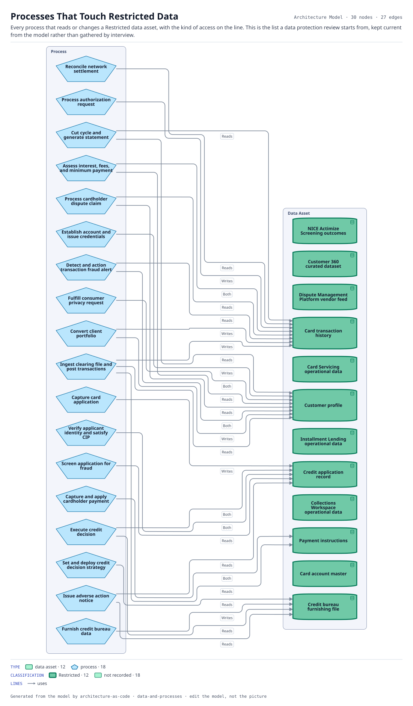

# Processes That Touch Restricted Data

Every process that reads or changes a Restricted data asset, with the kind of access on the line. This is the list a data protection review starts from, kept current from the model rather than gathered by interview.

```mermaid
%%{init: {'flowchart': {'curve': 'basis'}} }%%
flowchart LR
  %% Processes That Touch Restricted Data
  %% Generated from the model by `terrane render`. Do not edit by hand.

  subgraph grp_Data_Asset["Data Asset"]
    direction LR
    DA_CARD_ACCOUNT[("Card account master")]
    DA_CARDSVC_OPERATIONAL[("Card Servicing operational<br/>data")]
    DA_TRANSACTION[("Card transaction history")]
    DA_COLLECT_OPERATIONAL[("Collections Workspace<br/>operational data")]
    DA_APPLICATION[("Credit application record")]
    DA_BUREAU_FILE[("Credit bureau furnishing<br/>file")]
    DA_CUST360_CURATED[("Customer 360 curated<br/>dataset")]
    DA_CUSTOMER_PROFILE[("Customer profile")]
    DA_DISPUTES_VENDOR_FEED[("Dispute Management<br/>Platform vendor feed")]
    DA_LENDING_OPERATIONAL[("Installment Lending<br/>operational data")]
    DA_SCREENING_OUTCOMES[("NICE Actimize Screening<br/>outcomes")]
    DA_PAYMENT_INSTR[("Payment instructions")]
  end

  subgraph grp_Process["Process"]
    direction LR
    P_SERVICING_001[\"Assess interest, fees, and<br/>minimum payment"/]
    P_CARD_PMT_001[\"Capture and apply<br/>cardholder payment"/]
    P_ORIG_001[\"Capture card application"/]
    P_TPS_002[\"Convert client portfolio"/]
    P_STMT_GEN_001[\"Cut cycle and generate<br/>statement"/]
    P_FRAUD_001[\"Detect and action<br/>transaction fraud alert"/]
    P_ORIG_006[\"Establish account and<br/>issue credentials"/]
    P_ORIG_004[\"Execute credit decision"/]
    P_PRIVACY_001[\"Fulfill consumer privacy<br/>request"/]
    P_COLLECTIONS_005[\"Furnish credit bureau data"/]
    P_PAYMENTS_002[\"Ingest clearing file and<br/>post transactions"/]
    P_ORIG_005[\"Issue adverse action<br/>notice"/]
    P_PAYMENTS_001[\"Process authorization<br/>request"/]
    P_DISPUTE_001[\"Process cardholder dispute<br/>claim"/]
    P_NETWORK_RECON_001[\"Reconcile network<br/>settlement"/]
    P_ORIG_003[\"Screen application for<br/>fraud"/]
    P_CREDIT_001[\"Set and deploy credit<br/>decision strategy"/]
    P_ORIG_002[\"Verify applicant identity<br/>and satisfy CIP"/]
  end

  P_CARD_PMT_001 -->|"Both"| DA_PAYMENT_INSTR
  P_COLLECTIONS_005 -->|"Writes"| DA_BUREAU_FILE
  P_CREDIT_001 -->|"Reads"| DA_BUREAU_FILE
  P_DISPUTE_001 -->|"Reads"| DA_CUSTOMER_PROFILE
  P_DISPUTE_001 -->|"Reads"| DA_TRANSACTION
  P_ORIG_006 -->|"Writes"| DA_CUSTOMER_PROFILE
  P_PAYMENTS_001 -->|"Writes"| DA_TRANSACTION
  P_PRIVACY_001 -->|"Both"| DA_CUSTOMER_PROFILE
  P_ORIG_001 -->|"Writes"| DA_APPLICATION
  P_ORIG_002 -->|"Both"| DA_APPLICATION
  P_ORIG_003 -->|"Reads"| DA_APPLICATION
  P_ORIG_004 -->|"Both"| DA_APPLICATION
  P_ORIG_004 -->|"Reads"| DA_BUREAU_FILE
  P_ORIG_005 -->|"Reads"| DA_APPLICATION
  P_ORIG_005 -->|"Reads"| DA_BUREAU_FILE
  P_PAYMENTS_002 -->|"Writes"| DA_TRANSACTION
  P_PAYMENTS_002 -->|"Reads"| DA_CUSTOMER_PROFILE
  P_PAYMENTS_002 -->|"Reads"| DA_PAYMENT_INSTR
  P_NETWORK_RECON_001 -->|"Reads"| DA_TRANSACTION
  P_SERVICING_001 -->|"Reads"| DA_CUSTOMER_PROFILE
  P_SERVICING_001 -->|"Both"| DA_TRANSACTION
  P_STMT_GEN_001 -->|"Reads"| DA_CUSTOMER_PROFILE
  P_STMT_GEN_001 -->|"Reads"| DA_TRANSACTION
  P_FRAUD_001 -->|"Reads"| DA_TRANSACTION
  P_FRAUD_001 -->|"Both"| DA_CUSTOMER_PROFILE
  P_TPS_002 -->|"Writes"| DA_CUSTOMER_PROFILE
  P_TPS_002 -->|"Writes"| DA_TRANSACTION

  classDef s_data_assets__restricted fill:#70c9a7,stroke:#047857,color:#0f172a,stroke-width:2.6px;
  classDef s_processes__default fill:#bae6fd,stroke:#0369a1,color:#0f172a,stroke-width:1.1px;
  class DA_APPLICATION,DA_BUREAU_FILE,DA_CARD_ACCOUNT,DA_CARDSVC_OPERATIONAL,DA_COLLECT_OPERATIONAL,DA_CUST360_CURATED,DA_CUSTOMER_PROFILE,DA_DISPUTES_VENDOR_FEED,DA_LENDING_OPERATIONAL,DA_PAYMENT_INSTR,DA_SCREENING_OUTCOMES,DA_TRANSACTION s_data_assets__restricted;
  class P_CARD_PMT_001,P_COLLECTIONS_005,P_CREDIT_001,P_DISPUTE_001,P_FRAUD_001,P_NETWORK_RECON_001,P_ORIG_001,P_ORIG_002,P_ORIG_003,P_ORIG_004,P_ORIG_005,P_ORIG_006,P_PAYMENTS_001,P_PAYMENTS_002,P_PRIVACY_001,P_SERVICING_001,P_STMT_GEN_001,P_TPS_002 s_processes__default;
  classDef boundary1 fill:#f3f5fb,stroke:#8f9bb5,color:#3b4a6b;
  class grp_Data_Asset,grp_Process boundary1;
```

The same view as the app draws it, written beside the Mermaid by `terrane render`:

**Hue is the entity type.**

| | Entity type |
|---|---|
| `#047857` | data assets |
| `#0369a1` | processes |

**classification** is drawn as border weight and tint, strongest first.

| Border | Value |
|---|---|
| 2.6px | Restricted |
| 1.1px | default |

30 entities, 27 relationships. Generated from the model; edit the model, not this file.
