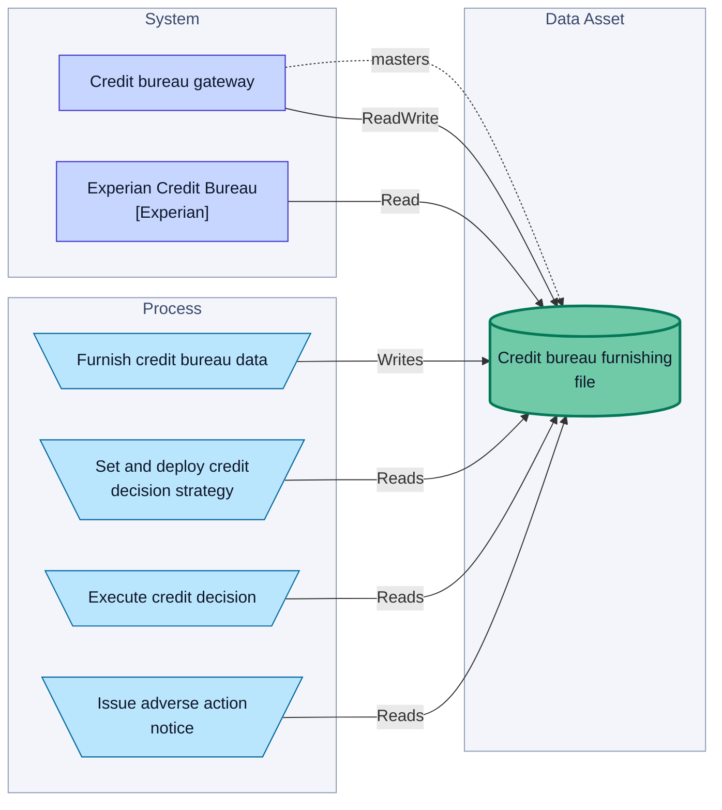
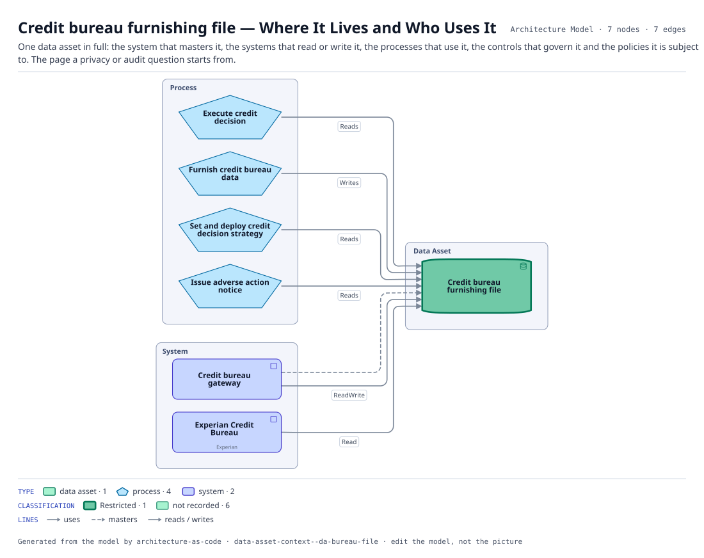

# Credit bureau furnishing file — Where It Lives and Who Uses It

One data asset in full: the system that masters it, the systems that read or write it, the processes that use it, the controls that govern it and the policies it is subject to. The page a privacy or audit question starts from.

The same view as the app draws it, written beside the Mermaid by `terrane render`:

**Hue is the entity type.**

| | Entity type |
|---|---|
| `#047857` | data assets |
| `#0369a1` | processes |
| `#4338ca` | systems |

**classification** is drawn as border weight and tint, strongest first.

| Border | Value |
|---|---|
| 2.6px | Restricted |
| 1.1px | default |

7 entities, 7 relationships. Generated from the model; edit the model, not this file.
