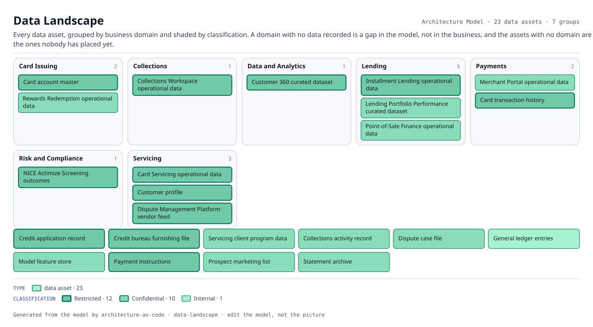

# Data Landscape

Every data asset, grouped by business domain and shaded by classification. A domain with no data recorded is a gap in the model, not in the business, and the assets with no domain are the ones nobody has placed yet.

```mermaid
%%{init: {'flowchart': {'curve': 'basis'}} }%%
flowchart TB
  %% Data Landscape
  %% Generated from the model by `terrane render`. Do not edit by hand.

  subgraph grp_Card_Issuing["Card Issuing"]
    direction LR
    DA_CARD_ACCOUNT[("Card account master")]
    DA_REWARDS_OPERATIONAL[("Rewards Redemption<br/>operational data")]
  end

  subgraph grp_Collections["Collections"]
    direction LR
    DA_COLLECT_OPERATIONAL[("Collections Workspace<br/>operational data")]
  end

  subgraph grp_Data_and_Analytics["Data and Analytics"]
    direction LR
    DA_CUST360_CURATED[("Customer 360 curated<br/>dataset")]
  end

  subgraph grp_Lending["Lending"]
    direction LR
    DA_LENDING_OPERATIONAL[("Installment Lending<br/>operational data")]
    DA_LENDPERF_CURATED[("Lending Portfolio<br/>Performance curated<br/>dataset")]
    DA_POSFIN_OPERATIONAL[("Point-of-Sale Finance<br/>operational data")]
  end

  subgraph grp_Payments["Payments"]
    direction LR
    DA_TRANSACTION[("Card transaction history")]
    DA_MERCHANT_OPERATIONAL[("Merchant Portal<br/>operational data")]
  end

  subgraph grp_Risk_and_Compliance["Risk and Compliance"]
    direction LR
    DA_SCREENING_OUTCOMES[("NICE Actimize Screening<br/>outcomes")]
  end

  subgraph grp_Servicing["Servicing"]
    direction LR
    DA_CARDSVC_OPERATIONAL[("Card Servicing operational<br/>data")]
    DA_CUSTOMER_PROFILE[("Customer profile")]
    DA_DISPUTES_VENDOR_FEED[("Dispute Management<br/>Platform vendor feed")]
  end

  DA_COLLECT_ACT[("Collections activity<br/>record")]
  DA_APPLICATION[("Credit application record")]
  DA_BUREAU_FILE[("Credit bureau furnishing<br/>file")]
  DA_DISPUTE_CASE[("Dispute case file")]
  DA_GL[("General ledger entries")]
  DA_MODEL_FEAT[("Model feature store")]
  DA_PAYMENT_INSTR[("Payment instructions")]
  DA_PROSPECT[("Prospect marketing list")]
  DA_CLIENT_SERV[("Servicing client program<br/>data")]
  DA_STATEMENTS[("Statement archive")]


  classDef s_data_assets__confidential fill:#8addba,stroke:#047857,color:#0f172a,stroke-width:1.9px;
  classDef s_data_assets__internal fill:#a7f3d0,stroke:#047857,color:#0f172a,stroke-width:1.1px;
  classDef s_data_assets__restricted fill:#70c9a7,stroke:#047857,color:#0f172a,stroke-width:2.6px;
  class DA_CLIENT_SERV,DA_COLLECT_ACT,DA_DISPUTE_CASE,DA_LENDPERF_CURATED,DA_MERCHANT_OPERATIONAL,DA_MODEL_FEAT,DA_POSFIN_OPERATIONAL,DA_PROSPECT,DA_REWARDS_OPERATIONAL,DA_STATEMENTS s_data_assets__confidential;
  class DA_GL s_data_assets__internal;
  class DA_APPLICATION,DA_BUREAU_FILE,DA_CARD_ACCOUNT,DA_CARDSVC_OPERATIONAL,DA_COLLECT_OPERATIONAL,DA_CUST360_CURATED,DA_CUSTOMER_PROFILE,DA_DISPUTES_VENDOR_FEED,DA_LENDING_OPERATIONAL,DA_PAYMENT_INSTR,DA_SCREENING_OUTCOMES,DA_TRANSACTION s_data_assets__restricted;
  classDef boundary1 fill:#f3f5fb,stroke:#8f9bb5,color:#3b4a6b;
  class grp_Card_Issuing,grp_Collections,grp_Data_and_Analytics,grp_Lending,grp_Payments,grp_Risk_and_Compliance,grp_Servicing boundary1;
```

The same view as the app draws it, written beside the Mermaid by `terrane render`:

**classification** is drawn as border weight and tint, strongest first.

| Border | Value |
|---|---|
| 2.6px | Restricted |
| 1.9px | Confidential |
| 1.1px | Internal |

23 entities, 0 relationships. Generated from the model; edit the model, not this file.

> No edges connected the selected entities.
