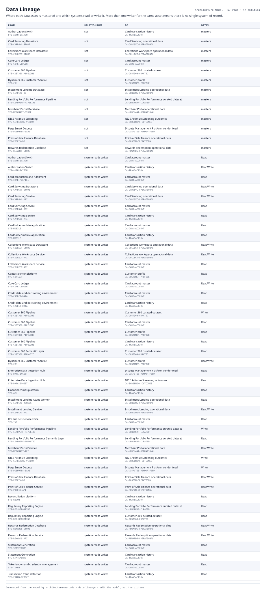

# Data Lineage

Where each data asset is mastered and which systems read or write it. More than one writer for the same asset means there is no single system of record.

| From | | To | Detail |
|---|---|---|---|
| Authorization Switch  `SYS-AUTH-SWITCH` | sot | Card transaction history  `DA-TRANSACTION` | masters |
| Card Servicing Datastore  `SYS-CARDSVC-STORE` | sot | Card Servicing operational data  `DA-CARDSVC-OPERATIONAL` | masters |
| Collections Workspace Datastore  `SYS-COLLECT-STORE` | sot | Collections Workspace operational data  `DA-COLLECT-OPERATIONAL` | masters |
| Core Card Ledger  `SYS-CORE-LEDGER` | sot | Card account master  `DA-CARD-ACCOUNT` | masters |
| Customer 360 Pipeline  `SYS-CUST360-PIPELINE` | sot | Customer 360 curated dataset  `DA-CUST360-CURATED` | masters |
| Dynamics 365 Customer Service  `SYS-CRM` | sot | Customer profile  `DA-CUSTOMER-PROFILE` | masters |
| Installment Lending Database  `SYS-LENDING-DB` | sot | Installment Lending operational data  `DA-LENDING-OPERATIONAL` | masters |
| Lending Portfolio Performance Pipeline  `SYS-LENDPERF-PIPELINE` | sot | Lending Portfolio Performance curated dataset  `DA-LENDPERF-CURATED` | masters |
| Merchant Portal Database  `SYS-MERCHANT-STORE` | sot | Merchant Portal operational data  `DA-MERCHANT-OPERATIONAL` | masters |
| NICE Actimize Screening  `SYS-SCREENING-VENDOR` | sot | NICE Actimize Screening outcomes  `DA-SCREENING-OUTCOMES` | masters |
| Pega Smart Dispute  `SYS-DISPUTES-SAAS` | sot | Dispute Management Platform vendor feed  `DA-DISPUTES-VENDOR-FEED` | masters |
| Point-of-Sale Finance Database  `SYS-POSFIN-DB` | sot | Point-of-Sale Finance operational data  `DA-POSFIN-OPERATIONAL` | masters |
| Rewards Redemption Database  `SYS-REWARDS-STORE` | sot | Rewards Redemption operational data  `DA-REWARDS-OPERATIONAL` | masters |
| Authorization Switch  `SYS-AUTH-SWITCH` | system reads writes | Card account master  `DA-CARD-ACCOUNT` | Read |
| Authorization Switch  `SYS-AUTH-SWITCH` | system reads writes | Card transaction history  `DA-TRANSACTION` | ReadWrite |
| Card production and fulfillment  `SYS-CARD-FULFILL` | system reads writes | Card account master  `DA-CARD-ACCOUNT` | Read |
| Card Servicing Datastore  `SYS-CARDSVC-STORE` | system reads writes | Card Servicing operational data  `DA-CARDSVC-OPERATIONAL` | ReadWrite |
| Card Servicing Service  `SYS-CARDSVC-API` | system reads writes | Card Servicing operational data  `DA-CARDSVC-OPERATIONAL` | ReadWrite |
| Card Servicing Service  `SYS-CARDSVC-API` | system reads writes | Card account master  `DA-CARD-ACCOUNT` | Read |
| Card Servicing Service  `SYS-CARDSVC-API` | system reads writes | Card transaction history  `DA-TRANSACTION` | Read |
| Cardholder mobile application  `SYS-MOBILE` | system reads writes | Card account master  `DA-CARD-ACCOUNT` | Read |
| Cardholder mobile application  `SYS-MOBILE` | system reads writes | Card transaction history  `DA-TRANSACTION` | Read |
| Collections Workspace Datastore  `SYS-COLLECT-STORE` | system reads writes | Collections Workspace operational data  `DA-COLLECT-OPERATIONAL` | ReadWrite |
| Collections Workspace Service  `SYS-COLLECT-API` | system reads writes | Collections Workspace operational data  `DA-COLLECT-OPERATIONAL` | ReadWrite |
| Collections Workspace Service  `SYS-COLLECT-API` | system reads writes | Card account master  `DA-CARD-ACCOUNT` | Read |
| Contact center platform  `SYS-CONTACT` | system reads writes | Customer profile  `DA-CUSTOMER-PROFILE` | Read |
| Core Card Ledger  `SYS-CORE-LEDGER` | system reads writes | Card account master  `DA-CARD-ACCOUNT` | ReadWrite |
| Credit data and decisioning environment  `SYS-CREDIT-DATA` | system reads writes | Card account master  `DA-CARD-ACCOUNT` | Read |
| Credit data and decisioning environment  `SYS-CREDIT-DATA` | system reads writes | Card transaction history  `DA-TRANSACTION` | Read |
| Customer 360 Pipeline  `SYS-CUST360-PIPELINE` | system reads writes | Customer 360 curated dataset  `DA-CUST360-CURATED` | Write |
| Customer 360 Pipeline  `SYS-CUST360-PIPELINE` | system reads writes | Card account master  `DA-CARD-ACCOUNT` | Read |
| Customer 360 Pipeline  `SYS-CUST360-PIPELINE` | system reads writes | Customer profile  `DA-CUSTOMER-PROFILE` | Read |
| Customer 360 Pipeline  `SYS-CUST360-PIPELINE` | system reads writes | Card transaction history  `DA-TRANSACTION` | Read |
| Customer 360 Semantic Layer  `SYS-CUST360-SEMANTIC` | system reads writes | Customer 360 curated dataset  `DA-CUST360-CURATED` | Read |
| Dynamics 365 Customer Service  `SYS-CRM` | system reads writes | Customer profile  `DA-CUSTOMER-PROFILE` | ReadWrite |
| Enterprise Data Ingestion Hub  `SYS-DATA-INGEST` | system reads writes | Dispute Management Platform vendor feed  `DA-DISPUTES-VENDOR-FEED` | Read |
| Enterprise Data Ingestion Hub  `SYS-DATA-INGEST` | system reads writes | NICE Actimize Screening outcomes  `DA-SCREENING-OUTCOMES` | Read |
| Financial crimes platform  `SYS-AML` | system reads writes | Card transaction history  `DA-TRANSACTION` | Read |
| Installment Lending Async Worker  `SYS-LENDING-WORKER` | system reads writes | Installment Lending operational data  `DA-LENDING-OPERATIONAL` | Read |
| Installment Lending Service  `SYS-LENDING-API` | system reads writes | Installment Lending operational data  `DA-LENDING-OPERATIONAL` | ReadWrite |
| IVR and self-service voice  `SYS-IVR` | system reads writes | Card account master  `DA-CARD-ACCOUNT` | Read |
| Lending Portfolio Performance Pipeline  `SYS-LENDPERF-PIPELINE` | system reads writes | Lending Portfolio Performance curated dataset  `DA-LENDPERF-CURATED` | Write |
| Lending Portfolio Performance Semantic Layer  `SYS-LENDPERF-SEMANTIC` | system reads writes | Lending Portfolio Performance curated dataset  `DA-LENDPERF-CURATED` | Read |
| Merchant Portal Service  `SYS-MERCHANT-API` | system reads writes | Merchant Portal operational data  `DA-MERCHANT-OPERATIONAL` | ReadWrite |
| NICE Actimize Screening  `SYS-SCREENING-VENDOR` | system reads writes | NICE Actimize Screening outcomes  `DA-SCREENING-OUTCOMES` | Write |
| Pega Smart Dispute  `SYS-DISPUTES-SAAS` | system reads writes | Dispute Management Platform vendor feed  `DA-DISPUTES-VENDOR-FEED` | Write |
| Point-of-Sale Finance Database  `SYS-POSFIN-DB` | system reads writes | Point-of-Sale Finance operational data  `DA-POSFIN-OPERATIONAL` | ReadWrite |
| Point-of-Sale Finance Service  `SYS-POSFIN-API` | system reads writes | Point-of-Sale Finance operational data  `DA-POSFIN-OPERATIONAL` | ReadWrite |
| Reconciliation platform  `SYS-RECON` | system reads writes | Card transaction history  `DA-TRANSACTION` | Read |
| Regulatory Reporting Engine  `SYS-REG-REPORTING` | system reads writes | Lending Portfolio Performance curated dataset  `DA-LENDPERF-CURATED` | Read |
| Regulatory Reporting Engine  `SYS-REG-REPORTING` | system reads writes | Customer 360 curated dataset  `DA-CUST360-CURATED` | Read |
| Rewards Redemption Database  `SYS-REWARDS-STORE` | system reads writes | Rewards Redemption operational data  `DA-REWARDS-OPERATIONAL` | ReadWrite |
| Rewards Redemption Service  `SYS-REWARDS-API` | system reads writes | Rewards Redemption operational data  `DA-REWARDS-OPERATIONAL` | ReadWrite |
| Statement Generation  `SYS-STATEMENTS` | system reads writes | Card account master  `DA-CARD-ACCOUNT` | Read |
| Statement Generation  `SYS-STATEMENTS` | system reads writes | Card transaction history  `DA-TRANSACTION` | Read |
| Tokenization and credential management  `SYS-TOKEN` | system reads writes | Card account master  `DA-CARD-ACCOUNT` | Read |
| Transaction fraud detection  `SYS-FRAUD-DETECT` | system reads writes | Card transaction history  `DA-TRANSACTION` | Read |

57 relationships across 47 entities. Generated from the model; this is a report rather than a diagram, so it is a table.
