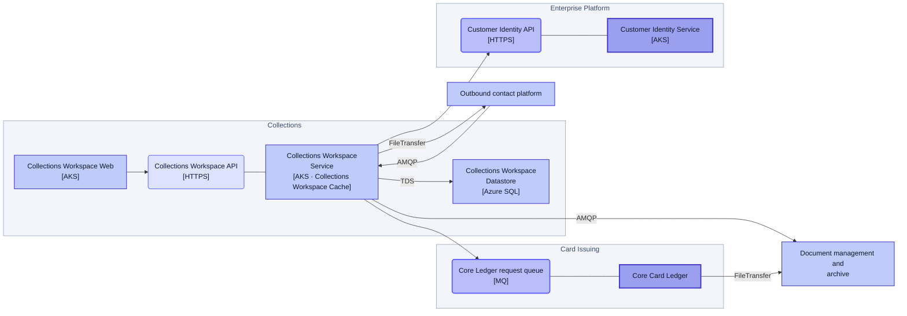
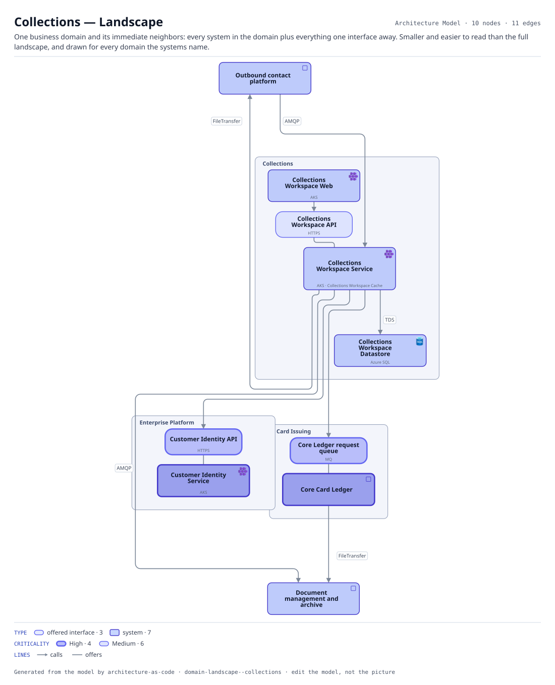

# Collections — Landscape

One business domain and its immediate neighbors: every system in the domain plus everything one interface away. Smaller and easier to read than the full landscape, and drawn for every domain the systems name.

The same view as the app draws it, written beside the Mermaid by `terrane render`:

**Hue is the entity type.**

| | Entity type |
|---|---|
| `#6366f1` | offered interfaces |
| `#4338ca` | systems |

**criticality** is drawn as border weight and tint, strongest first.

| Border | Value |
|---|---|
| 2.6px | High |
| 1.4px | Medium |

10 entities, 11 relationships. Generated from the model; edit the model, not this file.
