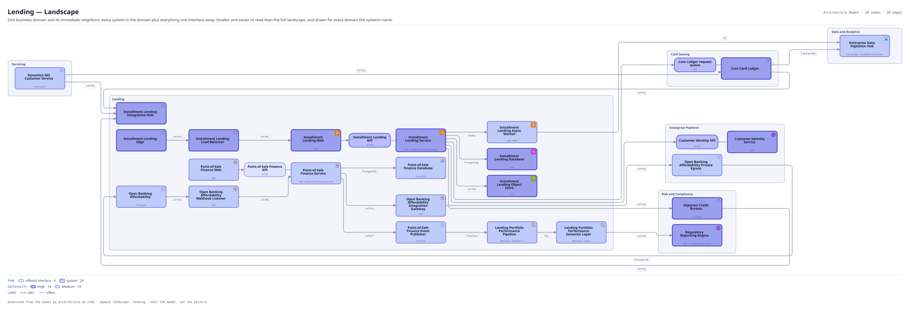

# Lending — Landscape

One business domain and its immediate neighbors: every system in the domain plus everything one interface away. Smaller and easier to read than the full landscape, and drawn for every domain the systems name.

```mermaid
%%{init: {'flowchart': {'curve': 'basis'}} }%%
flowchart LR
  %% Lending — Landscape
  %% Generated from the model by `terrane render`. Do not edit by hand.

  subgraph grp_Card_Issuing["Card Issuing"]
    direction LR
    SYS_CORE_LEDGER["Core Card Ledger"]
    OI_LEDGER_QUEUE("Core Ledger request queue<br/>[MQ]")
  end

  subgraph grp_Data_and_Analytics["Data and Analytics"]
    direction LR
    SYS_DATA_INGEST["Enterprise Data Ingestion<br/>Hub<br/>[Service Bus · Snowflake Data Cloud]"]
  end

  subgraph grp_Enterprise_Platform["Enterprise Platform"]
    direction LR
    OI_IDENTITY_API("Customer Identity API<br/>[HTTPS]")
    SYS_IDENTITY_SVC["Customer Identity Service<br/>[AKS]"]
    SYS_OBAFF_EGRESS["Open Banking Affordability<br/>Private Egress"]
  end

  subgraph grp_Lending["Lending"]
    direction LR
    OI_LENDING_API("Installment Lending API<br/>[HTTPS]")
    SYS_LENDING_WORKER["Installment Lending Async<br/>Worker<br/>[EKS · MSK]"]
    SYS_LENDING_DB["Installment Lending<br/>Database<br/>[RDS]"]
    SYS_LENDING_EDGE["Installment Lending Edge"]
    SYS_LENDING_HUB["Installment Lending<br/>Integration Hub"]
    SYS_LENDING_ALB["Installment Lending Load<br/>Balancer"]
    SYS_LENDING_BUCKET["Installment Lending Object<br/>Store<br/>[S3]"]
    SYS_LENDING_API["Installment Lending<br/>Service<br/>[EKS · Installment Lending Cache]"]
    SYS_LENDING_WEB["Installment Lending Web<br/>[EKS]"]
    SYS_LENDPERF_PIPELINE["Lending Portfolio<br/>Performance Pipeline<br/>[BigQuery · Dataflow +3]"]
    SYS_LENDPERF_SEMANTIC["Lending Portfolio<br/>Performance Semantic Layer<br/>[BigQuery · Looker]"]
    SYS_OBAFF_VENDOR["Open Banking Affordability<br/>[TrueLayer]"]
    SYS_OBAFF_GATEWAY["Open Banking Affordability<br/>Integration Gateway<br/>[GKE]"]
    SYS_OBAFF_WEBHOOKS["Open Banking Affordability<br/>Webhook Listener<br/>[GKE]"]
    OI_POSFIN_API("Point-of-Sale Finance API<br/>[HTTPS]")
    SYS_POSFIN_DB["Point-of-Sale Finance<br/>Database<br/>[Cloud SQL]"]
    SYS_POSFIN_EVENTS["Point-of-Sale Finance<br/>Event Publisher<br/>[Pub/Sub]"]
    SYS_POSFIN_API["Point-of-Sale Finance<br/>Service<br/>[GKE · Point-of-Sale Finance Cache]"]
    SYS_POSFIN_WEB["Point-of-Sale Finance Web<br/>[GKE]"]
  end

  subgraph grp_Risk_and_Compliance["Risk and Compliance"]
    direction LR
    SYS_CREDIT_BUREAU["Experian Credit Bureau<br/>[Experian]"]
    SYS_REG_REPORTING["Regulatory Reporting<br/>Engine<br/>[AKS · Snowflake Data Cloud]"]
  end

  subgraph grp_Servicing["Servicing"]
    direction LR
    SYS_CRM["Dynamics 365 Customer<br/>Service<br/>[Microsoft]"]
  end

  SYS_CRM -->|"HTTPS"| SYS_CORE_LEDGER
  SYS_CORE_LEDGER -->|"FileTransfer"| SYS_DATA_INGEST
  SYS_LENDING_API --> OI_LEDGER_QUEUE
  SYS_LENDING_API --> OI_IDENTITY_API
  SYS_LENDING_WORKER -->|"S3"| SYS_DATA_INGEST
  SYS_LENDING_API -->|"HTTPS"| SYS_CREDIT_BUREAU
  SYS_LENDING_WEB --> OI_LENDING_API
  SYS_LENDING_EDGE -->|"HTTPS"| SYS_LENDING_ALB
  SYS_LENDING_ALB -->|"HTTPS"| SYS_LENDING_WEB
  SYS_LENDING_API -->|"Kafka"| SYS_LENDING_WORKER
  SYS_LENDING_API -->|"PostgreSQL"| SYS_LENDING_DB
  SYS_LENDING_API -->|"HTTPS"| SYS_LENDING_BUCKET
  SYS_CORE_LEDGER -->|"HTTPS"| SYS_LENDING_HUB
  SYS_CREDIT_BUREAU -->|"HTTPS"| SYS_LENDING_HUB
  SYS_CRM -->|"HTTPS"| SYS_LENDING_HUB
  SYS_POSFIN_EVENTS -->|"Pub/Sub"| SYS_LENDPERF_PIPELINE
  SYS_LENDPERF_PIPELINE -->|"SQL"| SYS_LENDPERF_SEMANTIC
  SYS_LENDPERF_SEMANTIC -->|"HTTPS"| SYS_REG_REPORTING
  SYS_POSFIN_API -->|"HTTPS"| SYS_OBAFF_GATEWAY
  SYS_OBAFF_GATEWAY -->|"HTTPS"| SYS_OBAFF_EGRESS
  SYS_OBAFF_EGRESS -->|"PrivateLink"| SYS_OBAFF_VENDOR
  SYS_OBAFF_VENDOR -->|"HTTPS"| SYS_OBAFF_WEBHOOKS
  SYS_OBAFF_WEBHOOKS -->|"HTTPS"| SYS_POSFIN_API
  SYS_POSFIN_WEB --> OI_POSFIN_API
  SYS_POSFIN_API -->|"PostgreSQL"| SYS_POSFIN_DB
  SYS_POSFIN_API -->|"AMQP"| SYS_POSFIN_EVENTS
  OI_IDENTITY_API --- SYS_IDENTITY_SVC
  OI_LEDGER_QUEUE --- SYS_CORE_LEDGER
  OI_LENDING_API --- SYS_LENDING_API
  OI_POSFIN_API --- SYS_POSFIN_API

  classDef s_offered_interfaces__high fill:#b9befa,stroke:#6366f1,color:#0f172a,stroke-width:2.6px;
  classDef s_offered_interfaces__medium fill:#dde3fe,stroke:#6366f1,color:#0f172a,stroke-width:1.4px;
  classDef s_systems__high fill:#9aa0ed,stroke:#4338ca,color:#0f172a,stroke-width:2.6px;
  classDef s_systems__medium fill:#becbfb,stroke:#4338ca,color:#0f172a,stroke-width:1.4px;
  class OI_IDENTITY_API,OI_LEDGER_QUEUE,OI_LENDING_API s_offered_interfaces__high;
  class OI_POSFIN_API s_offered_interfaces__medium;
  class SYS_CORE_LEDGER,SYS_CREDIT_BUREAU,SYS_IDENTITY_SVC,SYS_LENDING_ALB,SYS_LENDING_API,SYS_LENDING_BUCKET,SYS_LENDING_DB,SYS_LENDING_EDGE,SYS_LENDING_HUB,SYS_LENDING_WEB,SYS_REG_REPORTING s_systems__high;
  class SYS_CRM,SYS_DATA_INGEST,SYS_LENDING_WORKER,SYS_LENDPERF_PIPELINE,SYS_LENDPERF_SEMANTIC,SYS_OBAFF_EGRESS,SYS_OBAFF_GATEWAY,SYS_OBAFF_VENDOR,SYS_OBAFF_WEBHOOKS,SYS_POSFIN_API,SYS_POSFIN_DB,SYS_POSFIN_EVENTS,SYS_POSFIN_WEB s_systems__medium;
  classDef boundary1 fill:#f3f5fb,stroke:#8f9bb5,color:#3b4a6b;
  class grp_Card_Issuing,grp_Data_and_Analytics,grp_Enterprise_Platform,grp_Lending,grp_Risk_and_Compliance,grp_Servicing boundary1;
```

The same view as the app draws it, written beside the Mermaid by `terrane render`:

**Hue is the entity type.**

| | Entity type |
|---|---|
| `#6366f1` | offered interfaces |
| `#4338ca` | systems |

**criticality** is drawn as border weight and tint, strongest first.

| Border | Value |
|---|---|
| 2.6px | High |
| 1.4px | Medium |

## Flows across this diagram

Each flow is a recorded sequence of interfaces. The steps drawn on this diagram are numbered; a step whose interface is not on it is marked.

**Installment Loan Application**: An applicant applies for point-of-sale credit. Bureau search, affordability and a decision, with referral to an underwriter when the automated decision declines to take it.

1. Installment Lending Edge → Installment Lending Load Balancer (HTTPS)
2. Installment Lending Load Balancer → Installment Lending Web (HTTPS)
3. Installment Lending Web → Installment Lending Service (HTTPS)
4. Installment Lending Service → Customer Identity Service (HTTPS)
5. Installment Lending Service → Experian Credit Bureau (HTTPS)
6. Installment Lending Service → Installment Lending Database (PostgreSQL)
7. Installment Lending Service → Core Card Ledger (MQ)
8. Installment Lending Service → Installment Lending Async Worker (Kafka)

**Dispute and Chargeback**: A cardholder disputes a transaction. Raised in the contact center, handled in the vendor platform, settled back through the ledger.

1. Dynamics 365 Customer Service → Core Card Ledger (HTTPS)
2. Core Card Ledger → Dispute Management Platform Integration Gateway (HTTPS) — not on this diagram
3. Dispute Management Platform Integration Gateway → Pega Smart Dispute (HTTPS) — not on this diagram
4. Pega Smart Dispute → Enterprise Data Ingestion Hub (SFTP) — not on this diagram

**Regulatory Return**: The monthly supervisory return. Entirely batch, and the only flow whose deadline is external and non-negotiable.

1. Core Card Ledger → Enterprise Data Ingestion Hub (FileTransfer)
2. Enterprise Data Ingestion Hub → Customer 360 Pipeline (Snowpipe) — not on this diagram
3. Customer 360 Pipeline → Customer 360 Semantic Layer (SQL) — not on this diagram
4. Customer 360 Semantic Layer → Regulatory Reporting Engine (SQL) — not on this diagram

28 entities, 30 relationships. Generated from the model; edit the model, not this file.
