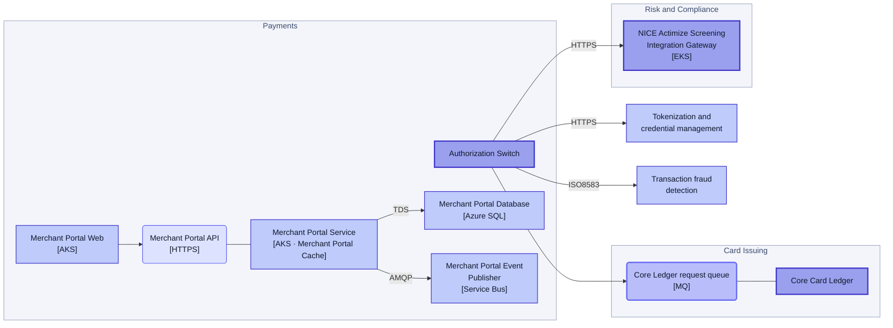
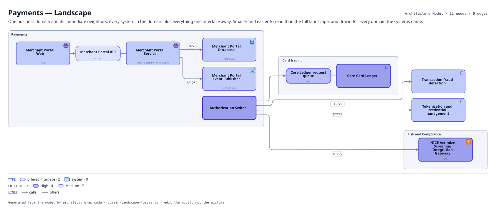

# Payments — Landscape

One business domain and its immediate neighbors: every system in the domain plus everything one interface away. Smaller and easier to read than the full landscape, and drawn for every domain the systems name.

The same view as the app draws it, written beside the Mermaid by `terrane render`:

**Hue is the entity type.**

| | Entity type |
|---|---|
| `#6366f1` | offered interfaces |
| `#4338ca` | systems |

**criticality** is drawn as border weight and tint, strongest first.

| Border | Value |
|---|---|
| 2.6px | High |
| 1.4px | Medium |

## Flows across this diagram

Each flow is a recorded sequence of interfaces. The steps drawn on this diagram are numbered; a step whose interface is not on it is marked.

**Card Authorization**: A card presented at a merchant, authorized or declined inside the scheme timeout. The tightest latency budget in the estate, and the reason the screening call has a circuit breaker rather than a retry.

1. Authorization Switch → NICE Actimize Screening Integration Gateway (HTTPS)
2. NICE Actimize Screening Integration Gateway → NICE Actimize Screening Private Egress (HTTPS) — not on this diagram
3. NICE Actimize Screening Private Egress → NICE Actimize Screening (PrivateLink) — not on this diagram
4. Authorization Switch → Core Card Ledger (MQ)

11 entities, 9 relationships. Generated from the model; edit the model, not this file.
