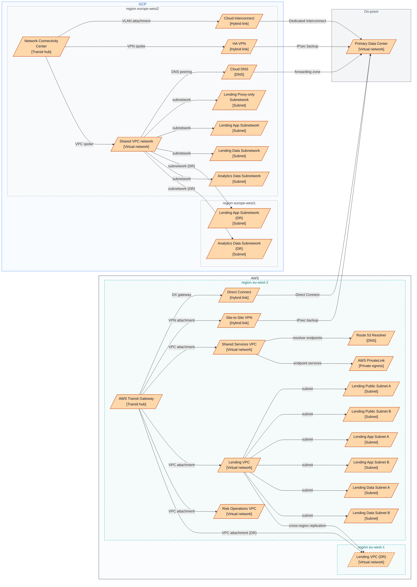
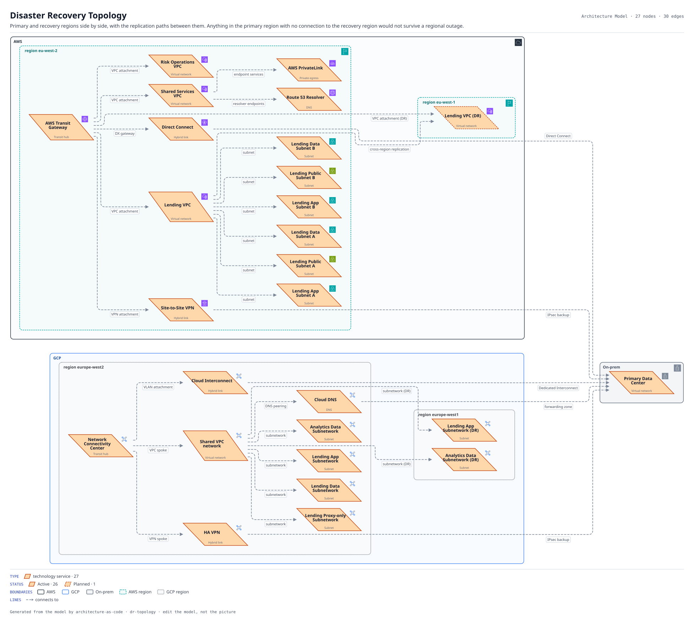

# Disaster Recovery Topology

Primary and recovery regions side by side, with the replication paths between them. Anything in the primary region with no connection to the recovery region would not survive a regional outage.

The same view as the app draws it, written beside the Mermaid by `terrane render`:

**status** is drawn as the border style: solid for Active, dashed for Planned, dotted for Proposed, and faded for Deprecated and Retired.

**Boundaries** are drawn the way their provider draws them.

| Border | Boundary |
|---|---|
| solid `#232f3e` | AWS |
| solid `#4285f4` | GCP |
| solid `#5f6b7a` | On-prem |
| dashed `#00a4a6` | AWS region |
| dotted `#5f6368` | GCP region |

27 entities, 30 relationships. Generated from the model; edit the model, not this file.
