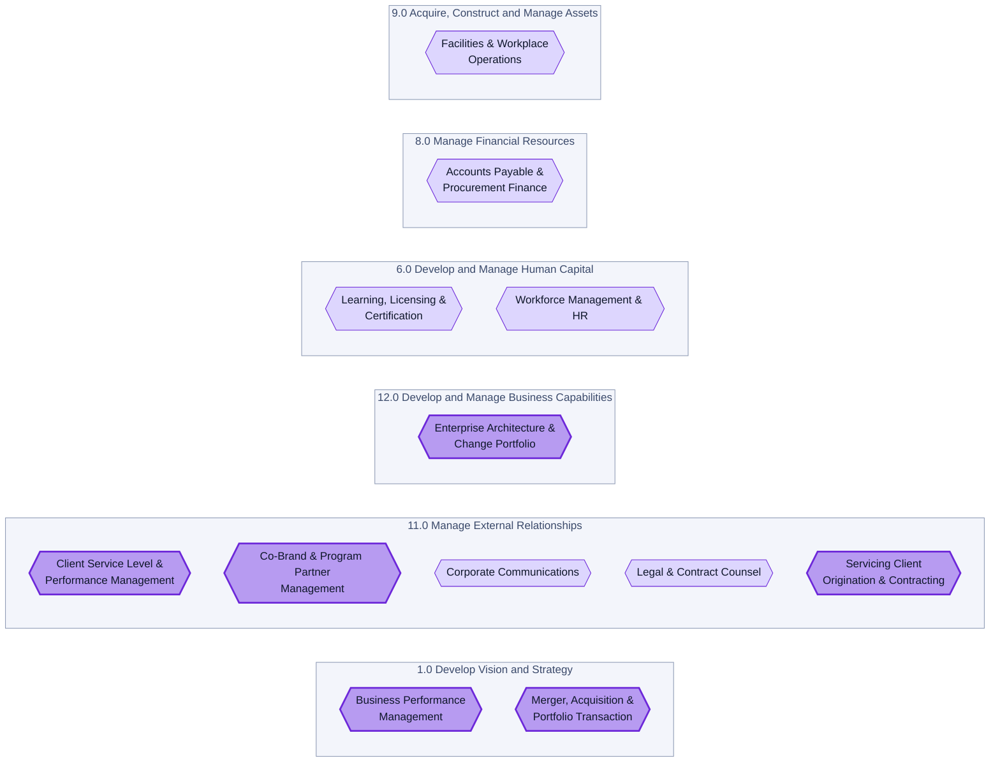
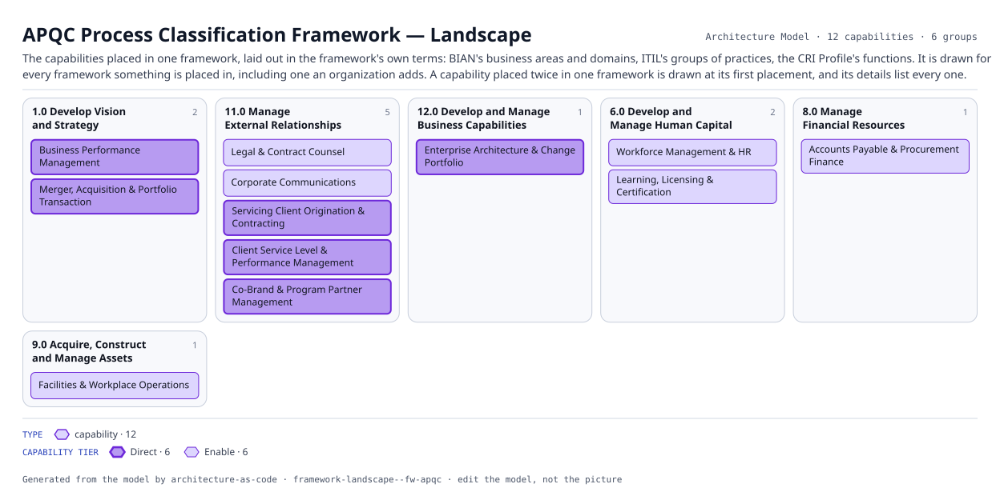

# APQC Process Classification Framework — Landscape

The capabilities placed in one framework, laid out in the framework's own terms: BIAN's business areas and domains, ITIL's groups of practices, the CRI Profile's functions. It is drawn for every framework something is placed in, including one an organization adds. A capability placed twice in one framework is drawn at its first placement, and its details list every one.

The same view as the app draws it, written beside the Mermaid by `terrane render`:

**capability tier** is drawn as border weight and tint, strongest first.

| Border | Value |
|---|---|
| 2.6px | Direct |
| 1.0px | Enable |

12 entities, 0 relationships. Generated from the model; edit the model, not this file.

> No edges connected the selected entities.
