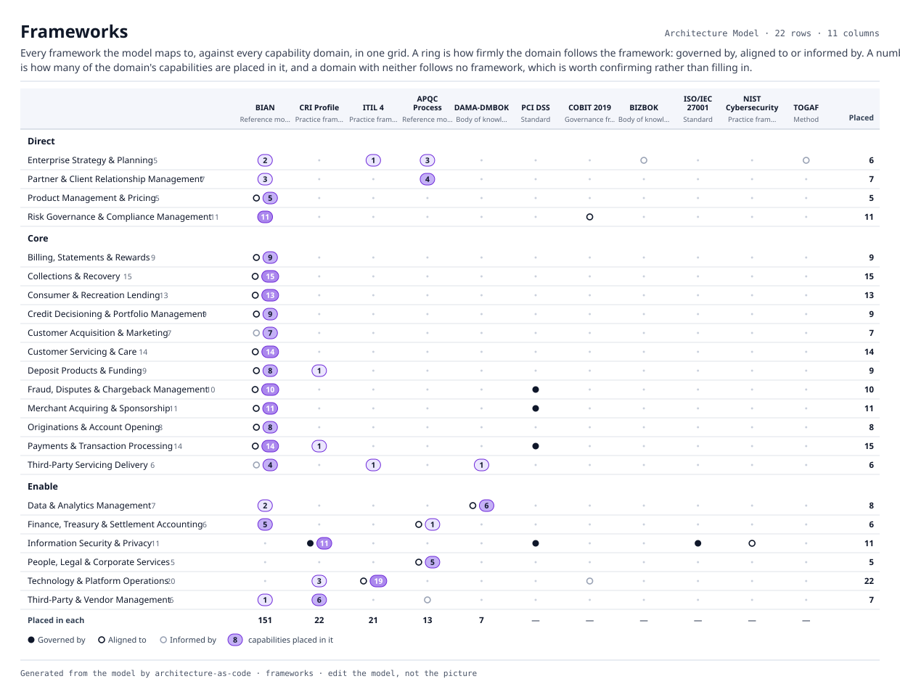

# Frameworks

Every framework the model maps to, against every capability domain, in one grid. A ring is how firmly the domain follows the framework: governed by, aligned to or informed by. A number is how many of the domain's capabilities are placed in it, and a domain with neither follows no framework, which is worth confirming rather than filling in.

| | BIAN | CRI Profile | ITIL 4 | APQC Process Classification Framework | DAMA-DMBOK | PCI DSS | COBIT 2019 | BIZBOK | ISO/IEC 27001 | NIST Cybersecurity Framework | TOGAF | Placed |
|---|---|---|---|---|---|---|---|---|---|---|---|---|
| **Direct** | | | | | | | | | | | | |
| Enterprise Strategy & Planning | 2 |  | 1 | 3 |  |  |  | Informed by |  |  | Informed by | 6 |
| Partner & Client Relationship Management | 3 |  |  | 4 |  |  |  |  |  |  |  | 7 |
| Product Management & Pricing | Aligned to · 5 |  |  |  |  |  |  |  |  |  |  | 5 |
| Risk Governance & Compliance Management | 11 |  |  |  |  |  | Aligned to |  |  |  |  | 11 |
| **Core** | | | | | | | | | | | | |
| Billing, Statements & Rewards | Aligned to · 9 |  |  |  |  |  |  |  |  |  |  | 9 |
| Collections & Recovery | Aligned to · 15 |  |  |  |  |  |  |  |  |  |  | 15 |
| Consumer & Recreation Lending | Aligned to · 13 |  |  |  |  |  |  |  |  |  |  | 13 |
| Credit Decisioning & Portfolio Management | Aligned to · 9 |  |  |  |  |  |  |  |  |  |  | 9 |
| Customer Acquisition & Marketing | Informed by · 7 |  |  |  |  |  |  |  |  |  |  | 7 |
| Customer Servicing & Care | Aligned to · 14 |  |  |  |  |  |  |  |  |  |  | 14 |
| Deposit Products & Funding | Aligned to · 8 | 1 |  |  |  |  |  |  |  |  |  | 9 |
| Fraud, Disputes & Chargeback Management | Aligned to · 10 |  |  |  |  | Governed by |  |  |  |  |  | 10 |
| Merchant Acquiring & Sponsorship | Aligned to · 11 |  |  |  |  | Governed by |  |  |  |  |  | 11 |
| Originations & Account Opening | Aligned to · 8 |  |  |  |  |  |  |  |  |  |  | 8 |
| Payments & Transaction Processing | Aligned to · 14 | 1 |  |  |  | Governed by |  |  |  |  |  | 15 |
| Third-Party Servicing Delivery | Informed by · 4 |  | 1 |  | 1 |  |  |  |  |  |  | 6 |
| **Enable** | | | | | | | | | | | | |
| Data & Analytics Management | 2 |  |  |  | Aligned to · 6 |  |  |  |  |  |  | 8 |
| Finance, Treasury & Settlement Accounting | 5 |  |  | Aligned to · 1 |  |  |  |  |  |  |  | 6 |
| Information Security & Privacy |  | Governed by · 11 |  |  |  | Governed by |  |  | Governed by | Aligned to |  | 11 |
| People, Legal & Corporate Services |  |  |  | Aligned to · 5 |  |  |  |  |  |  |  | 5 |
| Technology & Platform Operations |  | 3 | Aligned to · 19 |  |  |  | Informed by |  |  |  |  | 22 |
| Third-Party & Vendor Management | 1 | 6 |  | Informed by |  |  |  |  |  |  |  | 7 |
| Placed in each | 151 | 22 | 21 | 13 | 7 |  |  |  |  |  |  | |

A word is how firmly the domain follows the framework (capability aligns to framework). A number is how many capabilities under the domain are placed in it (capability references framework).
