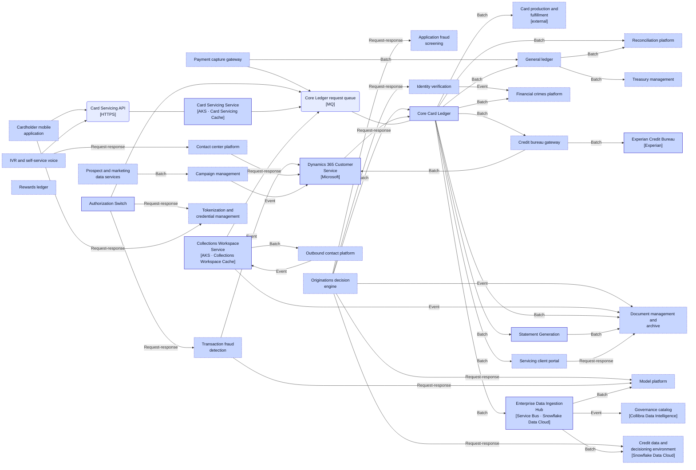
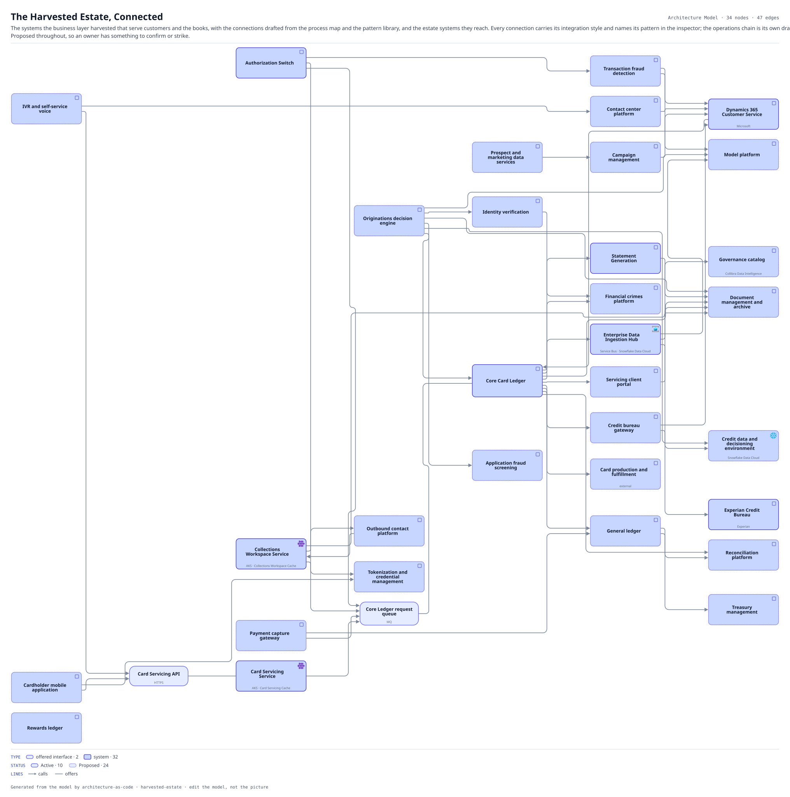

# The Harvested Estate, Connected

The systems the business layer harvested that serve customers and the books, with the connections drafted from the process map and the pattern library, and the estate systems they reach. Every connection carries its integration style and names its pattern in the inspector; the operations chain is its own drawing. Proposed throughout, so an owner has something to confirm or strike.

The same view as the app draws it, written beside the Mermaid by `terrane render`:

**Hue is the entity type.**

| | Entity type |
|---|---|
| `#6366f1` | offered interfaces |
| `#4338ca` | systems |

**status** is drawn as the border style: solid for Active, dashed for Planned, dotted for Proposed, and faded for Deprecated and Retired.

## Flows across this diagram

Each flow is a recorded sequence of interfaces. The steps drawn on this diagram are numbered; a step whose interface is not on it is marked.

**Card Authorization**: A card presented at a merchant, authorized or declined inside the scheme timeout. The tightest latency budget in the estate, and the reason the screening call has a circuit breaker rather than a retry.

1. Authorization Switch → NICE Actimize Screening Integration Gateway (HTTPS) — not on this diagram
2. NICE Actimize Screening Integration Gateway → NICE Actimize Screening Private Egress (HTTPS) — not on this diagram
3. NICE Actimize Screening Private Egress → NICE Actimize Screening (PrivateLink) — not on this diagram
4. Authorization Switch → Core Card Ledger (MQ)

**Dispute and Chargeback**: A cardholder disputes a transaction. Raised in the contact center, handled in the vendor platform, settled back through the ledger.

1. Dynamics 365 Customer Service → Core Card Ledger (HTTPS)
2. Core Card Ledger → Dispute Management Platform Integration Gateway (HTTPS) — not on this diagram
3. Dispute Management Platform Integration Gateway → Pega Smart Dispute (HTTPS) — not on this diagram
4. Pega Smart Dispute → Enterprise Data Ingestion Hub (SFTP) — not on this diagram

**Regulatory Return**: The monthly supervisory return. Entirely batch, and the only flow whose deadline is external and non-negotiable.

1. Core Card Ledger → Enterprise Data Ingestion Hub (FileTransfer)
2. Enterprise Data Ingestion Hub → Customer 360 Pipeline (Snowpipe) — not on this diagram
3. Customer 360 Pipeline → Customer 360 Semantic Layer (SQL) — not on this diagram
4. Customer 360 Semantic Layer → Regulatory Reporting Engine (SQL) — not on this diagram

34 entities, 47 relationships. Generated from the model; edit the model, not this file.
