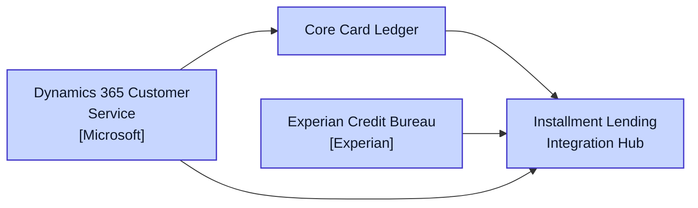
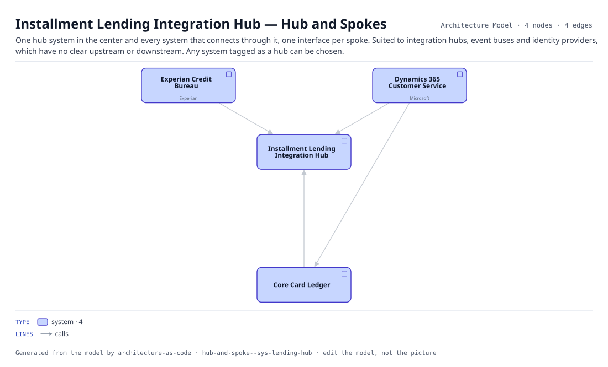

# Installment Lending Integration Hub — Hub and Spokes

One hub system in the center and every system that connects through it, one interface per spoke. Suited to integration hubs, event buses and identity providers, which have no clear upstream or downstream. Any system tagged as a hub can be chosen.

The same view as the app draws it, written beside the Mermaid by `terrane render`:

## Flows across this diagram

Each flow is a recorded sequence of interfaces. The steps drawn on this diagram are numbered; a step whose interface is not on it is marked.

**Dispute and Chargeback**: A cardholder disputes a transaction. Raised in the contact center, handled in the vendor platform, settled back through the ledger.

1. Dynamics 365 Customer Service → Core Card Ledger (HTTPS)
2. Core Card Ledger → Dispute Management Platform Integration Gateway (HTTPS) — not on this diagram
3. Dispute Management Platform Integration Gateway → Pega Smart Dispute (HTTPS) — not on this diagram
4. Pega Smart Dispute → Enterprise Data Ingestion Hub (SFTP) — not on this diagram

4 entities, 4 relationships. Generated from the model; edit the model, not this file.
