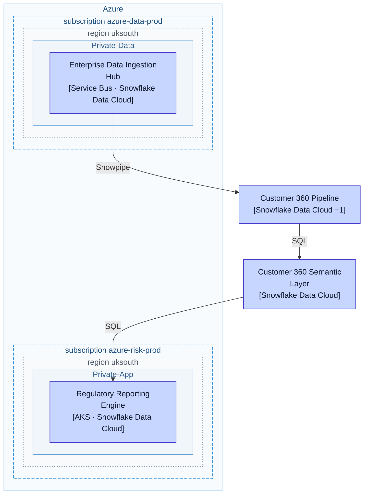
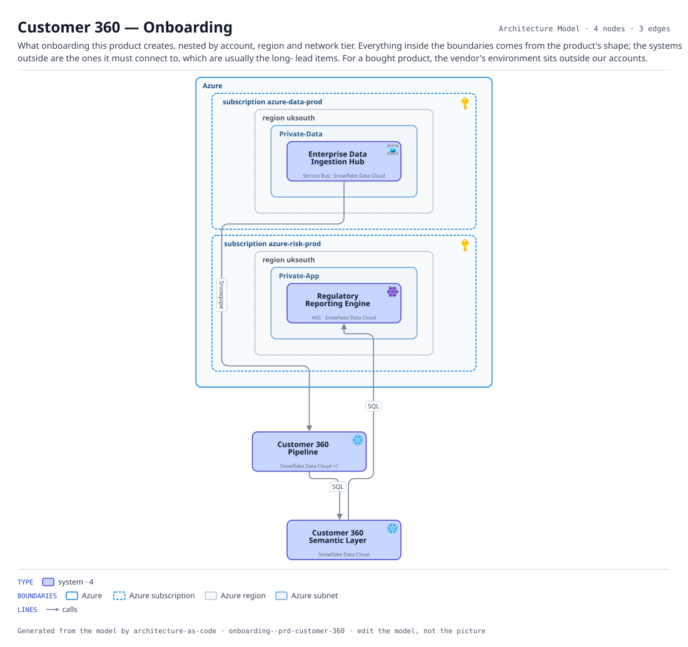

# Customer 360 — Onboarding

What onboarding this product creates, nested by account, region and network tier. Everything inside the boundaries comes from the product's shape; the systems outside are the ones it must connect to, which are usually the long- lead items. For a bought product, the vendor's environment sits outside our accounts.

The same view as the app draws it, written beside the Mermaid by `terrane render`:

**network zone** is the boundary each node sits in.

**Boundaries** are drawn the way their provider draws them.

| Border | Boundary |
|---|---|
| solid `#0078d4` | Azure |
| dashed `#0078d4` | Azure subscription |
| dotted `#7a8699` | Azure region |
| solid `#5b9bd5` | Azure subnet |

## Flows across this diagram

Each flow is a recorded sequence of interfaces. The steps drawn on this diagram are numbered; a step whose interface is not on it is marked.

**Regulatory Return**: The monthly supervisory return. Entirely batch, and the only flow whose deadline is external and non-negotiable.

1. Core Card Ledger → Enterprise Data Ingestion Hub (FileTransfer) — not on this diagram
2. Enterprise Data Ingestion Hub → Customer 360 Pipeline (Snowpipe)
3. Customer 360 Pipeline → Customer 360 Semantic Layer (SQL)
4. Customer 360 Semantic Layer → Regulatory Reporting Engine (SQL)

4 entities, 3 relationships. Generated from the model; edit the model, not this file.
