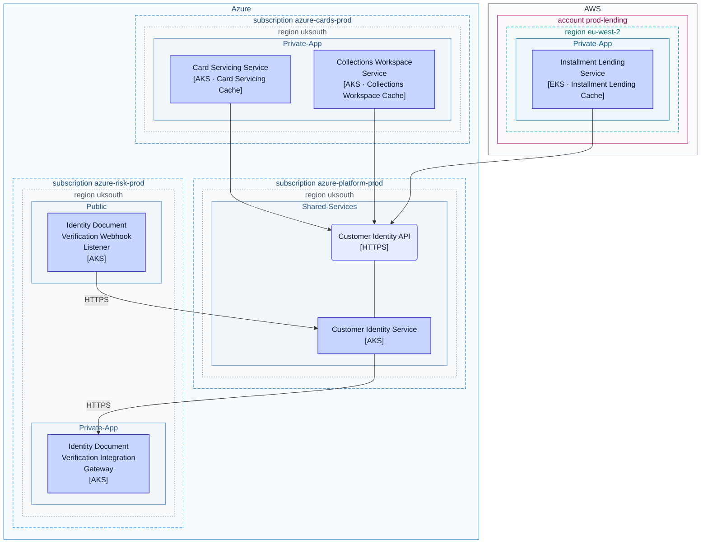
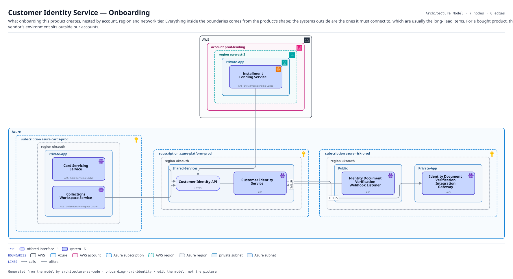

# Customer Identity Service — Onboarding

What onboarding this product creates, nested by account, region and network tier. Everything inside the boundaries comes from the product's shape; the systems outside are the ones it must connect to, which are usually the long- lead items. For a bought product, the vendor's environment sits outside our accounts.

The same view as the app draws it, written beside the Mermaid by `terrane render`:

**Hue is the entity type.**

| | Entity type |
|---|---|
| `#6366f1` | offered interfaces |
| `#4338ca` | systems |

**network zone** is the boundary each node sits in.

**Boundaries** are drawn the way their provider draws them.

| Border | Boundary |
|---|---|
| solid `#232f3e` | AWS |
| solid `#0078d4` | Azure |
| solid `#c7257e` | AWS account |
| dashed `#0078d4` | Azure subscription |
| dashed `#00a4a6` | AWS region |
| dotted `#7a8699` | Azure region |
| solid `#147eba` | private subnet |
| solid `#5b9bd5` | Azure subnet |

## Flows across this diagram

Each flow is a recorded sequence of interfaces. The steps drawn on this diagram are numbered; a step whose interface is not on it is marked.

**Installment Loan Application**: An applicant applies for point-of-sale credit. Bureau search, affordability and a decision, with referral to an underwriter when the automated decision declines to take it.

1. Installment Lending Edge → Installment Lending Load Balancer (HTTPS) — not on this diagram
2. Installment Lending Load Balancer → Installment Lending Web (HTTPS) — not on this diagram
3. Installment Lending Web → Installment Lending Service (HTTPS) — not on this diagram
4. Installment Lending Service → Customer Identity Service (HTTPS)
5. Installment Lending Service → Experian Credit Bureau (HTTPS) — not on this diagram
6. Installment Lending Service → Installment Lending Database (PostgreSQL) — not on this diagram
7. Installment Lending Service → Core Card Ledger (MQ) — not on this diagram
8. Installment Lending Service → Installment Lending Async Worker (Kafka) — not on this diagram

7 entities, 6 relationships. Generated from the model; edit the model, not this file.
