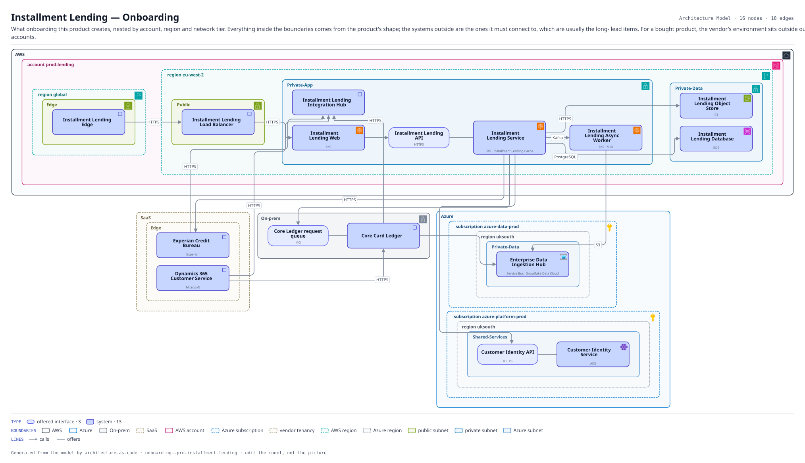

# Installment Lending — Onboarding

What onboarding this product creates, nested by account, region and network tier. Everything inside the boundaries comes from the product's shape; the systems outside are the ones it must connect to, which are usually the long- lead items. For a bought product, the vendor's environment sits outside our accounts.

```mermaid
%%{init: {'flowchart': {'curve': 'basis'}} }%%
flowchart TB
  %% Installment Lending — Onboarding
  %% Generated from the model by `terrane render`. Do not edit by hand.

  subgraph grp_AWS["AWS"]
    direction TB
    subgraph grp_AWS__prod_lending["account prod-lending"]
      direction TB
      subgraph grp_AWS__prod_lending__eu_west_2["region eu-west-2"]
        direction TB
        subgraph grp_AWS__prod_lending__eu_west_2__Public["Public"]
          direction TB
          SYS_LENDING_ALB["Installment Lending Load<br/>Balancer"]
        end
        subgraph grp_AWS__prod_lending__eu_west_2__Private_App["Private-App"]
          direction TB
          OI_LENDING_API("Installment Lending API<br/>[HTTPS]")
          SYS_LENDING_WORKER["Installment Lending Async<br/>Worker<br/>[EKS · MSK]"]
          SYS_LENDING_HUB["Installment Lending<br/>Integration Hub"]
          SYS_LENDING_API["Installment Lending<br/>Service<br/>[EKS · Installment Lending Cache]"]
          SYS_LENDING_WEB["Installment Lending Web<br/>[EKS]"]
        end
        subgraph grp_AWS__prod_lending__eu_west_2__Private_Data["Private-Data"]
          direction TB
          SYS_LENDING_DB["Installment Lending<br/>Database<br/>[RDS]"]
          SYS_LENDING_BUCKET["Installment Lending Object<br/>Store<br/>[S3]"]
        end
      end
      subgraph grp_AWS__prod_lending__global["region global"]
        direction TB
        subgraph grp_AWS__prod_lending__global__Edge["Edge"]
          direction TB
          SYS_LENDING_EDGE["Installment Lending Edge"]
        end
      end
    end
  end

  subgraph grp_Azure["Azure"]
    direction TB
    subgraph grp_Azure__azure_data_prod["subscription azure-data-prod"]
      direction TB
      subgraph grp_Azure__azure_data_prod__uksouth["region uksouth"]
        direction TB
        subgraph grp_Azure__azure_data_prod__uksouth__Private_Data["Private-Data"]
          direction TB
          SYS_DATA_INGEST["Enterprise Data Ingestion<br/>Hub<br/>[Service Bus · Snowflake Data Cloud]"]
        end
      end
    end
    subgraph grp_Azure__azure_platform_prod["subscription azure-platform-prod"]
      direction TB
      subgraph grp_Azure__azure_platform_prod__uksouth["region uksouth"]
        direction TB
        subgraph grp_Azure__azure_platform_prod__uksouth__Shared_Services["Shared-Services"]
          direction TB
          OI_IDENTITY_API("Customer Identity API<br/>[HTTPS]")
          SYS_IDENTITY_SVC["Customer Identity Service<br/>[AKS]"]
        end
      end
    end
  end

  subgraph grp_On_prem["On-prem"]
    direction TB
    SYS_CORE_LEDGER["Core Card Ledger"]
    OI_LEDGER_QUEUE("Core Ledger request queue<br/>[MQ]")
  end

  subgraph grp_SaaS["SaaS"]
    direction TB
    subgraph grp_SaaS__Edge["Edge"]
      direction TB
      SYS_CRM["Dynamics 365 Customer<br/>Service<br/>[Microsoft]"]
      SYS_CREDIT_BUREAU["Experian Credit Bureau<br/>[Experian]"]
    end
  end

  SYS_CRM -->|"HTTPS"| SYS_CORE_LEDGER
  SYS_CORE_LEDGER -->|"FileTransfer"| SYS_DATA_INGEST
  SYS_LENDING_API --> OI_LEDGER_QUEUE
  SYS_LENDING_API --> OI_IDENTITY_API
  SYS_LENDING_WORKER -->|"S3"| SYS_DATA_INGEST
  SYS_LENDING_API -->|"HTTPS"| SYS_CREDIT_BUREAU
  SYS_LENDING_WEB --> OI_LENDING_API
  SYS_LENDING_EDGE -->|"HTTPS"| SYS_LENDING_ALB
  SYS_LENDING_ALB -->|"HTTPS"| SYS_LENDING_WEB
  SYS_LENDING_API -->|"Kafka"| SYS_LENDING_WORKER
  SYS_LENDING_API -->|"PostgreSQL"| SYS_LENDING_DB
  SYS_LENDING_API -->|"HTTPS"| SYS_LENDING_BUCKET
  SYS_CORE_LEDGER -->|"HTTPS"| SYS_LENDING_HUB
  SYS_CREDIT_BUREAU -->|"HTTPS"| SYS_LENDING_HUB
  SYS_CRM -->|"HTTPS"| SYS_LENDING_HUB
  OI_IDENTITY_API --- SYS_IDENTITY_SVC
  OI_LEDGER_QUEUE --- SYS_CORE_LEDGER
  OI_LENDING_API --- SYS_LENDING_API

  classDef s_offered_interfaces__on_prem fill:#e6ecff,stroke:#6366f1,color:#0f172a,stroke-width:1.4px;
  classDef s_offered_interfaces__private_app fill:#e6ecff,stroke:#6366f1,color:#0f172a,stroke-width:1.4px;
  classDef s_offered_interfaces__shared_services fill:#e6ecff,stroke:#6366f1,color:#0f172a,stroke-width:1.4px;
  classDef s_systems__edge fill:#c7d6ff,stroke:#4338ca,color:#0f172a,stroke-width:1.4px;
  classDef s_systems__on_prem fill:#c7d6ff,stroke:#4338ca,color:#0f172a,stroke-width:1.4px;
  classDef s_systems__private_app fill:#c7d6ff,stroke:#4338ca,color:#0f172a,stroke-width:1.4px;
  classDef s_systems__private_data fill:#c7d6ff,stroke:#4338ca,color:#0f172a,stroke-width:1.4px;
  classDef s_systems__public fill:#c7d6ff,stroke:#4338ca,color:#0f172a,stroke-width:1.4px;
  classDef s_systems__shared_services fill:#c7d6ff,stroke:#4338ca,color:#0f172a,stroke-width:1.4px;
  class OI_LEDGER_QUEUE s_offered_interfaces__on_prem;
  class OI_LENDING_API s_offered_interfaces__private_app;
  class OI_IDENTITY_API s_offered_interfaces__shared_services;
  class SYS_CREDIT_BUREAU,SYS_CRM,SYS_LENDING_EDGE s_systems__edge;
  class SYS_CORE_LEDGER s_systems__on_prem;
  class SYS_LENDING_API,SYS_LENDING_HUB,SYS_LENDING_WEB,SYS_LENDING_WORKER s_systems__private_app;
  class SYS_DATA_INGEST,SYS_LENDING_BUCKET,SYS_LENDING_DB s_systems__private_data;
  class SYS_LENDING_ALB s_systems__public;
  class SYS_IDENTITY_SVC s_systems__shared_services;
  classDef boundary1 fill:#eef5fb,stroke:#147eba,color:#0f5f8c;
  class grp_AWS__prod_lending__eu_west_2__Private_App,grp_AWS__prod_lending__eu_west_2__Private_Data boundary1;
  classDef boundary2 fill:#f1f6fb,stroke:#5b9bd5,color:#2f5d8a;
  class grp_Azure__azure_data_prod__uksouth__Private_Data,grp_Azure__azure_platform_prod__uksouth__Shared_Services boundary2;
  classDef boundary3 fill:#f3f7e9,stroke:#7aa116,color:#4f6a0e;
  class grp_AWS__prod_lending__eu_west_2__Public,grp_AWS__prod_lending__global__Edge boundary3;
  classDef boundary4 fill:#f4f5f7,stroke:#5f6b7a,color:#3f4a5c;
  class grp_On_prem boundary4;
  classDef boundary5 fill:#f5fbfb,stroke:#00a4a6,color:#0b6e70,stroke-dasharray:6 3;
  class grp_AWS__prod_lending__eu_west_2,grp_AWS__prod_lending__global boundary5;
  classDef boundary6 fill:#f7fbfe,stroke:#0078d4,color:#1b4b7a,stroke-dasharray:6 3;
  class grp_Azure__azure_data_prod,grp_Azure__azure_platform_prod boundary6;
  classDef boundary7 fill:#f7fbfe,stroke:#0078d4,color:#1b4b7a;
  class grp_Azure boundary7;
  classDef boundary8 fill:#f8fafc,stroke:#7a8699,color:#4b5563,stroke-dasharray:2 3;
  class grp_Azure__azure_data_prod__uksouth,grp_Azure__azure_platform_prod__uksouth boundary8;
  classDef boundary9 fill:#fbfcfd,stroke:#232f3e,color:#232f3e;
  class grp_AWS boundary9;
  classDef boundary10 fill:#fcfbf7,stroke:#9a8f6a,color:#6b6246,stroke-dasharray:6 3;
  class grp_SaaS,grp_SaaS__Edge boundary10;
  classDef boundary11 fill:#fdf6fa,stroke:#c7257e,color:#8b1a58;
  class grp_AWS__prod_lending boundary11;
```

The same view as the app draws it, written beside the Mermaid by `terrane render`:

**Hue is the entity type.**

| | Entity type |
|---|---|
| `#6366f1` | offered interfaces |
| `#4338ca` | systems |

**network zone** is the boundary each node sits in.

**Boundaries** are drawn the way their provider draws them.

| Border | Boundary |
|---|---|
| solid `#232f3e` | AWS |
| solid `#0078d4` | Azure |
| solid `#5f6b7a` | On-prem |
| dashed `#9a8f6a` | SaaS |
| solid `#c7257e` | AWS account |
| dashed `#0078d4` | Azure subscription |
| dashed `#9a8f6a` | vendor tenancy |
| dashed `#00a4a6` | AWS region |
| dotted `#7a8699` | Azure region |
| solid `#7aa116` | public subnet |
| solid `#147eba` | private subnet |
| solid `#5b9bd5` | Azure subnet |

## Flows across this diagram

Each flow is a recorded sequence of interfaces. The steps drawn on this diagram are numbered; a step whose interface is not on it is marked.

**Installment Loan Application**: An applicant applies for point-of-sale credit. Bureau search, affordability and a decision, with referral to an underwriter when the automated decision declines to take it.

1. Installment Lending Edge → Installment Lending Load Balancer (HTTPS)
2. Installment Lending Load Balancer → Installment Lending Web (HTTPS)
3. Installment Lending Web → Installment Lending Service (HTTPS)
4. Installment Lending Service → Customer Identity Service (HTTPS)
5. Installment Lending Service → Experian Credit Bureau (HTTPS)
6. Installment Lending Service → Installment Lending Database (PostgreSQL)
7. Installment Lending Service → Core Card Ledger (MQ)
8. Installment Lending Service → Installment Lending Async Worker (Kafka)

**Dispute and Chargeback**: A cardholder disputes a transaction. Raised in the contact center, handled in the vendor platform, settled back through the ledger.

1. Dynamics 365 Customer Service → Core Card Ledger (HTTPS)
2. Core Card Ledger → Dispute Management Platform Integration Gateway (HTTPS) — not on this diagram
3. Dispute Management Platform Integration Gateway → Pega Smart Dispute (HTTPS) — not on this diagram
4. Pega Smart Dispute → Enterprise Data Ingestion Hub (SFTP) — not on this diagram

**Regulatory Return**: The monthly supervisory return. Entirely batch, and the only flow whose deadline is external and non-negotiable.

1. Core Card Ledger → Enterprise Data Ingestion Hub (FileTransfer)
2. Enterprise Data Ingestion Hub → Customer 360 Pipeline (Snowpipe) — not on this diagram
3. Customer 360 Pipeline → Customer 360 Semantic Layer (SQL) — not on this diagram
4. Customer 360 Semantic Layer → Regulatory Reporting Engine (SQL) — not on this diagram

16 entities, 18 relationships. Generated from the model; edit the model, not this file.
