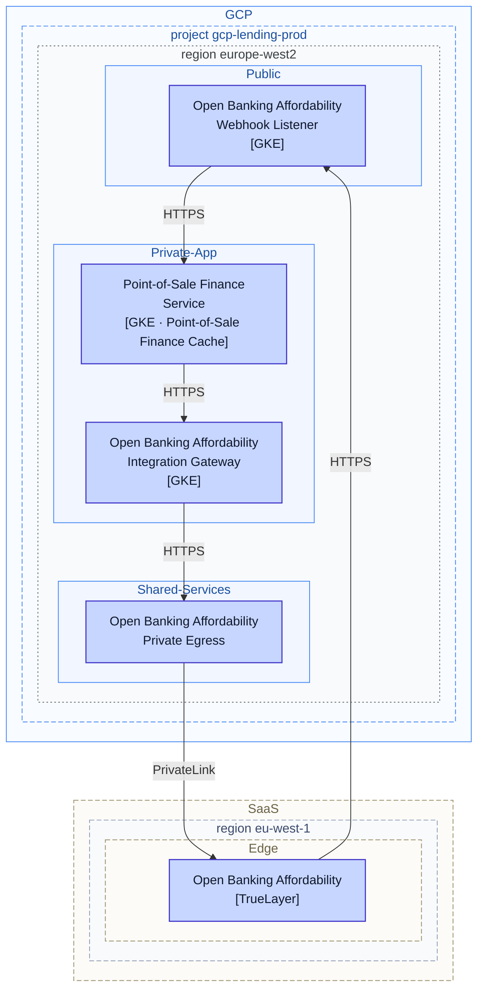
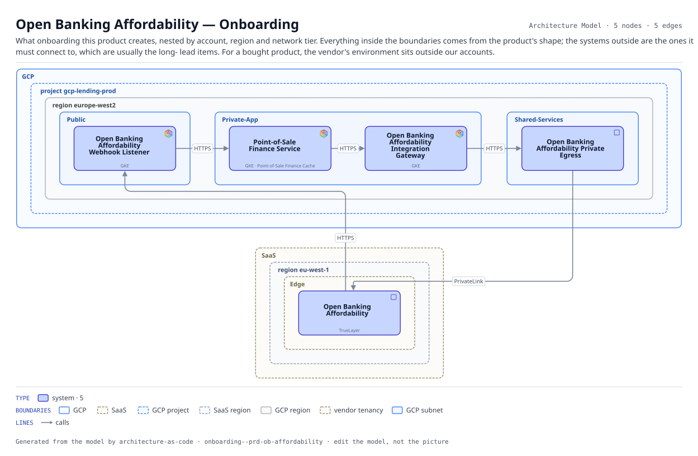

# Open Banking Affordability — Onboarding

What onboarding this product creates, nested by account, region and network tier. Everything inside the boundaries comes from the product's shape; the systems outside are the ones it must connect to, which are usually the long- lead items. For a bought product, the vendor's environment sits outside our accounts.

The same view as the app draws it, written beside the Mermaid by `terrane render`:

**network zone** is the boundary each node sits in.

**Boundaries** are drawn the way their provider draws them.

| Border | Boundary |
|---|---|
| solid `#4285f4` | GCP |
| dashed `#9a8f6a` | SaaS |
| dashed `#4285f4` | GCP project |
| dashed `#8f9bb5` | SaaS region |
| dotted `#5f6368` | GCP region |
| dashed `#9a8f6a` | vendor tenancy |
| solid `#4285f4` | GCP subnet |

5 entities, 5 relationships. Generated from the model; edit the model, not this file.
