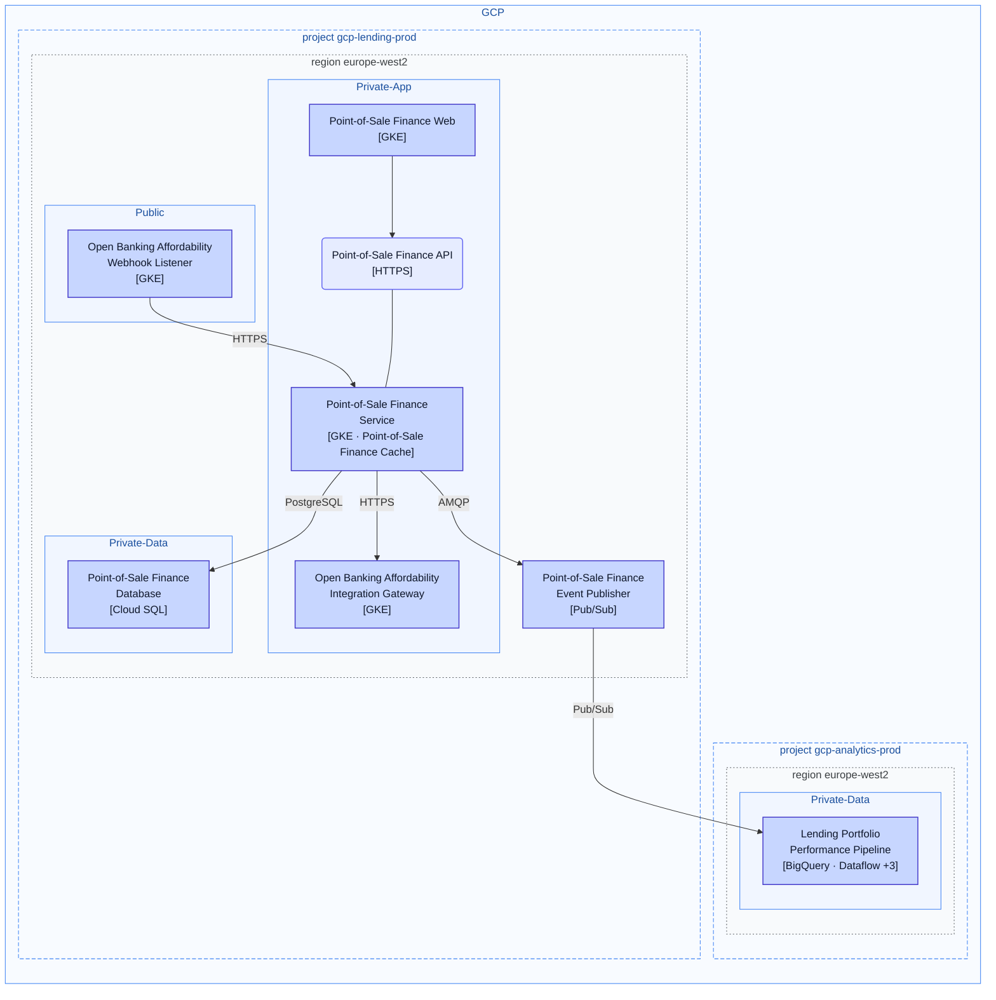
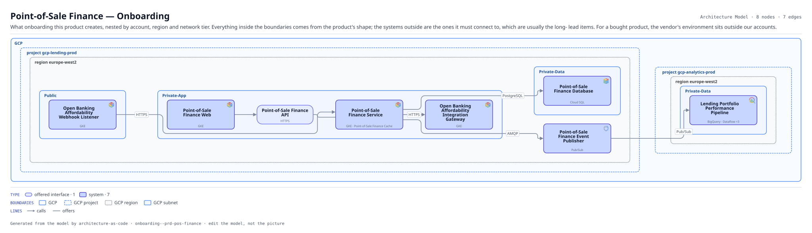

# Point-of-Sale Finance — Onboarding

What onboarding this product creates, nested by account, region and network tier. Everything inside the boundaries comes from the product's shape; the systems outside are the ones it must connect to, which are usually the long- lead items. For a bought product, the vendor's environment sits outside our accounts.

The same view as the app draws it, written beside the Mermaid by `terrane render`:

**Hue is the entity type.**

| | Entity type |
|---|---|
| `#6366f1` | offered interfaces |
| `#4338ca` | systems |

**network zone** is the boundary each node sits in.

**Boundaries** are drawn the way their provider draws them.

| Border | Boundary |
|---|---|
| solid `#4285f4` | GCP |
| dashed `#4285f4` | GCP project |
| dotted `#5f6368` | GCP region |
| solid `#4285f4` | GCP subnet |

8 entities, 7 relationships. Generated from the model; edit the model, not this file.
