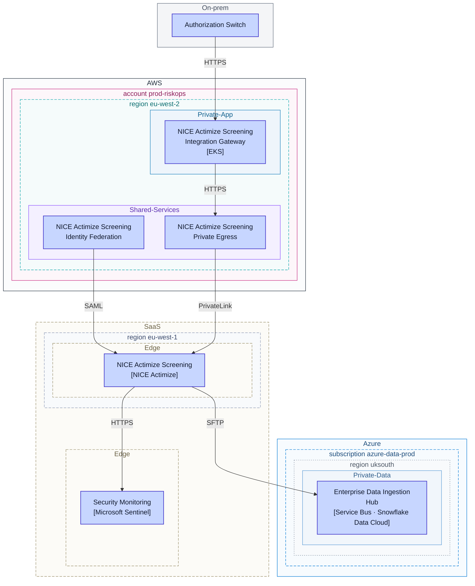
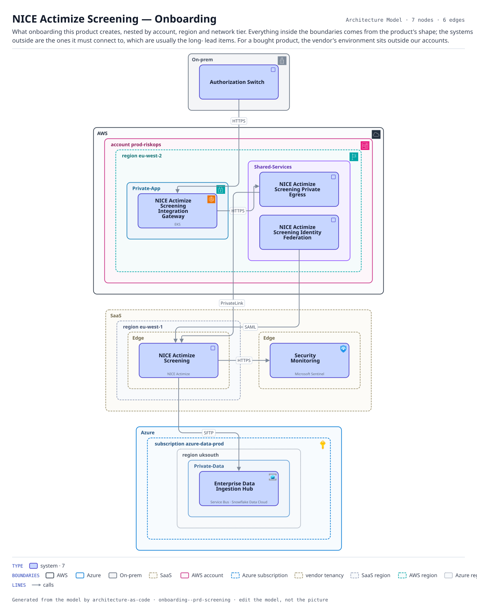

# NICE Actimize Screening — Onboarding

What onboarding this product creates, nested by account, region and network tier. Everything inside the boundaries comes from the product's shape; the systems outside are the ones it must connect to, which are usually the long- lead items. For a bought product, the vendor's environment sits outside our accounts.

The same view as the app draws it, written beside the Mermaid by `terrane render`:

**network zone** is the boundary each node sits in.

**Boundaries** are drawn the way their provider draws them.

| Border | Boundary |
|---|---|
| solid `#232f3e` | AWS |
| solid `#0078d4` | Azure |
| solid `#5f6b7a` | On-prem |
| dashed `#9a8f6a` | SaaS |
| solid `#c7257e` | AWS account |
| dashed `#0078d4` | Azure subscription |
| dashed `#9a8f6a` | vendor tenancy |
| dashed `#8f9bb5` | SaaS region |
| dashed `#00a4a6` | AWS region |
| dotted `#7a8699` | Azure region |
| solid `#147eba` | private subnet |
| solid `#8c4fff` | shared services |
| solid `#5b9bd5` | Azure subnet |

## Flows across this diagram

Each flow is a recorded sequence of interfaces. The steps drawn on this diagram are numbered; a step whose interface is not on it is marked.

**Card Authorization**: A card presented at a merchant, authorized or declined inside the scheme timeout. The tightest latency budget in the estate, and the reason the screening call has a circuit breaker rather than a retry.

1. Authorization Switch → NICE Actimize Screening Integration Gateway (HTTPS)
2. NICE Actimize Screening Integration Gateway → NICE Actimize Screening Private Egress (HTTPS)
3. NICE Actimize Screening Private Egress → NICE Actimize Screening (PrivateLink)
4. Authorization Switch → Core Card Ledger (MQ) — not on this diagram

7 entities, 6 relationships. Generated from the model; edit the model, not this file.
