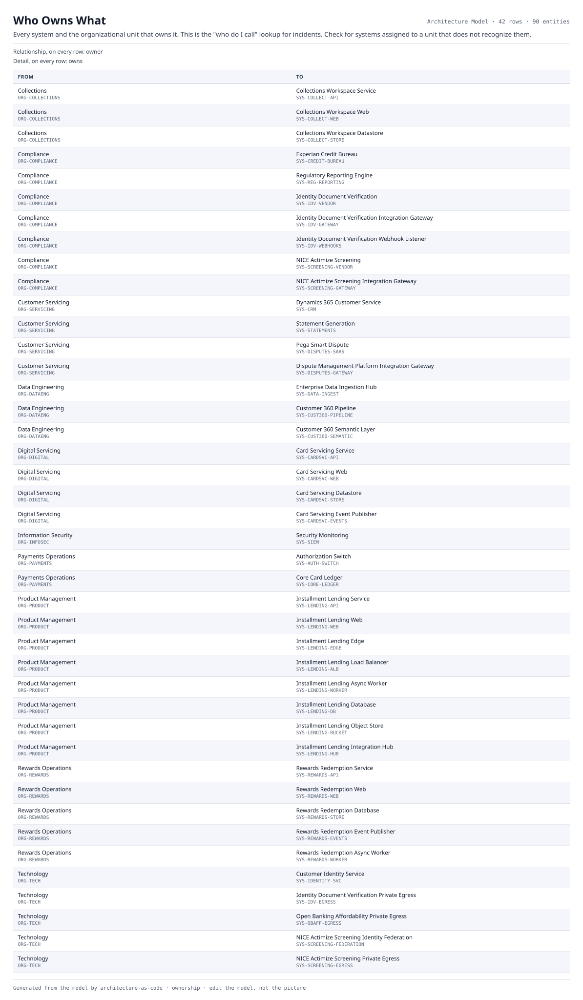

# Who Owns What

Every system and the organizational unit that owns it. This is the "who do I call" lookup for incidents. Check for systems assigned to a unit that does not recognize them.

| From | | To | Detail |
|---|---|---|---|
| Collections  `ORG-COLLECTIONS` | owner | Collections Workspace Service  `SYS-COLLECT-API` | owns |
| Collections  `ORG-COLLECTIONS` | owner | Collections Workspace Web  `SYS-COLLECT-WEB` | owns |
| Collections  `ORG-COLLECTIONS` | owner | Collections Workspace Datastore  `SYS-COLLECT-STORE` | owns |
| Compliance  `ORG-COMPLIANCE` | owner | Experian Credit Bureau  `SYS-CREDIT-BUREAU` | owns |
| Compliance  `ORG-COMPLIANCE` | owner | Regulatory Reporting Engine  `SYS-REG-REPORTING` | owns |
| Compliance  `ORG-COMPLIANCE` | owner | Identity Document Verification  `SYS-IDV-VENDOR` | owns |
| Compliance  `ORG-COMPLIANCE` | owner | Identity Document Verification Integration Gateway  `SYS-IDV-GATEWAY` | owns |
| Compliance  `ORG-COMPLIANCE` | owner | Identity Document Verification Webhook Listener  `SYS-IDV-WEBHOOKS` | owns |
| Compliance  `ORG-COMPLIANCE` | owner | NICE Actimize Screening  `SYS-SCREENING-VENDOR` | owns |
| Compliance  `ORG-COMPLIANCE` | owner | NICE Actimize Screening Integration Gateway  `SYS-SCREENING-GATEWAY` | owns |
| Customer Servicing  `ORG-SERVICING` | owner | Dynamics 365 Customer Service  `SYS-CRM` | owns |
| Customer Servicing  `ORG-SERVICING` | owner | Statement Generation  `SYS-STATEMENTS` | owns |
| Customer Servicing  `ORG-SERVICING` | owner | Pega Smart Dispute  `SYS-DISPUTES-SAAS` | owns |
| Customer Servicing  `ORG-SERVICING` | owner | Dispute Management Platform Integration Gateway  `SYS-DISPUTES-GATEWAY` | owns |
| Data Engineering  `ORG-DATAENG` | owner | Enterprise Data Ingestion Hub  `SYS-DATA-INGEST` | owns |
| Data Engineering  `ORG-DATAENG` | owner | Customer 360 Pipeline  `SYS-CUST360-PIPELINE` | owns |
| Data Engineering  `ORG-DATAENG` | owner | Customer 360 Semantic Layer  `SYS-CUST360-SEMANTIC` | owns |
| Digital Servicing  `ORG-DIGITAL` | owner | Card Servicing Service  `SYS-CARDSVC-API` | owns |
| Digital Servicing  `ORG-DIGITAL` | owner | Card Servicing Web  `SYS-CARDSVC-WEB` | owns |
| Digital Servicing  `ORG-DIGITAL` | owner | Card Servicing Datastore  `SYS-CARDSVC-STORE` | owns |
| Digital Servicing  `ORG-DIGITAL` | owner | Card Servicing Event Publisher  `SYS-CARDSVC-EVENTS` | owns |
| Information Security  `ORG-INFOSEC` | owner | Security Monitoring  `SYS-SIEM` | owns |
| Payments Operations  `ORG-PAYMENTS` | owner | Authorization Switch  `SYS-AUTH-SWITCH` | owns |
| Payments Operations  `ORG-PAYMENTS` | owner | Core Card Ledger  `SYS-CORE-LEDGER` | owns |
| Product Management  `ORG-PRODUCT` | owner | Installment Lending Service  `SYS-LENDING-API` | owns |
| Product Management  `ORG-PRODUCT` | owner | Installment Lending Web  `SYS-LENDING-WEB` | owns |
| Product Management  `ORG-PRODUCT` | owner | Installment Lending Edge  `SYS-LENDING-EDGE` | owns |
| Product Management  `ORG-PRODUCT` | owner | Installment Lending Load Balancer  `SYS-LENDING-ALB` | owns |
| Product Management  `ORG-PRODUCT` | owner | Installment Lending Async Worker  `SYS-LENDING-WORKER` | owns |
| Product Management  `ORG-PRODUCT` | owner | Installment Lending Database  `SYS-LENDING-DB` | owns |
| Product Management  `ORG-PRODUCT` | owner | Installment Lending Object Store  `SYS-LENDING-BUCKET` | owns |
| Product Management  `ORG-PRODUCT` | owner | Installment Lending Integration Hub  `SYS-LENDING-HUB` | owns |
| Rewards Operations  `ORG-REWARDS` | owner | Rewards Redemption Service  `SYS-REWARDS-API` | owns |
| Rewards Operations  `ORG-REWARDS` | owner | Rewards Redemption Web  `SYS-REWARDS-WEB` | owns |
| Rewards Operations  `ORG-REWARDS` | owner | Rewards Redemption Database  `SYS-REWARDS-STORE` | owns |
| Rewards Operations  `ORG-REWARDS` | owner | Rewards Redemption Event Publisher  `SYS-REWARDS-EVENTS` | owns |
| Rewards Operations  `ORG-REWARDS` | owner | Rewards Redemption Async Worker  `SYS-REWARDS-WORKER` | owns |
| Technology  `ORG-TECH` | owner | Customer Identity Service  `SYS-IDENTITY-SVC` | owns |
| Technology  `ORG-TECH` | owner | Identity Document Verification Private Egress  `SYS-IDV-EGRESS` | owns |
| Technology  `ORG-TECH` | owner | Open Banking Affordability Private Egress  `SYS-OBAFF-EGRESS` | owns |
| Technology  `ORG-TECH` | owner | NICE Actimize Screening Identity Federation  `SYS-SCREENING-FEDERATION` | owns |
| Technology  `ORG-TECH` | owner | NICE Actimize Screening Private Egress  `SYS-SCREENING-EGRESS` | owns |

42 relationships across 90 entities. Generated from the model; this is a report rather than a diagram, so it is a table.
