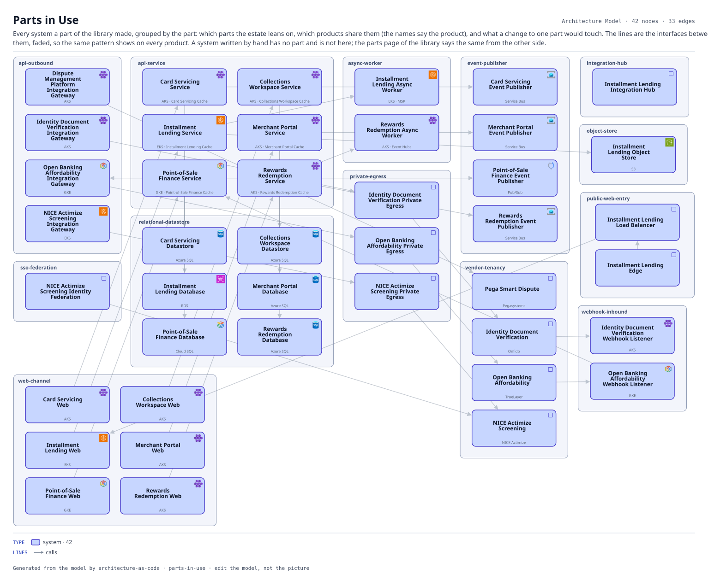

# Parts in Use

Every system a part of the library made, grouped by the part: which parts the estate leans on, which products share them (the names say the product), and what a change to one part would touch. The lines are the interfaces between them, faded, so the same pattern shows on every product. A system written by hand has no part and is not here; the parts page of the library says the same from the other side.

```mermaid
%%{init: {'flowchart': {'curve': 'basis'}} }%%
flowchart TB
  %% Parts in Use
  %% Generated from the model by `terrane render`. Do not edit by hand.

  subgraph grp_api_outbound["api-outbound"]
    direction TB
    SYS_DISPUTES_GATEWAY["Dispute Management<br/>Platform Integration<br/>Gateway<br/>[AKS]"]
    SYS_IDV_GATEWAY["Identity Document<br/>Verification Integration<br/>Gateway<br/>[AKS]"]
    SYS_SCREENING_GATEWAY["NICE Actimize Screening<br/>Integration Gateway<br/>[EKS]"]
    SYS_OBAFF_GATEWAY["Open Banking Affordability<br/>Integration Gateway<br/>[GKE]"]
  end

  subgraph grp_api_service["api-service"]
    direction TB
    SYS_CARDSVC_API["Card Servicing Service<br/>[AKS · Card Servicing Cache]"]
    SYS_COLLECT_API["Collections Workspace<br/>Service<br/>[AKS · Collections Workspace Cache]"]
    SYS_LENDING_API["Installment Lending<br/>Service<br/>[EKS · Installment Lending Cache]"]
    SYS_MERCHANT_API["Merchant Portal Service<br/>[AKS · Merchant Portal Cache]"]
    SYS_POSFIN_API["Point-of-Sale Finance<br/>Service<br/>[GKE · Point-of-Sale Finance Cache]"]
    SYS_REWARDS_API["Rewards Redemption Service<br/>[AKS · Rewards Redemption Cache]"]
  end

  subgraph grp_async_worker["async-worker"]
    direction TB
    SYS_LENDING_WORKER["Installment Lending Async<br/>Worker<br/>[EKS · MSK]"]
    SYS_REWARDS_WORKER["Rewards Redemption Async<br/>Worker<br/>[AKS · Event Hubs]"]
  end

  subgraph grp_event_publisher["event-publisher"]
    direction TB
    SYS_CARDSVC_EVENTS["Card Servicing Event<br/>Publisher<br/>[Service Bus]"]
    SYS_MERCHANT_EVENTS["Merchant Portal Event<br/>Publisher<br/>[Service Bus]"]
    SYS_POSFIN_EVENTS["Point-of-Sale Finance<br/>Event Publisher<br/>[Pub/Sub]"]
    SYS_REWARDS_EVENTS["Rewards Redemption Event<br/>Publisher<br/>[Service Bus]"]
  end

  subgraph grp_integration_hub["integration-hub"]
    direction TB
    SYS_LENDING_HUB["Installment Lending<br/>Integration Hub"]
  end

  subgraph grp_object_store["object-store"]
    direction TB
    SYS_LENDING_BUCKET["Installment Lending Object<br/>Store<br/>[S3]"]
  end

  subgraph grp_private_egress["private-egress"]
    direction TB
    SYS_IDV_EGRESS["Identity Document<br/>Verification Private<br/>Egress"]
    SYS_SCREENING_EGRESS["NICE Actimize Screening<br/>Private Egress"]
    SYS_OBAFF_EGRESS["Open Banking Affordability<br/>Private Egress"]
  end

  subgraph grp_public_web_entry["public-web-entry"]
    direction TB
    SYS_LENDING_EDGE["Installment Lending Edge"]
    SYS_LENDING_ALB["Installment Lending Load<br/>Balancer"]
  end

  subgraph grp_relational_datastore["relational-datastore"]
    direction TB
    SYS_CARDSVC_STORE["Card Servicing Datastore<br/>[Azure SQL]"]
    SYS_COLLECT_STORE["Collections Workspace<br/>Datastore<br/>[Azure SQL]"]
    SYS_LENDING_DB["Installment Lending<br/>Database<br/>[RDS]"]
    SYS_MERCHANT_STORE["Merchant Portal Database<br/>[Azure SQL]"]
    SYS_POSFIN_DB["Point-of-Sale Finance<br/>Database<br/>[Cloud SQL]"]
    SYS_REWARDS_STORE["Rewards Redemption<br/>Database<br/>[Azure SQL]"]
  end

  subgraph grp_sso_federation["sso-federation"]
    direction TB
    SYS_SCREENING_FEDERATION["NICE Actimize Screening<br/>Identity Federation"]
  end

  subgraph grp_vendor_tenancy["vendor-tenancy"]
    direction TB
    SYS_IDV_VENDOR["Identity Document<br/>Verification<br/>[Onfido]"]
    SYS_SCREENING_VENDOR["NICE Actimize Screening<br/>[NICE Actimize]"]
    SYS_OBAFF_VENDOR["Open Banking Affordability<br/>[TrueLayer]"]
    SYS_DISPUTES_SAAS["Pega Smart Dispute<br/>[Pegasystems]"]
  end

  subgraph grp_web_channel["web-channel"]
    direction TB
    SYS_CARDSVC_WEB["Card Servicing Web<br/>[AKS]"]
    SYS_COLLECT_WEB["Collections Workspace Web<br/>[AKS]"]
    SYS_LENDING_WEB["Installment Lending Web<br/>[EKS]"]
    SYS_MERCHANT_WEB["Merchant Portal Web<br/>[AKS]"]
    SYS_POSFIN_WEB["Point-of-Sale Finance Web<br/>[GKE]"]
    SYS_REWARDS_WEB["Rewards Redemption Web<br/>[AKS]"]
  end

  subgraph grp_webhook_inbound["webhook-inbound"]
    direction TB
    SYS_IDV_WEBHOOKS["Identity Document<br/>Verification Webhook<br/>Listener<br/>[AKS]"]
    SYS_OBAFF_WEBHOOKS["Open Banking Affordability<br/>Webhook Listener<br/>[GKE]"]
  end

  SYS_CARDSVC_WEB --> SYS_CARDSVC_API
  SYS_CARDSVC_API --> SYS_CARDSVC_STORE
  SYS_CARDSVC_API --> SYS_CARDSVC_EVENTS
  SYS_COLLECT_WEB --> SYS_COLLECT_API
  SYS_COLLECT_API --> SYS_COLLECT_STORE
  SYS_DISPUTES_GATEWAY --> SYS_DISPUTES_SAAS
  SYS_IDV_GATEWAY --> SYS_IDV_EGRESS
  SYS_IDV_EGRESS --> SYS_IDV_VENDOR
  SYS_IDV_VENDOR --> SYS_IDV_WEBHOOKS
  SYS_LENDING_WEB --> SYS_LENDING_API
  SYS_LENDING_EDGE --> SYS_LENDING_ALB
  SYS_LENDING_ALB --> SYS_LENDING_WEB
  SYS_LENDING_API --> SYS_LENDING_WORKER
  SYS_LENDING_API --> SYS_LENDING_DB
  SYS_LENDING_API --> SYS_LENDING_BUCKET
  SYS_MERCHANT_WEB --> SYS_MERCHANT_API
  SYS_MERCHANT_API --> SYS_MERCHANT_STORE
  SYS_MERCHANT_API --> SYS_MERCHANT_EVENTS
  SYS_POSFIN_API --> SYS_OBAFF_GATEWAY
  SYS_OBAFF_GATEWAY --> SYS_OBAFF_EGRESS
  SYS_OBAFF_EGRESS --> SYS_OBAFF_VENDOR
  SYS_OBAFF_VENDOR --> SYS_OBAFF_WEBHOOKS
  SYS_OBAFF_WEBHOOKS --> SYS_POSFIN_API
  SYS_POSFIN_WEB --> SYS_POSFIN_API
  SYS_POSFIN_API --> SYS_POSFIN_DB
  SYS_POSFIN_API --> SYS_POSFIN_EVENTS
  SYS_REWARDS_WEB --> SYS_REWARDS_API
  SYS_REWARDS_API --> SYS_REWARDS_STORE
  SYS_REWARDS_API --> SYS_REWARDS_EVENTS
  SYS_REWARDS_API --> SYS_REWARDS_WORKER
  SYS_SCREENING_FEDERATION --> SYS_SCREENING_VENDOR
  SYS_SCREENING_GATEWAY --> SYS_SCREENING_EGRESS
  SYS_SCREENING_EGRESS --> SYS_SCREENING_VENDOR

  classDef s_systems__systems fill:#c7d6ff,stroke:#4338ca,color:#0f172a,stroke-width:1.4px;
  class SYS_CARDSVC_API,SYS_CARDSVC_EVENTS,SYS_CARDSVC_STORE,SYS_CARDSVC_WEB,SYS_COLLECT_API,SYS_COLLECT_STORE,SYS_COLLECT_WEB,SYS_DISPUTES_GATEWAY,SYS_DISPUTES_SAAS,SYS_IDV_EGRESS,SYS_IDV_GATEWAY,SYS_IDV_VENDOR,SYS_IDV_WEBHOOKS,SYS_LENDING_ALB,SYS_LENDING_API,SYS_LENDING_BUCKET,SYS_LENDING_DB,SYS_LENDING_EDGE,SYS_LENDING_HUB,SYS_LENDING_WEB,SYS_LENDING_WORKER,SYS_MERCHANT_API,SYS_MERCHANT_EVENTS,SYS_MERCHANT_STORE,SYS_MERCHANT_WEB,SYS_OBAFF_EGRESS,SYS_OBAFF_GATEWAY,SYS_OBAFF_VENDOR,SYS_OBAFF_WEBHOOKS,SYS_POSFIN_API,SYS_POSFIN_DB,SYS_POSFIN_EVENTS,SYS_POSFIN_WEB,SYS_REWARDS_API,SYS_REWARDS_EVENTS,SYS_REWARDS_STORE,SYS_REWARDS_WEB,SYS_REWARDS_WORKER,SYS_SCREENING_EGRESS,SYS_SCREENING_FEDERATION,SYS_SCREENING_GATEWAY,SYS_SCREENING_VENDOR s_systems__systems;
  classDef boundary1 fill:#f3f5fb,stroke:#8f9bb5,color:#3b4a6b;
  class grp_api_outbound,grp_api_service,grp_async_worker,grp_event_publisher,grp_integration_hub,grp_object_store,grp_private_egress,grp_public_web_entry,grp_relational_datastore,grp_sso_federation,grp_vendor_tenancy,grp_web_channel,grp_webhook_inbound boundary1;
```

The same view as the app draws it, written beside the Mermaid by `terrane render`:

## Flows across this diagram

Each flow is a recorded sequence of interfaces. The steps drawn on this diagram are numbered; a step whose interface is not on it is marked.

**Installment Loan Application**: An applicant applies for point-of-sale credit. Bureau search, affordability and a decision, with referral to an underwriter when the automated decision declines to take it.

1. Installment Lending Edge → Installment Lending Load Balancer (HTTPS)
2. Installment Lending Load Balancer → Installment Lending Web (HTTPS)
3. Installment Lending Web → Installment Lending Service (HTTPS)
4. Installment Lending Service → Customer Identity Service (HTTPS) — not on this diagram
5. Installment Lending Service → Experian Credit Bureau (HTTPS) — not on this diagram
6. Installment Lending Service → Installment Lending Database (PostgreSQL)
7. Installment Lending Service → Core Card Ledger (MQ) — not on this diagram
8. Installment Lending Service → Installment Lending Async Worker (Kafka)

**Card Authorization**: A card presented at a merchant, authorized or declined inside the scheme timeout. The tightest latency budget in the estate, and the reason the screening call has a circuit breaker rather than a retry.

1. Authorization Switch → NICE Actimize Screening Integration Gateway (HTTPS) — not on this diagram
2. NICE Actimize Screening Integration Gateway → NICE Actimize Screening Private Egress (HTTPS)
3. NICE Actimize Screening Private Egress → NICE Actimize Screening (PrivateLink)
4. Authorization Switch → Core Card Ledger (MQ) — not on this diagram

**Dispute and Chargeback**: A cardholder disputes a transaction. Raised in the contact center, handled in the vendor platform, settled back through the ledger.

1. Dynamics 365 Customer Service → Core Card Ledger (HTTPS) — not on this diagram
2. Core Card Ledger → Dispute Management Platform Integration Gateway (HTTPS) — not on this diagram
3. Dispute Management Platform Integration Gateway → Pega Smart Dispute (HTTPS)
4. Pega Smart Dispute → Enterprise Data Ingestion Hub (SFTP) — not on this diagram

42 entities, 33 relationships. Generated from the model; edit the model, not this file.
