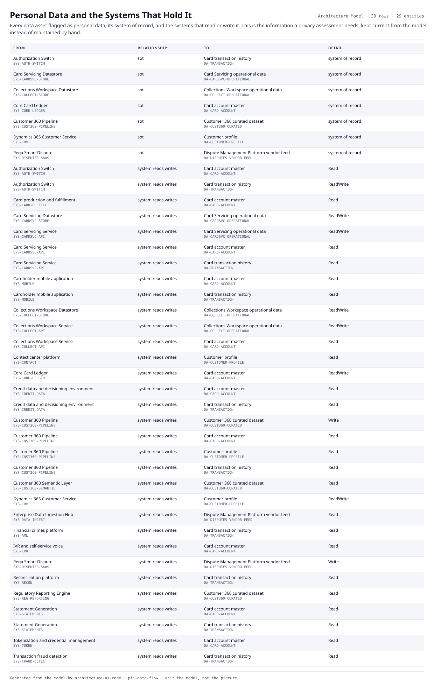

# Personal Data and the Systems That Hold It

Every data asset flagged as personal data, its system of record, and the systems that read or write it. This is the information a privacy assessment needs, kept current from the model instead of maintained by hand.

| From | | To | Detail |
|---|---|---|---|
| Authorization Switch  `SYS-AUTH-SWITCH` | sot | Card transaction history  `DA-TRANSACTION` | system of record |
| Card Servicing Datastore  `SYS-CARDSVC-STORE` | sot | Card Servicing operational data  `DA-CARDSVC-OPERATIONAL` | system of record |
| Collections Workspace Datastore  `SYS-COLLECT-STORE` | sot | Collections Workspace operational data  `DA-COLLECT-OPERATIONAL` | system of record |
| Core Card Ledger  `SYS-CORE-LEDGER` | sot | Card account master  `DA-CARD-ACCOUNT` | system of record |
| Customer 360 Pipeline  `SYS-CUST360-PIPELINE` | sot | Customer 360 curated dataset  `DA-CUST360-CURATED` | system of record |
| Dynamics 365 Customer Service  `SYS-CRM` | sot | Customer profile  `DA-CUSTOMER-PROFILE` | system of record |
| Pega Smart Dispute  `SYS-DISPUTES-SAAS` | sot | Dispute Management Platform vendor feed  `DA-DISPUTES-VENDOR-FEED` | system of record |
| Authorization Switch  `SYS-AUTH-SWITCH` | system reads writes | Card account master  `DA-CARD-ACCOUNT` | Read |
| Authorization Switch  `SYS-AUTH-SWITCH` | system reads writes | Card transaction history  `DA-TRANSACTION` | ReadWrite |
| Card production and fulfillment  `SYS-CARD-FULFILL` | system reads writes | Card account master  `DA-CARD-ACCOUNT` | Read |
| Card Servicing Datastore  `SYS-CARDSVC-STORE` | system reads writes | Card Servicing operational data  `DA-CARDSVC-OPERATIONAL` | ReadWrite |
| Card Servicing Service  `SYS-CARDSVC-API` | system reads writes | Card Servicing operational data  `DA-CARDSVC-OPERATIONAL` | ReadWrite |
| Card Servicing Service  `SYS-CARDSVC-API` | system reads writes | Card account master  `DA-CARD-ACCOUNT` | Read |
| Card Servicing Service  `SYS-CARDSVC-API` | system reads writes | Card transaction history  `DA-TRANSACTION` | Read |
| Cardholder mobile application  `SYS-MOBILE` | system reads writes | Card account master  `DA-CARD-ACCOUNT` | Read |
| Cardholder mobile application  `SYS-MOBILE` | system reads writes | Card transaction history  `DA-TRANSACTION` | Read |
| Collections Workspace Datastore  `SYS-COLLECT-STORE` | system reads writes | Collections Workspace operational data  `DA-COLLECT-OPERATIONAL` | ReadWrite |
| Collections Workspace Service  `SYS-COLLECT-API` | system reads writes | Collections Workspace operational data  `DA-COLLECT-OPERATIONAL` | ReadWrite |
| Collections Workspace Service  `SYS-COLLECT-API` | system reads writes | Card account master  `DA-CARD-ACCOUNT` | Read |
| Contact center platform  `SYS-CONTACT` | system reads writes | Customer profile  `DA-CUSTOMER-PROFILE` | Read |
| Core Card Ledger  `SYS-CORE-LEDGER` | system reads writes | Card account master  `DA-CARD-ACCOUNT` | ReadWrite |
| Credit data and decisioning environment  `SYS-CREDIT-DATA` | system reads writes | Card account master  `DA-CARD-ACCOUNT` | Read |
| Credit data and decisioning environment  `SYS-CREDIT-DATA` | system reads writes | Card transaction history  `DA-TRANSACTION` | Read |
| Customer 360 Pipeline  `SYS-CUST360-PIPELINE` | system reads writes | Customer 360 curated dataset  `DA-CUST360-CURATED` | Write |
| Customer 360 Pipeline  `SYS-CUST360-PIPELINE` | system reads writes | Card account master  `DA-CARD-ACCOUNT` | Read |
| Customer 360 Pipeline  `SYS-CUST360-PIPELINE` | system reads writes | Customer profile  `DA-CUSTOMER-PROFILE` | Read |
| Customer 360 Pipeline  `SYS-CUST360-PIPELINE` | system reads writes | Card transaction history  `DA-TRANSACTION` | Read |
| Customer 360 Semantic Layer  `SYS-CUST360-SEMANTIC` | system reads writes | Customer 360 curated dataset  `DA-CUST360-CURATED` | Read |
| Dynamics 365 Customer Service  `SYS-CRM` | system reads writes | Customer profile  `DA-CUSTOMER-PROFILE` | ReadWrite |
| Enterprise Data Ingestion Hub  `SYS-DATA-INGEST` | system reads writes | Dispute Management Platform vendor feed  `DA-DISPUTES-VENDOR-FEED` | Read |
| Financial crimes platform  `SYS-AML` | system reads writes | Card transaction history  `DA-TRANSACTION` | Read |
| IVR and self-service voice  `SYS-IVR` | system reads writes | Card account master  `DA-CARD-ACCOUNT` | Read |
| Pega Smart Dispute  `SYS-DISPUTES-SAAS` | system reads writes | Dispute Management Platform vendor feed  `DA-DISPUTES-VENDOR-FEED` | Write |
| Reconciliation platform  `SYS-RECON` | system reads writes | Card transaction history  `DA-TRANSACTION` | Read |
| Regulatory Reporting Engine  `SYS-REG-REPORTING` | system reads writes | Customer 360 curated dataset  `DA-CUST360-CURATED` | Read |
| Statement Generation  `SYS-STATEMENTS` | system reads writes | Card account master  `DA-CARD-ACCOUNT` | Read |
| Statement Generation  `SYS-STATEMENTS` | system reads writes | Card transaction history  `DA-TRANSACTION` | Read |
| Tokenization and credential management  `SYS-TOKEN` | system reads writes | Card account master  `DA-CARD-ACCOUNT` | Read |
| Transaction fraud detection  `SYS-FRAUD-DETECT` | system reads writes | Card transaction history  `DA-TRANSACTION` | Read |

39 relationships across 29 entities. Generated from the model; this is a report rather than a diagram, so it is a table.
