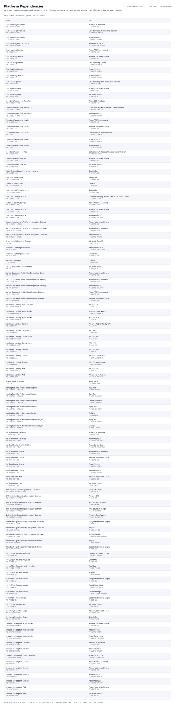

# Platform Dependencies

Which technology services each system runs on. The systems attached to a service are the ones affected if that service changes.

| From | | To |
|---|---|---|
| Card Servicing Datastore  `SYS-CARDSVC-STORE` | system uses tech service | Azure SQL Database  `TS-AZURE-SQL` |
| Card Servicing Datastore  `SYS-CARDSVC-STORE` | system uses tech service | Card Servicing Backup and recovery  `TS-CARDSVC-BACKUP` |
| Card Servicing Datastore  `SYS-CARDSVC-STORE` | system uses tech service | Azure Key Vault  `TS-AZURE-KEYVAULT` |
| Card Servicing Event Publisher  `SYS-CARDSVC-EVENTS` | system uses tech service | Azure Service Bus  `TS-AZURE-SERVICEBUS` |
| Card Servicing Service  `SYS-CARDSVC-API` | system uses tech service | Azure API Management  `TS-AZURE-APIM` |
| Card Servicing Service  `SYS-CARDSVC-API` | system uses tech service | Azure Kubernetes Service  `TS-AZURE-AKS` |
| Card Servicing Service  `SYS-CARDSVC-API` | system uses tech service | Card Servicing Cache  `TS-CARDSVC-CACHE` |
| Card Servicing Service  `SYS-CARDSVC-API` | system uses tech service | Azure Monitor  `TS-AZURE-MONITOR` |
| Card Servicing Service  `SYS-CARDSVC-API` | system uses tech service | Azure Key Vault  `TS-AZURE-KEYVAULT` |
| Card Servicing Web  `SYS-CARDSVC-WEB` | system uses tech service | Card Servicing Web application firewall  `TS-CARDSVC-WAF` |
| Card Servicing Web  `SYS-CARDSVC-WEB` | system uses tech service | Azure Kubernetes Service  `TS-AZURE-AKS` |
| Card Servicing Web  `SYS-CARDSVC-WEB` | system uses tech service | Microsoft Entra ID  `TS-ENTRA-ID` |
| Collections Workspace Datastore  `SYS-COLLECT-STORE` | system uses tech service | Azure SQL Database  `TS-AZURE-SQL` |
| Collections Workspace Datastore  `SYS-COLLECT-STORE` | system uses tech service | Collections Workspace Backup and recovery  `TS-COLLECT-BACKUP` |
| Collections Workspace Datastore  `SYS-COLLECT-STORE` | system uses tech service | Azure Key Vault  `TS-AZURE-KEYVAULT` |
| Collections Workspace Service  `SYS-COLLECT-API` | system uses tech service | Azure API Management  `TS-AZURE-APIM` |
| Collections Workspace Service  `SYS-COLLECT-API` | system uses tech service | Azure Kubernetes Service  `TS-AZURE-AKS` |
| Collections Workspace Service  `SYS-COLLECT-API` | system uses tech service | Collections Workspace Cache  `TS-COLLECT-CACHE` |
| Collections Workspace Service  `SYS-COLLECT-API` | system uses tech service | Azure Monitor  `TS-AZURE-MONITOR` |
| Collections Workspace Service  `SYS-COLLECT-API` | system uses tech service | Azure Key Vault  `TS-AZURE-KEYVAULT` |
| Collections Workspace Web  `SYS-COLLECT-WEB` | system uses tech service | Collections Workspace Web application firewall  `TS-COLLECT-WAF` |
| Collections Workspace Web  `SYS-COLLECT-WEB` | system uses tech service | Azure Kubernetes Service  `TS-AZURE-AKS` |
| Collections Workspace Web  `SYS-COLLECT-WEB` | system uses tech service | Microsoft Entra ID  `TS-ENTRA-ID` |
| Credit data and decisioning environment  `SYS-CREDIT-DATA` | system uses tech service | Snowflake  `TS-SNOWFLAKE` |
| Customer 360 Pipeline  `SYS-CUST360-PIPELINE` | system uses tech service | Snowflake  `TS-SNOWFLAKE` |
| Customer 360 Pipeline  `SYS-CUST360-PIPELINE` | system uses tech service | Collibra  `TS-COLLIBRA` |
| Customer 360 Semantic Layer  `SYS-CUST360-SEMANTIC` | system uses tech service | Snowflake  `TS-SNOWFLAKE` |
| Customer Identity Service  `SYS-IDENTITY-SVC` | system uses tech service | Customer Identity Service Web application firewall  `TS-IDENTITY-WAF` |
| Customer Identity Service  `SYS-IDENTITY-SVC` | system uses tech service | Azure API Management  `TS-AZURE-APIM` |
| Customer Identity Service  `SYS-IDENTITY-SVC` | system uses tech service | Azure Kubernetes Service  `TS-AZURE-AKS` |
| Customer Identity Service  `SYS-IDENTITY-SVC` | system uses tech service | Azure Key Vault  `TS-AZURE-KEYVAULT` |
| Dispute Management Platform Integration Gateway  `SYS-DISPUTES-GATEWAY` | system uses tech service | Azure Kubernetes Service  `TS-AZURE-AKS` |
| Dispute Management Platform Integration Gateway  `SYS-DISPUTES-GATEWAY` | system uses tech service | Azure API Management  `TS-AZURE-APIM` |
| Dispute Management Platform Integration Gateway  `SYS-DISPUTES-GATEWAY` | system uses tech service | Azure Key Vault  `TS-AZURE-KEYVAULT` |
| Dynamics 365 Customer Service  `SYS-CRM` | system uses tech service | Microsoft Entra ID  `TS-ENTRA-ID` |
| Enterprise Data Ingestion Hub  `SYS-DATA-INGEST` | system uses tech service | Azure Service Bus  `TS-AZURE-SERVICEBUS` |
| Enterprise Data Ingestion Hub  `SYS-DATA-INGEST` | system uses tech service | Snowflake  `TS-SNOWFLAKE` |
| Governance catalog  `SYS-CATALOG` | system uses tech service | Collibra  `TS-COLLIBRA` |
| Identity and access management  `SYS-IAM` | system uses tech service | Microsoft Entra ID  `TS-ENTRA-ID` |
| Identity Document Verification Integration Gateway  `SYS-IDV-GATEWAY` | system uses tech service | Azure Kubernetes Service  `TS-AZURE-AKS` |
| Identity Document Verification Integration Gateway  `SYS-IDV-GATEWAY` | system uses tech service | Azure API Management  `TS-AZURE-APIM` |
| Identity Document Verification Integration Gateway  `SYS-IDV-GATEWAY` | system uses tech service | Azure Key Vault  `TS-AZURE-KEYVAULT` |
| Identity Document Verification Webhook Listener  `SYS-IDV-WEBHOOKS` | system uses tech service | Azure API Management  `TS-AZURE-APIM` |
| Identity Document Verification Webhook Listener  `SYS-IDV-WEBHOOKS` | system uses tech service | Azure Kubernetes Service  `TS-AZURE-AKS` |
| Installment Lending Async Worker  `SYS-LENDING-WORKER` | system uses tech service | Amazon EKS  `TS-AWS-EKS` |
| Installment Lending Async Worker  `SYS-LENDING-WORKER` | system uses tech service | Amazon CloudWatch  `TS-AWS-CLOUDWATCH` |
| Installment Lending Async Worker  `SYS-LENDING-WORKER` | system uses tech service | Amazon MSK  `TS-AWS-MSK` |
| Installment Lending Database  `SYS-LENDING-DB` | system uses tech service | Amazon RDS for PostgreSQL  `TS-AWS-RDS` |
| Installment Lending Database  `SYS-LENDING-DB` | system uses tech service | AWS KMS  `TS-AWS-KMS` |
| Installment Lending Object Store  `SYS-LENDING-BUCKET` | system uses tech service | Amazon S3  `TS-AWS-S3` |
| Installment Lending Object Store  `SYS-LENDING-BUCKET` | system uses tech service | AWS KMS  `TS-AWS-KMS` |
| Installment Lending Service  `SYS-LENDING-API` | system uses tech service | Amazon EKS  `TS-AWS-EKS` |
| Installment Lending Service  `SYS-LENDING-API` | system uses tech service | Amazon CloudWatch  `TS-AWS-CLOUDWATCH` |
| Installment Lending Service  `SYS-LENDING-API` | system uses tech service | AWS Secrets Manager  `TS-AWS-SECRETS` |
| Installment Lending Web  `SYS-LENDING-WEB` | system uses tech service | Amazon EKS  `TS-AWS-EKS` |
| Installment Lending Web  `SYS-LENDING-WEB` | system uses tech service | Amazon CloudWatch  `TS-AWS-CLOUDWATCH` |
| IT service management  `SYS-ITSM` | system uses tech service | ServiceNow  `TS-SERVICENOW` |
| Lending Portfolio Performance Pipeline  `SYS-LENDPERF-PIPELINE` | system uses tech service | Pub/Sub  `TS-GCP-PUBSUB` |
| Lending Portfolio Performance Pipeline  `SYS-LENDPERF-PIPELINE` | system uses tech service | Dataflow  `TS-GCP-DATAFLOW` |
| Lending Portfolio Performance Pipeline  `SYS-LENDPERF-PIPELINE` | system uses tech service | Cloud Composer  `TS-GCP-COMPOSER` |
| Lending Portfolio Performance Pipeline  `SYS-LENDPERF-PIPELINE` | system uses tech service | BigQuery  `TS-GCP-BIGQUERY` |
| Lending Portfolio Performance Pipeline  `SYS-LENDPERF-PIPELINE` | system uses tech service | Collibra  `TS-COLLIBRA` |
| Lending Portfolio Performance Semantic Layer  `SYS-LENDPERF-SEMANTIC` | system uses tech service | BigQuery  `TS-GCP-BIGQUERY` |
| Lending Portfolio Performance Semantic Layer  `SYS-LENDPERF-SEMANTIC` | system uses tech service | Looker  `TS-GCP-LOOKER` |
| Merchant Portal Database  `SYS-MERCHANT-STORE` | system uses tech service | Azure SQL Database  `TS-AZURE-SQL` |
| Merchant Portal Database  `SYS-MERCHANT-STORE` | system uses tech service | Azure Key Vault  `TS-AZURE-KEYVAULT` |
| Merchant Portal Event Publisher  `SYS-MERCHANT-EVENTS` | system uses tech service | Azure Service Bus  `TS-AZURE-SERVICEBUS` |
| Merchant Portal Service  `SYS-MERCHANT-API` | system uses tech service | Azure API Management  `TS-AZURE-APIM` |
| Merchant Portal Service  `SYS-MERCHANT-API` | system uses tech service | Azure Kubernetes Service  `TS-AZURE-AKS` |
| Merchant Portal Service  `SYS-MERCHANT-API` | system uses tech service | Azure Monitor  `TS-AZURE-MONITOR` |
| Merchant Portal Service  `SYS-MERCHANT-API` | system uses tech service | Azure Key Vault  `TS-AZURE-KEYVAULT` |
| Merchant Portal Web  `SYS-MERCHANT-WEB` | system uses tech service | Azure Kubernetes Service  `TS-AZURE-AKS` |
| Merchant Portal Web  `SYS-MERCHANT-WEB` | system uses tech service | Microsoft Entra ID  `TS-ENTRA-ID` |
| NICE Actimize Screening Identity Federation  `SYS-SCREENING-FEDERATION` | system uses tech service | Microsoft Entra ID  `TS-ENTRA-ID` |
| NICE Actimize Screening Integration Gateway  `SYS-SCREENING-GATEWAY` | system uses tech service | Amazon EKS  `TS-AWS-EKS` |
| NICE Actimize Screening Integration Gateway  `SYS-SCREENING-GATEWAY` | system uses tech service | Amazon API Gateway  `TS-AWS-APIGW` |
| NICE Actimize Screening Integration Gateway  `SYS-SCREENING-GATEWAY` | system uses tech service | AWS Secrets Manager  `TS-AWS-SECRETS` |
| NICE Actimize Screening Integration Gateway  `SYS-SCREENING-GATEWAY` | system uses tech service | Amazon CloudWatch  `TS-AWS-CLOUDWATCH` |
| Open Banking Affordability Integration Gateway  `SYS-OBAFF-GATEWAY` | system uses tech service | Google Kubernetes Engine  `TS-GCP-GKE` |
| Open Banking Affordability Integration Gateway  `SYS-OBAFF-GATEWAY` | system uses tech service | Apigee  `TS-GCP-APIGEE` |
| Open Banking Affordability Integration Gateway  `SYS-OBAFF-GATEWAY` | system uses tech service | Secret Manager  `TS-GCP-SECRET-MANAGER` |
| Open Banking Affordability Webhook Listener  `SYS-OBAFF-WEBHOOKS` | system uses tech service | Apigee  `TS-GCP-APIGEE` |
| Open Banking Affordability Webhook Listener  `SYS-OBAFF-WEBHOOKS` | system uses tech service | Google Kubernetes Engine  `TS-GCP-GKE` |
| Point-of-Sale Finance Database  `SYS-POSFIN-DB` | system uses tech service | Cloud SQL for PostgreSQL  `TS-GCP-CLOUD-SQL` |
| Point-of-Sale Finance Database  `SYS-POSFIN-DB` | system uses tech service | Cloud KMS  `TS-GCP-KMS` |
| Point-of-Sale Finance Event Publisher  `SYS-POSFIN-EVENTS` | system uses tech service | Pub/Sub  `TS-GCP-PUBSUB` |
| Point-of-Sale Finance Service  `SYS-POSFIN-API` | system uses tech service | Apigee  `TS-GCP-APIGEE` |
| Point-of-Sale Finance Service  `SYS-POSFIN-API` | system uses tech service | Google Kubernetes Engine  `TS-GCP-GKE` |
| Point-of-Sale Finance Service  `SYS-POSFIN-API` | system uses tech service | Cloud Monitoring  `TS-GCP-MONITORING` |
| Point-of-Sale Finance Service  `SYS-POSFIN-API` | system uses tech service | Secret Manager  `TS-GCP-SECRET-MANAGER` |
| Point-of-Sale Finance Web  `SYS-POSFIN-WEB` | system uses tech service | Google Kubernetes Engine  `TS-GCP-GKE` |
| Point-of-Sale Finance Web  `SYS-POSFIN-WEB` | system uses tech service | Microsoft Entra ID  `TS-ENTRA-ID` |
| Regulatory Reporting Engine  `SYS-REG-REPORTING` | system uses tech service | Azure Kubernetes Service  `TS-AZURE-AKS` |
| Regulatory Reporting Engine  `SYS-REG-REPORTING` | system uses tech service | Snowflake  `TS-SNOWFLAKE` |
| Rewards Redemption Async Worker  `SYS-REWARDS-WORKER` | system uses tech service | Azure Kubernetes Service  `TS-AZURE-AKS` |
| Rewards Redemption Async Worker  `SYS-REWARDS-WORKER` | system uses tech service | Azure Monitor  `TS-AZURE-MONITOR` |
| Rewards Redemption Async Worker  `SYS-REWARDS-WORKER` | system uses tech service | Azure Event Hubs  `TS-AZURE-EVENTHUBS` |
| Rewards Redemption Database  `SYS-REWARDS-STORE` | system uses tech service | Azure SQL Database  `TS-AZURE-SQL` |
| Rewards Redemption Database  `SYS-REWARDS-STORE` | system uses tech service | Azure Key Vault  `TS-AZURE-KEYVAULT` |
| Rewards Redemption Event Publisher  `SYS-REWARDS-EVENTS` | system uses tech service | Azure Service Bus  `TS-AZURE-SERVICEBUS` |
| Rewards Redemption Service  `SYS-REWARDS-API` | system uses tech service | Azure API Management  `TS-AZURE-APIM` |
| Rewards Redemption Service  `SYS-REWARDS-API` | system uses tech service | Azure Kubernetes Service  `TS-AZURE-AKS` |
| Rewards Redemption Service  `SYS-REWARDS-API` | system uses tech service | Azure Monitor  `TS-AZURE-MONITOR` |
| Rewards Redemption Service  `SYS-REWARDS-API` | system uses tech service | Azure Key Vault  `TS-AZURE-KEYVAULT` |
| Rewards Redemption Web  `SYS-REWARDS-WEB` | system uses tech service | Azure Kubernetes Service  `TS-AZURE-AKS` |
| Rewards Redemption Web  `SYS-REWARDS-WEB` | system uses tech service | Microsoft Entra ID  `TS-ENTRA-ID` |

106 relationships across 91 entities. Generated from the model; this is a report rather than a diagram, so it is a table.
