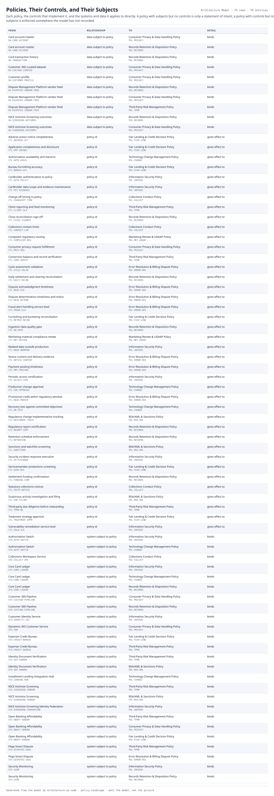

# Policies, Their Controls, and Their Subjects

Each policy, the controls that implement it, and the systems and data it applies to directly. A policy with subjects but no controls is only a statement of intent; a policy with controls but no subjects is enforced somewhere the model has not recorded.

| From | | To | Detail |
|---|---|---|---|
| Card account master  `DA-CARD-ACCOUNT` | data subject to policy | Consumer Privacy & Data Handling Policy  `POL-PRIVACY` | binds |
| Card account master  `DA-CARD-ACCOUNT` | data subject to policy | Records Retention & Disposition Policy  `POL-RECORDS` | binds |
| Card transaction history  `DA-TRANSACTION` | data subject to policy | Records Retention & Disposition Policy  `POL-RECORDS` | binds |
| Customer 360 curated dataset  `DA-CUST360-CURATED` | data subject to policy | Consumer Privacy & Data Handling Policy  `POL-PRIVACY` | binds |
| Customer profile  `DA-CUSTOMER-PROFILE` | data subject to policy | Consumer Privacy & Data Handling Policy  `POL-PRIVACY` | binds |
| Dispute Management Platform vendor feed  `DA-DISPUTES-VENDOR-FEED` | data subject to policy | Records Retention & Disposition Policy  `POL-RECORDS` | binds |
| Dispute Management Platform vendor feed  `DA-DISPUTES-VENDOR-FEED` | data subject to policy | Consumer Privacy & Data Handling Policy  `POL-PRIVACY` | binds |
| Dispute Management Platform vendor feed  `DA-DISPUTES-VENDOR-FEED` | data subject to policy | Third-Party Risk Management Policy  `POL-TPRM` | binds |
| NICE Actimize Screening outcomes  `DA-SCREENING-OUTCOMES` | data subject to policy | Records Retention & Disposition Policy  `POL-RECORDS` | binds |
| NICE Actimize Screening outcomes  `DA-SCREENING-OUTCOMES` | data subject to policy | Consumer Privacy & Data Handling Policy  `POL-PRIVACY` | binds |
| Adverse action notice completeness  `CTL-ADVERSE-ACT` | policy id | Fair Lending & Credit Decision Policy  `POL-FAIR-LEND` | gives effect to |
| Application completeness and disclosure  `CTL-APP-INTAKE` | policy id | Fair Lending & Credit Decision Policy  `POL-FAIR-LEND` | gives effect to |
| Authorization availability and stand-in  `CTL-AUTH-AVAIL` | policy id | Technology Change Management Policy  `POL-CHANGE` | gives effect to |
| Bureau furnishing accuracy  `CTL-BUREAU-ACC` | policy id | Fair Lending & Credit Decision Policy  `POL-FAIR-LEND` | gives effect to |
| Cardholder authentication to policy  `CTL-AUTH-POLICY` | policy id | Information Security Policy  `POL-INFOSEC` | gives effect to |
| Cardholder data scope and evidence maintenance  `CTL-PCI-EVIDENCE` | policy id | Information Security Policy  `POL-INFOSEC` | gives effect to |
| Charge-off timing to policy  `CTL-CHARGEOFF-TIME` | policy id | Collections Conduct Policy  `POL-COLLECT` | gives effect to |
| Client reporting and feed monitoring  `CTL-CLIENT-SLA` | policy id | Third-Party Risk Management Policy  `POL-TPRM` | gives effect to |
| Close reconciliation sign-off  `CTL-CLOSE-SIGNOFF` | policy id | Records Retention & Disposition Policy  `POL-RECORDS` | gives effect to |
| Collections contact limits  `CTL-CONTACT-LIM` | policy id | Collections Conduct Policy  `POL-COLLECT` | gives effect to |
| Complaint regulatory routing  `CTL-COMPLAINT-REG` | policy id | Marketing Review & UDAAP Policy  `POL-MKT-UDAAP` | gives effect to |
| Consumer privacy request fulfillment  `CTL-PRIV-REQ` | policy id | Consumer Privacy & Data Handling Policy  `POL-PRIVACY` | gives effect to |
| Conversion balance and record verification  `CTL-CONV-VERIFY` | policy id | Third-Party Risk Management Policy  `POL-TPRM` | gives effect to |
| Cycle assessment validation  `CTL-CYCLE-VALID` | policy id | Error Resolution & Billing Dispute Policy  `POL-ERROR-RES` | gives effect to |
| Daily settlement and clearing reconciliation  `CTL-DAILY-RECON` | policy id | Records Retention & Disposition Policy  `POL-RECORDS` | gives effect to |
| Dispute acknowledgment timeliness  `CTL-REGE-ACK` | policy id | Error Resolution & Billing Dispute Policy  `POL-ERROR-RES` | gives effect to |
| Dispute determination timeliness and notice  `CTL-REGE-DETERM` | policy id | Error Resolution & Billing Dispute Policy  `POL-ERROR-RES` | gives effect to |
| Fraud alert handling service level  `CTL-FRAUD-SLA` | policy id | Error Resolution & Billing Dispute Policy  `POL-ERROR-RES` | gives effect to |
| Furnishing and bucketing reconciliation  `CTL-METRO2-RECON` | policy id | Fair Lending & Credit Decision Policy  `POL-FAIR-LEND` | gives effect to |
| Ingestion data quality gate  `CTL-DQ-GATE` | policy id | Records Retention & Disposition Policy  `POL-RECORDS` | gives effect to |
| Marketing material compliance review  `CTL-MKT-REVIEW` | policy id | Marketing Review & UDAAP Policy  `POL-MKT-UDAAP` | gives effect to |
| Masked data outside production  `CTL-MASK-NONPROD` | policy id | Information Security Policy  `POL-INFOSEC` | gives effect to |
| Notice content and delivery evidence  `CTL-NOTICE-CONTENT` | policy id | Error Resolution & Billing Dispute Policy  `POL-ERROR-RES` | gives effect to |
| Payment posting timeliness  `CTL-PMT-POSTING` | policy id | Error Resolution & Billing Dispute Policy  `POL-ERROR-RES` | gives effect to |
| Periodic access certification  `CTL-ACCESS-CERT` | policy id | Information Security Policy  `POL-INFOSEC` | gives effect to |
| Production change approval  `CTL-CHG-APPROVAL` | policy id | Technology Change Management Policy  `POL-CHANGE` | gives effect to |
| Provisional credit within regulatory window  `CTL-REGE-PROVCR` | policy id | Error Resolution & Billing Dispute Policy  `POL-ERROR-RES` | gives effect to |
| Recovery test against committed objectives  `CTL-DR-TEST` | policy id | Technology Change Management Policy  `POL-CHANGE` | gives effect to |
| Regulatory change implementation tracking  `CTL-REGCHANGE-TRACK` | policy id | BSA/AML & Sanctions Policy  `POL-BSA-AML` | gives effect to |
| Regulatory report certification  `CTL-REGRPT-CERT` | policy id | Records Retention & Disposition Policy  `POL-RECORDS` | gives effect to |
| Retention schedule enforcement  `CTL-RETENTION` | policy id | Records Retention & Disposition Policy  `POL-RECORDS` | gives effect to |
| Sanctions and watchlist screening  `CTL-SANCTIONS` | policy id | BSA/AML & Sanctions Policy  `POL-BSA-AML` | gives effect to |
| Security incident response execution  `CTL-IR-PLAYBOOK` | policy id | Information Security Policy  `POL-INFOSEC` | gives effect to |
| Servicemember protections screening  `CTL-SCRA-MLA` | policy id | Fair Lending & Credit Decision Policy  `POL-FAIR-LEND` | gives effect to |
| Settlement funding confirmation  `CTL-FUNDING-CONF` | policy id | Records Retention & Disposition Policy  `POL-RECORDS` | gives effect to |
| Statutory collections notices  `CTL-FDCPA-NOTICE` | policy id | Collections Conduct Policy  `POL-COLLECT` | gives effect to |
| Suspicious activity investigation and filing  `CTL-SAR-FILING` | policy id | BSA/AML & Sanctions Policy  `POL-BSA-AML` | gives effect to |
| Third-party due diligence before onboarding  `CTL-TPRM-DD` | policy id | Third-Party Risk Management Policy  `POL-TPRM` | gives effect to |
| Treatment strategy approval  `CTL-TREATMENT-APPR` | policy id | Fair Lending & Credit Decision Policy  `POL-FAIR-LEND` | gives effect to |
| Vulnerability remediation service level  `CTL-VULN-SLA` | policy id | Information Security Policy  `POL-INFOSEC` | gives effect to |
| Authorization Switch  `SYS-AUTH-SWITCH` | system subject to policy | Information Security Policy  `POL-INFOSEC` | binds |
| Authorization Switch  `SYS-AUTH-SWITCH` | system subject to policy | Technology Change Management Policy  `POL-CHANGE` | binds |
| Collections Workspace Service  `SYS-COLLECT-API` | system subject to policy | Collections Conduct Policy  `POL-COLLECT` | binds |
| Core Card Ledger  `SYS-CORE-LEDGER` | system subject to policy | Information Security Policy  `POL-INFOSEC` | binds |
| Core Card Ledger  `SYS-CORE-LEDGER` | system subject to policy | Technology Change Management Policy  `POL-CHANGE` | binds |
| Core Card Ledger  `SYS-CORE-LEDGER` | system subject to policy | Records Retention & Disposition Policy  `POL-RECORDS` | binds |
| Customer 360 Pipeline  `SYS-CUST360-PIPELINE` | system subject to policy | Consumer Privacy & Data Handling Policy  `POL-PRIVACY` | binds |
| Customer 360 Pipeline  `SYS-CUST360-PIPELINE` | system subject to policy | Records Retention & Disposition Policy  `POL-RECORDS` | binds |
| Customer Identity Service  `SYS-IDENTITY-SVC` | system subject to policy | Information Security Policy  `POL-INFOSEC` | binds |
| Dynamics 365 Customer Service  `SYS-CRM` | system subject to policy | Consumer Privacy & Data Handling Policy  `POL-PRIVACY` | binds |
| Experian Credit Bureau  `SYS-CREDIT-BUREAU` | system subject to policy | Fair Lending & Credit Decision Policy  `POL-FAIR-LEND` | binds |
| Experian Credit Bureau  `SYS-CREDIT-BUREAU` | system subject to policy | Third-Party Risk Management Policy  `POL-TPRM` | binds |
| Identity Document Verification  `SYS-IDV-VENDOR` | system subject to policy | Third-Party Risk Management Policy  `POL-TPRM` | binds |
| Identity Document Verification  `SYS-IDV-VENDOR` | system subject to policy | BSA/AML & Sanctions Policy  `POL-BSA-AML` | binds |
| Installment Lending Integration Hub  `SYS-LENDING-HUB` | system subject to policy | Technology Change Management Policy  `POL-CHANGE` | binds |
| NICE Actimize Screening  `SYS-SCREENING-VENDOR` | system subject to policy | Third-Party Risk Management Policy  `POL-TPRM` | binds |
| NICE Actimize Screening  `SYS-SCREENING-VENDOR` | system subject to policy | BSA/AML & Sanctions Policy  `POL-BSA-AML` | binds |
| NICE Actimize Screening Identity Federation  `SYS-SCREENING-FEDERATION` | system subject to policy | Information Security Policy  `POL-INFOSEC` | binds |
| Open Banking Affordability  `SYS-OBAFF-VENDOR` | system subject to policy | Third-Party Risk Management Policy  `POL-TPRM` | binds |
| Open Banking Affordability  `SYS-OBAFF-VENDOR` | system subject to policy | Consumer Privacy & Data Handling Policy  `POL-PRIVACY` | binds |
| Open Banking Affordability  `SYS-OBAFF-VENDOR` | system subject to policy | Fair Lending & Credit Decision Policy  `POL-FAIR-LEND` | binds |
| Pega Smart Dispute  `SYS-DISPUTES-SAAS` | system subject to policy | Third-Party Risk Management Policy  `POL-TPRM` | binds |
| Pega Smart Dispute  `SYS-DISPUTES-SAAS` | system subject to policy | Error Resolution & Billing Dispute Policy  `POL-ERROR-RES` | binds |
| Security Monitoring  `SYS-SIEM` | system subject to policy | Information Security Policy  `POL-INFOSEC` | binds |
| Security Monitoring  `SYS-SIEM` | system subject to policy | Records Retention & Disposition Policy  `POL-RECORDS` | binds |

75 relationships across 70 entities. Generated from the model; this is a report rather than a diagram, so it is a table.
