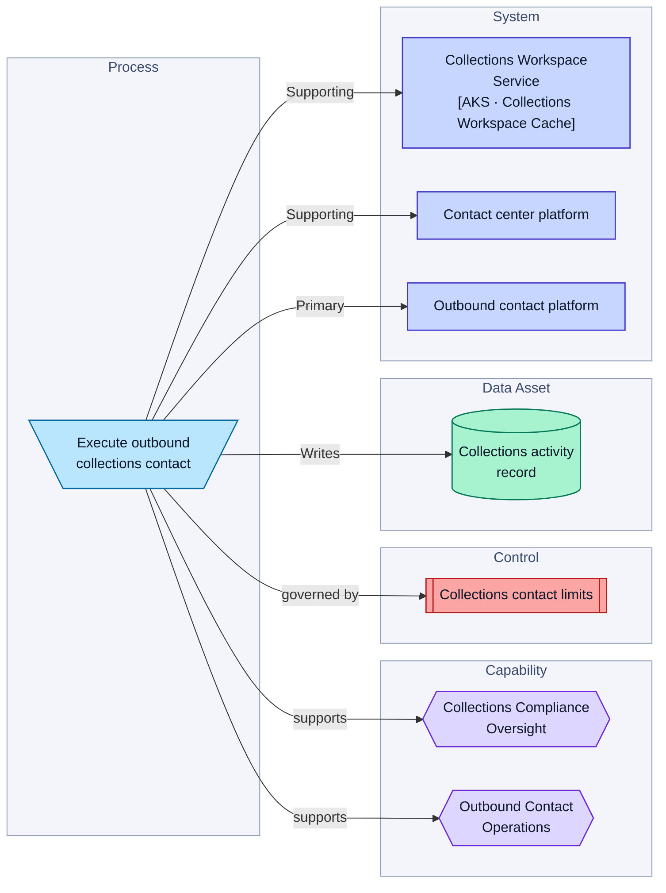
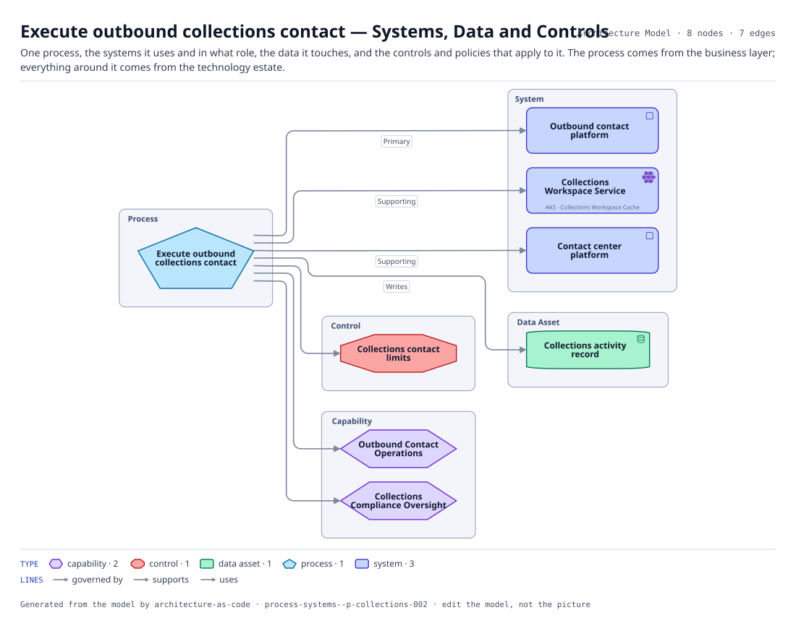

# Execute outbound collections contact — Systems, Data and Controls

One process, the systems it uses and in what role, the data it touches, and the controls and policies that apply to it. The process comes from the business layer; everything around it comes from the technology estate.

The same view as the app draws it, written beside the Mermaid by `terrane render`:

**Hue is the entity type.**

| | Entity type |
|---|---|
| `#6d28d9` | capabilities |
| `#b91c1c` | controls |
| `#047857` | data assets |
| `#0369a1` | processes |
| `#4338ca` | systems |

8 entities, 7 relationships. Generated from the model; edit the model, not this file.
