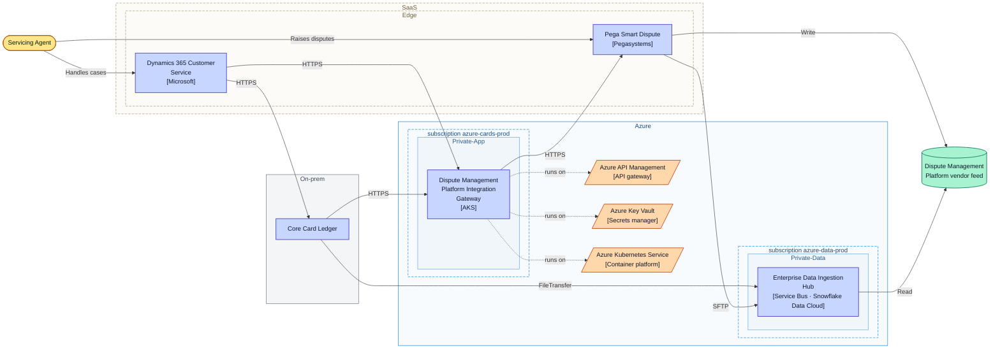
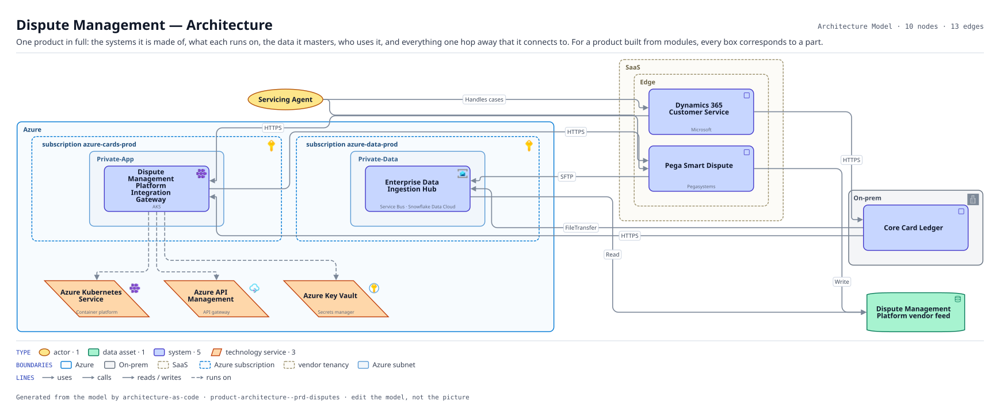

# Dispute Management — Architecture

One product in full: the systems it is made of, what each runs on, the data it masters, who uses it, and everything one hop away that it connects to. For a product built from modules, every box corresponds to a part.

The same view as the app draws it, written beside the Mermaid by `terrane render`:

**Hue is the entity type.**

| | Entity type |
|---|---|
| `#b45309` | actors |
| `#047857` | data assets |
| `#4338ca` | systems |
| `#c2410c` | tech services |

**Boundaries** are drawn the way their provider draws them.

| Border | Boundary |
|---|---|
| solid `#0078d4` | Azure |
| solid `#5f6b7a` | On-prem |
| dashed `#9a8f6a` | SaaS |
| dashed `#0078d4` | Azure subscription |
| dashed `#9a8f6a` | vendor tenancy |
| solid `#5b9bd5` | Azure subnet |

## Flows across this diagram

Each flow is a recorded sequence of interfaces. The steps drawn on this diagram are numbered; a step whose interface is not on it is marked.

**Dispute and Chargeback**: A cardholder disputes a transaction. Raised in the contact center, handled in the vendor platform, settled back through the ledger.

1. Dynamics 365 Customer Service → Core Card Ledger (HTTPS)
2. Core Card Ledger → Dispute Management Platform Integration Gateway (HTTPS)
3. Dispute Management Platform Integration Gateway → Pega Smart Dispute (HTTPS)
4. Pega Smart Dispute → Enterprise Data Ingestion Hub (SFTP)

**Regulatory Return**: The monthly supervisory return. Entirely batch, and the only flow whose deadline is external and non-negotiable.

1. Core Card Ledger → Enterprise Data Ingestion Hub (FileTransfer)
2. Enterprise Data Ingestion Hub → Customer 360 Pipeline (Snowpipe) — not on this diagram
3. Customer 360 Pipeline → Customer 360 Semantic Layer (SQL) — not on this diagram
4. Customer 360 Semantic Layer → Regulatory Reporting Engine (SQL) — not on this diagram

10 entities, 13 relationships. Generated from the model; edit the model, not this file.
