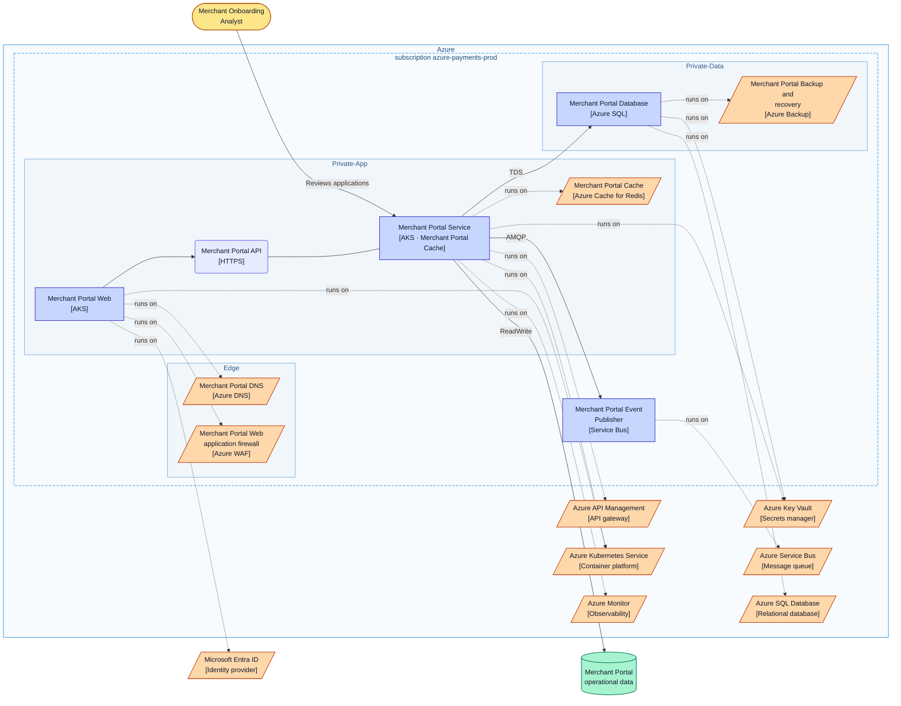
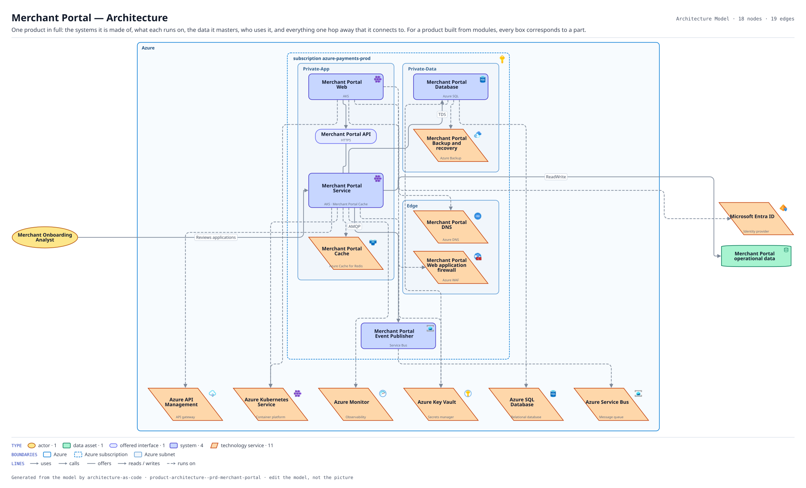

# Merchant Portal — Architecture

One product in full: the systems it is made of, what each runs on, the data it masters, who uses it, and everything one hop away that it connects to. For a product built from modules, every box corresponds to a part.

The same view as the app draws it, written beside the Mermaid by `terrane render`:

**Hue is the entity type.**

| | Entity type |
|---|---|
| `#b45309` | actors |
| `#047857` | data assets |
| `#6366f1` | offered interfaces |
| `#4338ca` | systems |
| `#c2410c` | tech services |

**Boundaries** are drawn the way their provider draws them.

| Border | Boundary |
|---|---|
| solid `#0078d4` | Azure |
| dashed `#0078d4` | Azure subscription |
| solid `#5b9bd5` | Azure subnet |

18 entities, 19 relationships. Generated from the model; edit the model, not this file.
