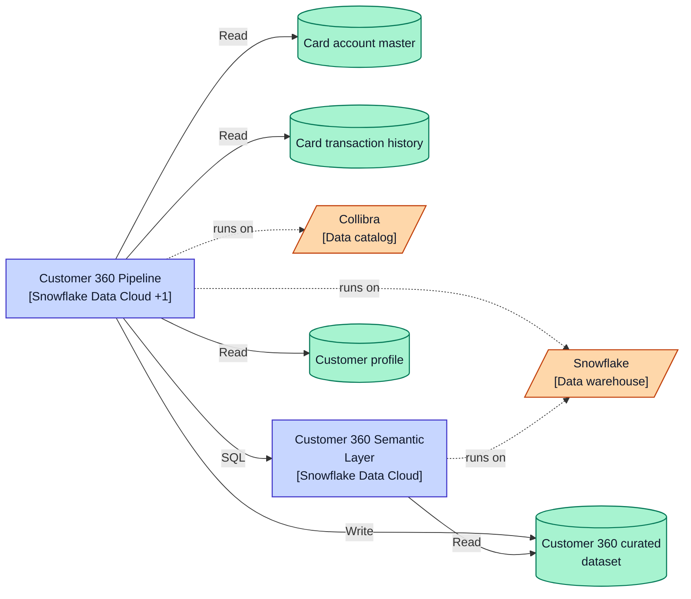
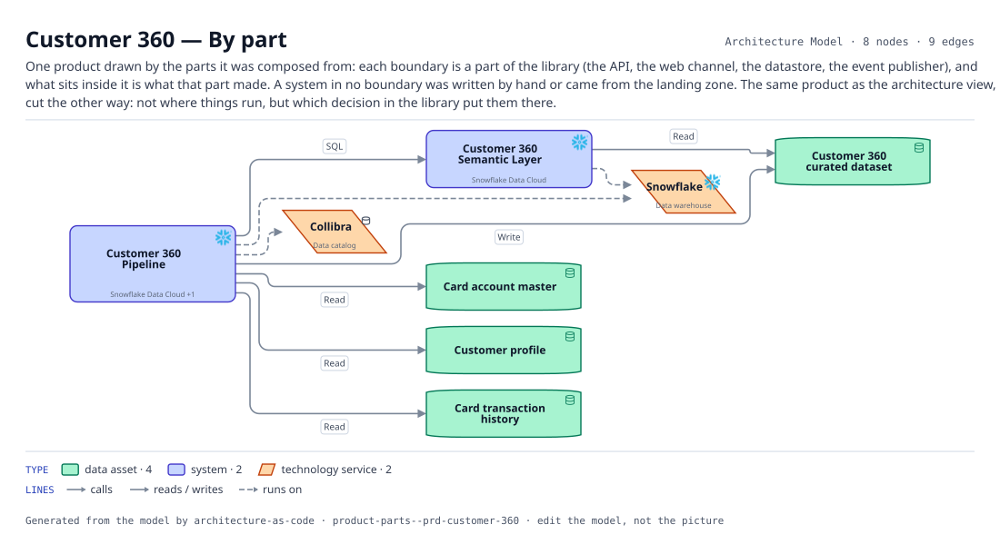

# Customer 360 — By part

One product drawn by the parts it was composed from: each boundary is a part of the library (the API, the web channel, the datastore, the event publisher), and what sits inside it is what that part made. A system in no boundary was written by hand or came from the landing zone. The same product as the architecture view, cut the other way: not where things run, but which decision in the library put them there.

The same view as the app draws it, written beside the Mermaid by `terrane render`:

**Hue is the entity type.**

| | Entity type |
|---|---|
| `#047857` | data assets |
| `#4338ca` | systems |
| `#c2410c` | tech services |

## Flows across this diagram

Each flow is a recorded sequence of interfaces. The steps drawn on this diagram are numbered; a step whose interface is not on it is marked.

**Regulatory Return**: The monthly supervisory return. Entirely batch, and the only flow whose deadline is external and non-negotiable.

1. Core Card Ledger → Enterprise Data Ingestion Hub (FileTransfer) — not on this diagram
2. Enterprise Data Ingestion Hub → Customer 360 Pipeline (Snowpipe) — not on this diagram
3. Customer 360 Pipeline → Customer 360 Semantic Layer (SQL)
4. Customer 360 Semantic Layer → Regulatory Reporting Engine (SQL) — not on this diagram

8 entities, 9 relationships. Generated from the model; edit the model, not this file.
