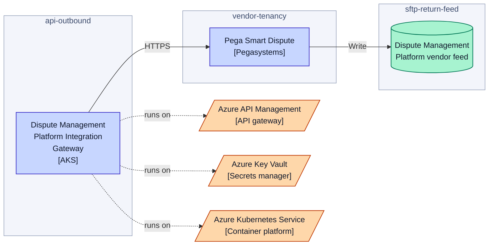
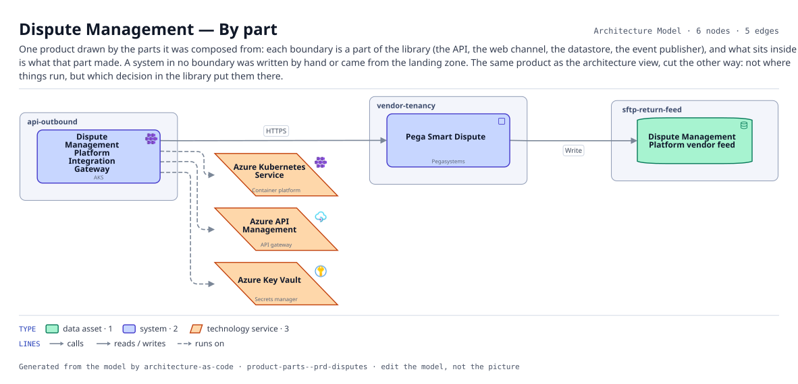

# Dispute Management — By part

One product drawn by the parts it was composed from: each boundary is a part of the library (the API, the web channel, the datastore, the event publisher), and what sits inside it is what that part made. A system in no boundary was written by hand or came from the landing zone. The same product as the architecture view, cut the other way: not where things run, but which decision in the library put them there.

The same view as the app draws it, written beside the Mermaid by `terrane render`:

**Hue is the entity type.**

| | Entity type |
|---|---|
| `#047857` | data assets |
| `#4338ca` | systems |
| `#c2410c` | tech services |

## Flows across this diagram

Each flow is a recorded sequence of interfaces. The steps drawn on this diagram are numbered; a step whose interface is not on it is marked.

**Dispute and Chargeback**: A cardholder disputes a transaction. Raised in the contact center, handled in the vendor platform, settled back through the ledger.

1. Dynamics 365 Customer Service → Core Card Ledger (HTTPS) — not on this diagram
2. Core Card Ledger → Dispute Management Platform Integration Gateway (HTTPS) — not on this diagram
3. Dispute Management Platform Integration Gateway → Pega Smart Dispute (HTTPS)
4. Pega Smart Dispute → Enterprise Data Ingestion Hub (SFTP) — not on this diagram

6 entities, 5 relationships. Generated from the model; edit the model, not this file.
