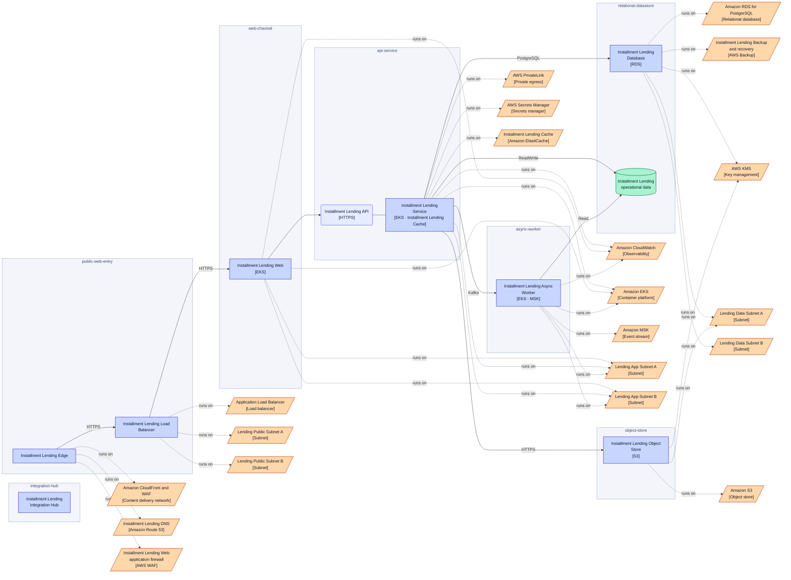
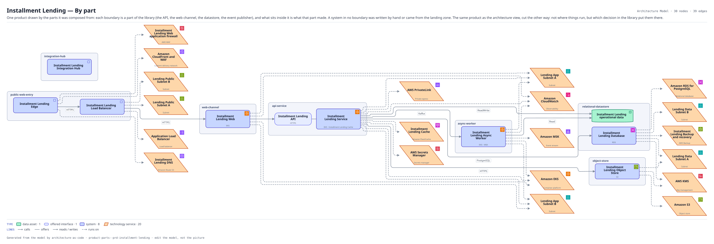

# Installment Lending — By part

One product drawn by the parts it was composed from: each boundary is a part of the library (the API, the web channel, the datastore, the event publisher), and what sits inside it is what that part made. A system in no boundary was written by hand or came from the landing zone. The same product as the architecture view, cut the other way: not where things run, but which decision in the library put them there.

The same view as the app draws it, written beside the Mermaid by `terrane render`:

**Hue is the entity type.**

| | Entity type |
|---|---|
| `#047857` | data assets |
| `#6366f1` | offered interfaces |
| `#4338ca` | systems |
| `#c2410c` | tech services |

## Flows across this diagram

Each flow is a recorded sequence of interfaces. The steps drawn on this diagram are numbered; a step whose interface is not on it is marked.

**Installment Loan Application**: An applicant applies for point-of-sale credit. Bureau search, affordability and a decision, with referral to an underwriter when the automated decision declines to take it.

1. Installment Lending Edge → Installment Lending Load Balancer (HTTPS)
2. Installment Lending Load Balancer → Installment Lending Web (HTTPS)
3. Installment Lending Web → Installment Lending Service (HTTPS)
4. Installment Lending Service → Customer Identity Service (HTTPS) — not on this diagram
5. Installment Lending Service → Experian Credit Bureau (HTTPS) — not on this diagram
6. Installment Lending Service → Installment Lending Database (PostgreSQL)
7. Installment Lending Service → Core Card Ledger (MQ) — not on this diagram
8. Installment Lending Service → Installment Lending Async Worker (Kafka)

30 entities, 39 relationships. Generated from the model; edit the model, not this file.
