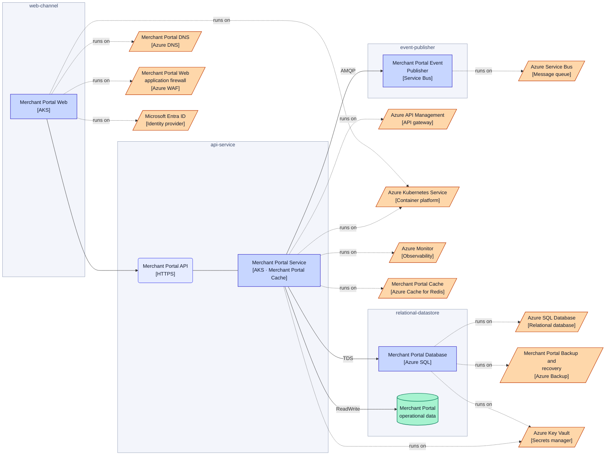
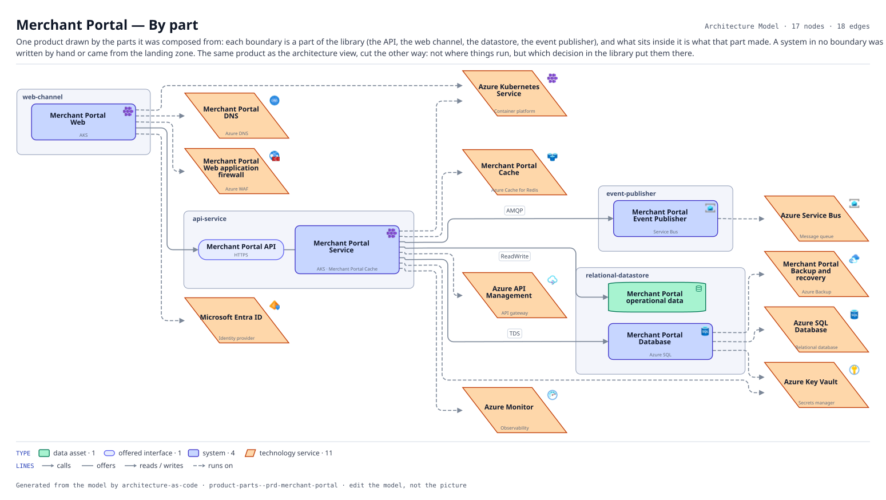

# Merchant Portal — By part

One product drawn by the parts it was composed from: each boundary is a part of the library (the API, the web channel, the datastore, the event publisher), and what sits inside it is what that part made. A system in no boundary was written by hand or came from the landing zone. The same product as the architecture view, cut the other way: not where things run, but which decision in the library put them there.

The same view as the app draws it, written beside the Mermaid by `terrane render`:

**Hue is the entity type.**

| | Entity type |
|---|---|
| `#047857` | data assets |
| `#6366f1` | offered interfaces |
| `#4338ca` | systems |
| `#c2410c` | tech services |

17 entities, 18 relationships. Generated from the model; edit the model, not this file.
