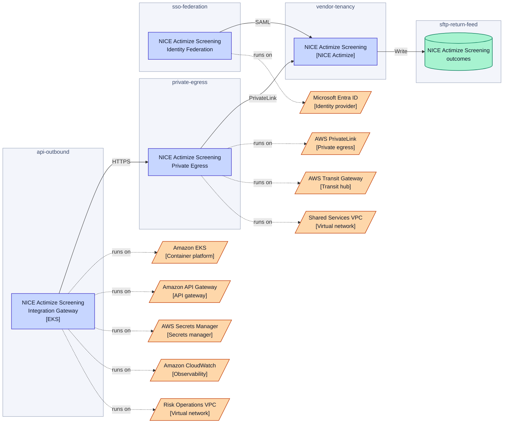
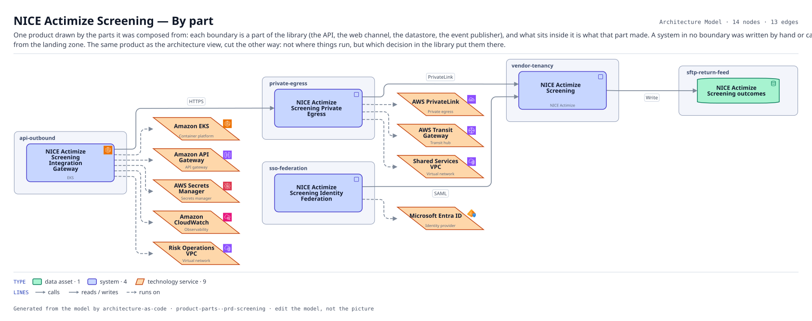

# NICE Actimize Screening — By part

One product drawn by the parts it was composed from: each boundary is a part of the library (the API, the web channel, the datastore, the event publisher), and what sits inside it is what that part made. A system in no boundary was written by hand or came from the landing zone. The same product as the architecture view, cut the other way: not where things run, but which decision in the library put them there.

The same view as the app draws it, written beside the Mermaid by `terrane render`:

**Hue is the entity type.**

| | Entity type |
|---|---|
| `#047857` | data assets |
| `#4338ca` | systems |
| `#c2410c` | tech services |

## Flows across this diagram

Each flow is a recorded sequence of interfaces. The steps drawn on this diagram are numbered; a step whose interface is not on it is marked.

**Card Authorization**: A card presented at a merchant, authorized or declined inside the scheme timeout. The tightest latency budget in the estate, and the reason the screening call has a circuit breaker rather than a retry.

1. Authorization Switch → NICE Actimize Screening Integration Gateway (HTTPS) — not on this diagram
2. NICE Actimize Screening Integration Gateway → NICE Actimize Screening Private Egress (HTTPS)
3. NICE Actimize Screening Private Egress → NICE Actimize Screening (PrivateLink)
4. Authorization Switch → Core Card Ledger (MQ) — not on this diagram

14 entities, 13 relationships. Generated from the model; edit the model, not this file.
