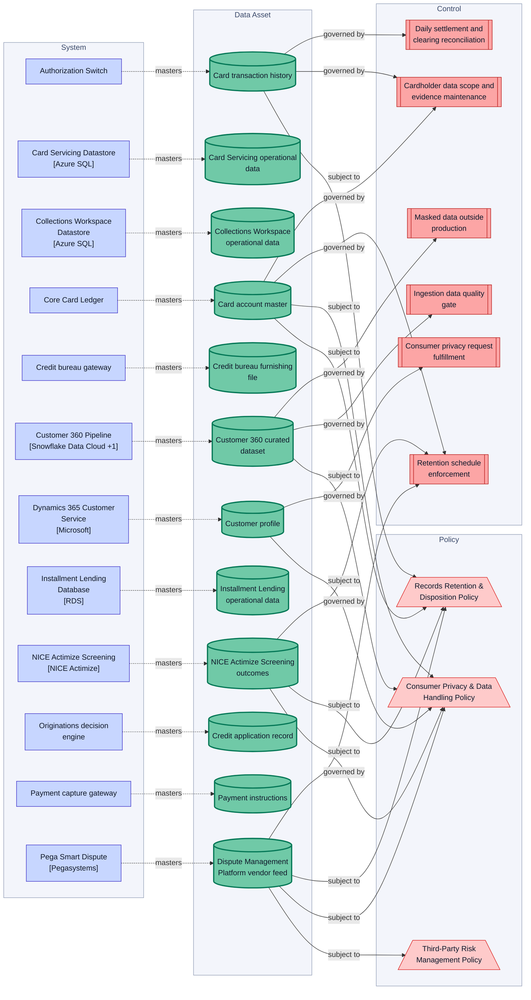
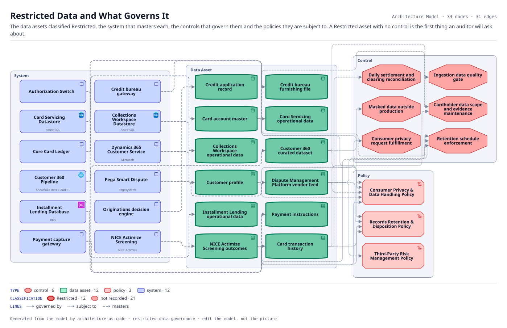

# Restricted Data and What Governs It

The data assets classified Restricted, the system that masters each, the controls that govern them and the policies they are subject to. A Restricted asset with no control is the first thing an auditor will ask about.

The same view as the app draws it, written beside the Mermaid by `terrane render`:

**Hue is the entity type.**

| | Entity type |
|---|---|
| `#b91c1c` | controls |
| `#047857` | data assets |
| `#dc2626` | policies |
| `#4338ca` | systems |

**classification** is drawn as border weight and tint, strongest first.

| Border | Value |
|---|---|
| 2.6px | Restricted |
| 1.1px | default |

33 entities, 31 relationships. Generated from the model; edit the model, not this file.
