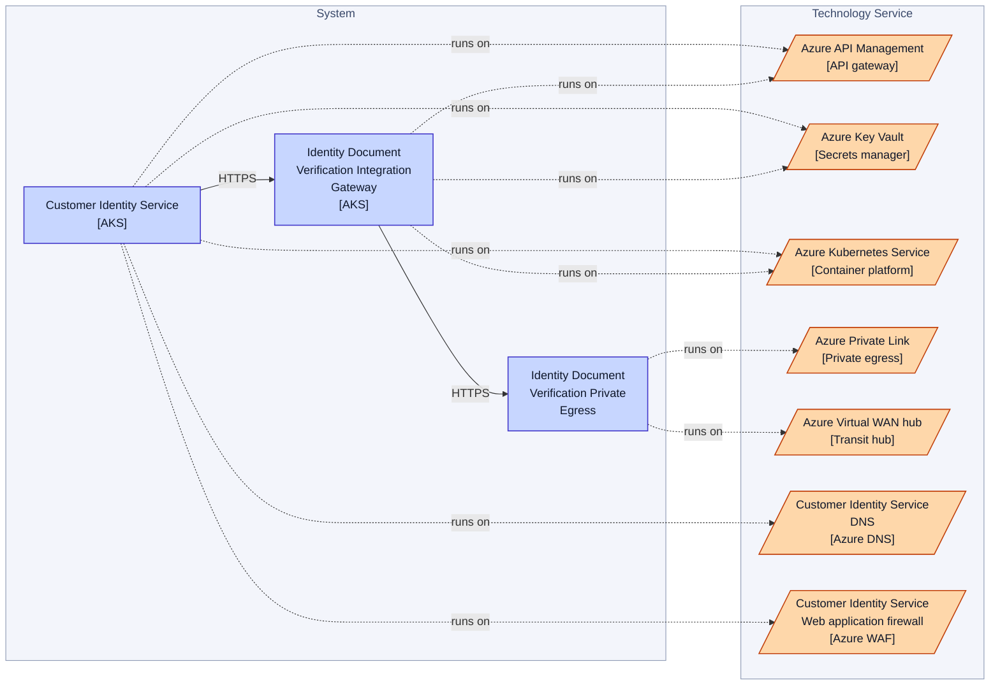
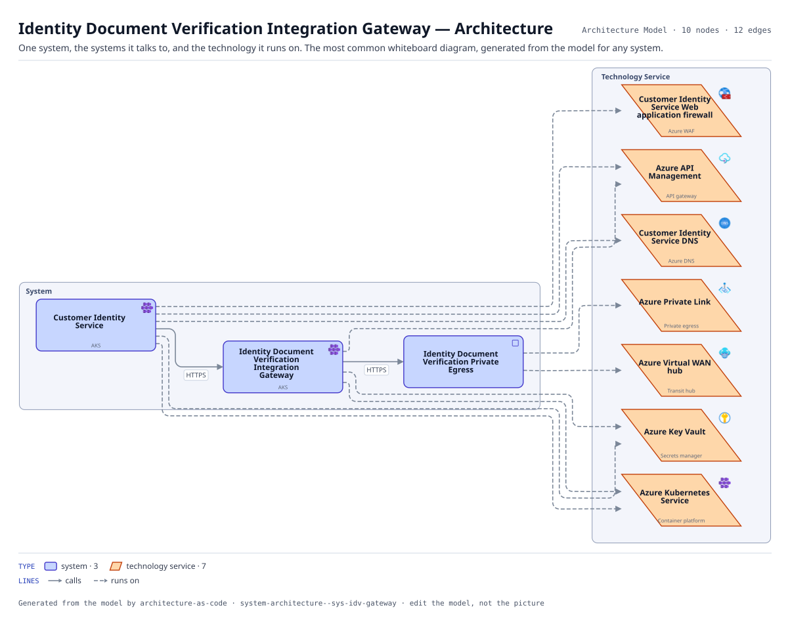

# Identity Document Verification Integration Gateway — Architecture

One system, the systems it talks to, and the technology it runs on. The most common whiteboard diagram, generated from the model for any system.

The same view as the app draws it, written beside the Mermaid by `terrane render`:

**Hue is the entity type.**

| | Entity type |
|---|---|
| `#4338ca` | systems |
| `#c2410c` | tech services |

10 entities, 12 relationships. Generated from the model; edit the model, not this file.
