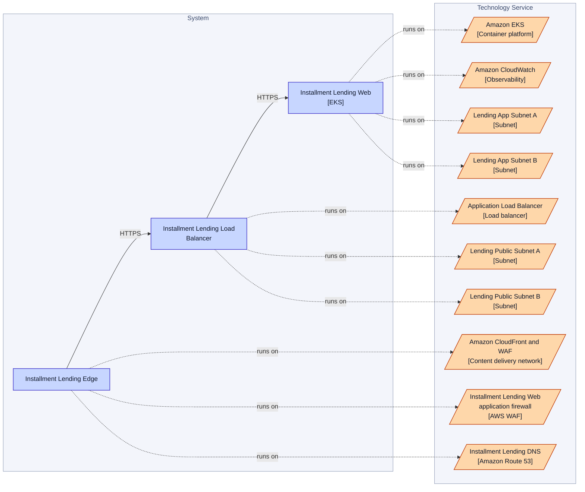
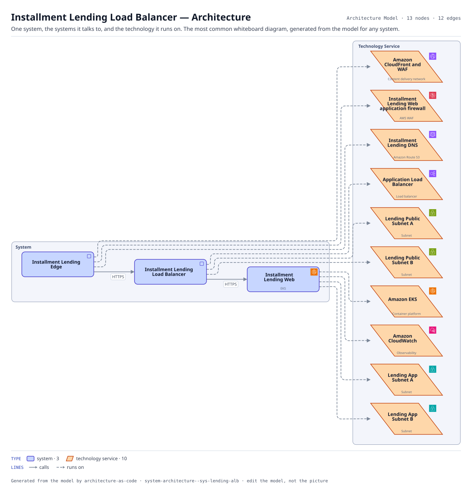

# Installment Lending Load Balancer — Architecture

One system, the systems it talks to, and the technology it runs on. The most common whiteboard diagram, generated from the model for any system.

The same view as the app draws it, written beside the Mermaid by `terrane render`:

**Hue is the entity type.**

| | Entity type |
|---|---|
| `#4338ca` | systems |
| `#c2410c` | tech services |

## Flows across this diagram

Each flow is a recorded sequence of interfaces. The steps drawn on this diagram are numbered; a step whose interface is not on it is marked.

**Installment Loan Application**: An applicant applies for point-of-sale credit. Bureau search, affordability and a decision, with referral to an underwriter when the automated decision declines to take it.

1. Installment Lending Edge → Installment Lending Load Balancer (HTTPS)
2. Installment Lending Load Balancer → Installment Lending Web (HTTPS)
3. Installment Lending Web → Installment Lending Service (HTTPS) — not on this diagram
4. Installment Lending Service → Customer Identity Service (HTTPS) — not on this diagram
5. Installment Lending Service → Experian Credit Bureau (HTTPS) — not on this diagram
6. Installment Lending Service → Installment Lending Database (PostgreSQL) — not on this diagram
7. Installment Lending Service → Core Card Ledger (MQ) — not on this diagram
8. Installment Lending Service → Installment Lending Async Worker (Kafka) — not on this diagram

13 entities, 12 relationships. Generated from the model; edit the model, not this file.
