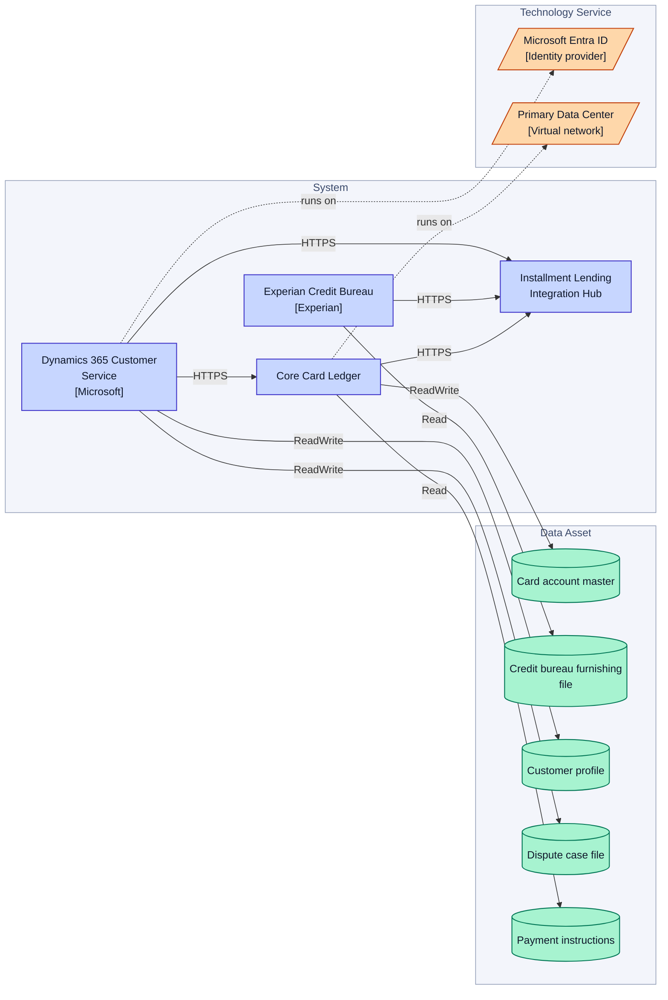
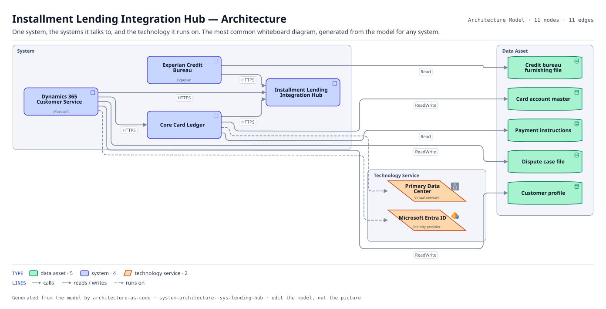

# Installment Lending Integration Hub — Architecture

One system, the systems it talks to, and the technology it runs on. The most common whiteboard diagram, generated from the model for any system.

The same view as the app draws it, written beside the Mermaid by `terrane render`:

**Hue is the entity type.**

| | Entity type |
|---|---|
| `#047857` | data assets |
| `#4338ca` | systems |
| `#c2410c` | tech services |

## Flows across this diagram

Each flow is a recorded sequence of interfaces. The steps drawn on this diagram are numbered; a step whose interface is not on it is marked.

**Dispute and Chargeback**: A cardholder disputes a transaction. Raised in the contact center, handled in the vendor platform, settled back through the ledger.

1. Dynamics 365 Customer Service → Core Card Ledger (HTTPS)
2. Core Card Ledger → Dispute Management Platform Integration Gateway (HTTPS) — not on this diagram
3. Dispute Management Platform Integration Gateway → Pega Smart Dispute (HTTPS) — not on this diagram
4. Pega Smart Dispute → Enterprise Data Ingestion Hub (SFTP) — not on this diagram

11 entities, 11 relationships. Generated from the model; edit the model, not this file.
