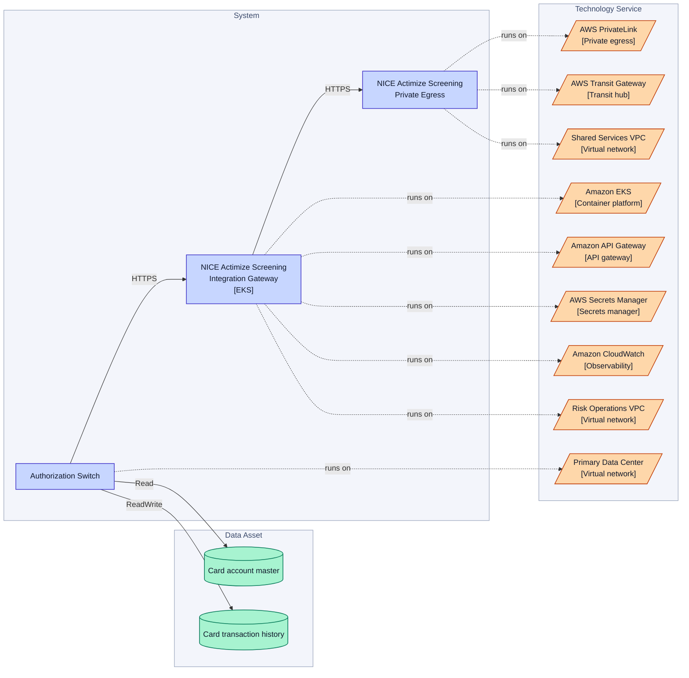
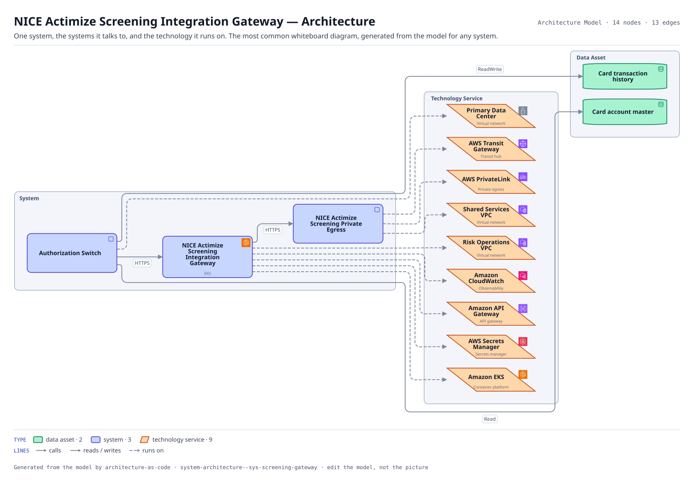

# NICE Actimize Screening Integration Gateway — Architecture

One system, the systems it talks to, and the technology it runs on. The most common whiteboard diagram, generated from the model for any system.

The same view as the app draws it, written beside the Mermaid by `terrane render`:

**Hue is the entity type.**

| | Entity type |
|---|---|
| `#047857` | data assets |
| `#4338ca` | systems |
| `#c2410c` | tech services |

## Flows across this diagram

Each flow is a recorded sequence of interfaces. The steps drawn on this diagram are numbered; a step whose interface is not on it is marked.

**Card Authorization**: A card presented at a merchant, authorized or declined inside the scheme timeout. The tightest latency budget in the estate, and the reason the screening call has a circuit breaker rather than a retry.

1. Authorization Switch → NICE Actimize Screening Integration Gateway (HTTPS)
2. NICE Actimize Screening Integration Gateway → NICE Actimize Screening Private Egress (HTTPS)
3. NICE Actimize Screening Private Egress → NICE Actimize Screening (PrivateLink) — not on this diagram
4. Authorization Switch → Core Card Ledger (MQ) — not on this diagram

14 entities, 13 relationships. Generated from the model; edit the model, not this file.
